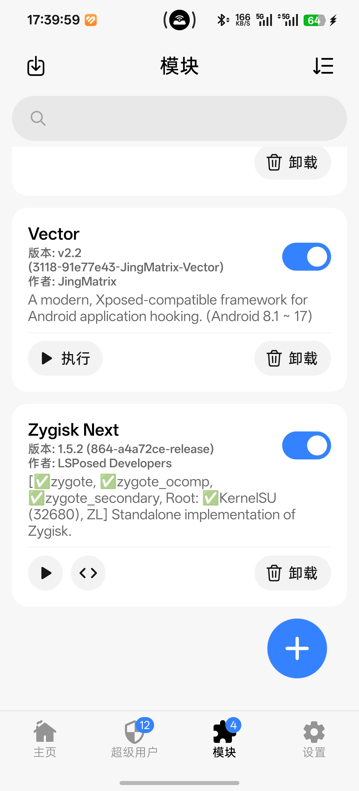
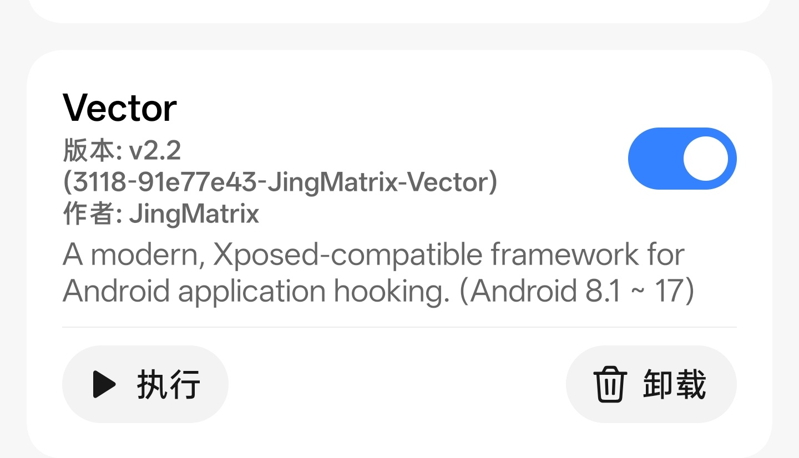
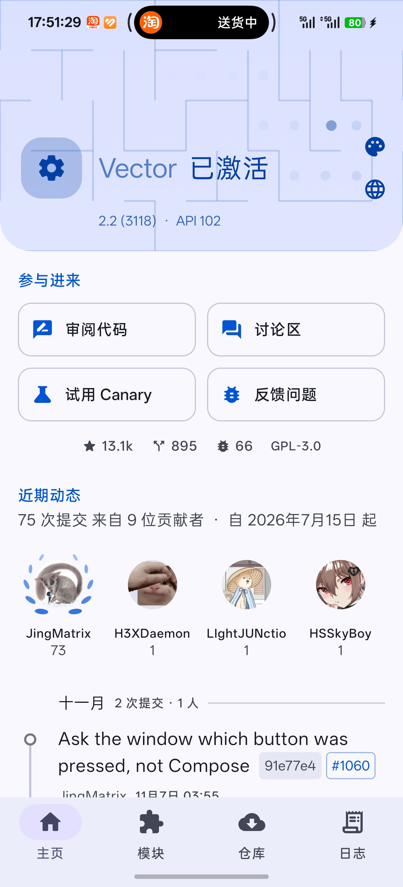
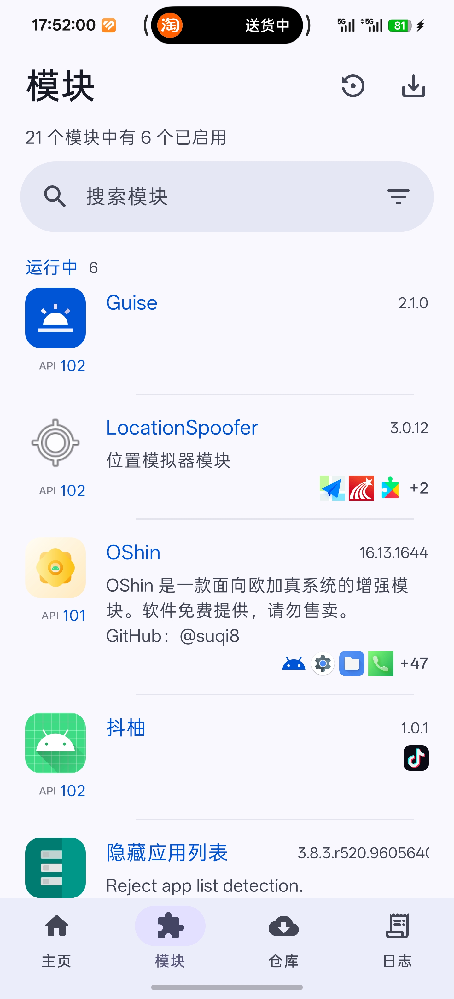
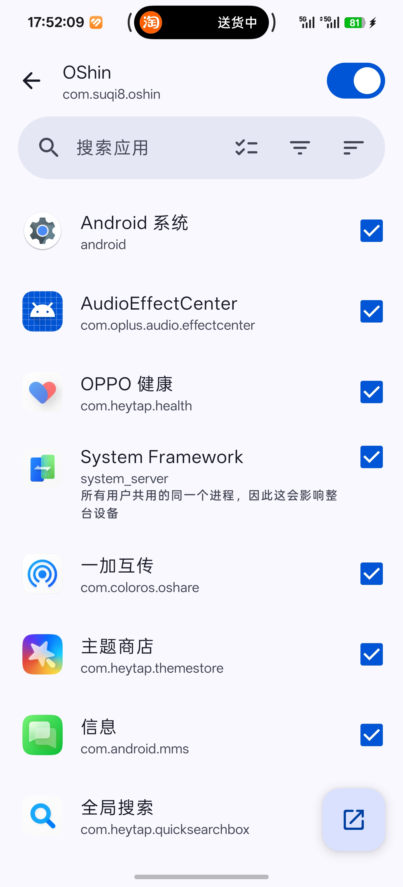

按照[上一篇](/blog/android-unlock-bl-kernelsu)走到这里，手里应该是一台解了 BL、装了 KernelSU、能正常 `su` 的机器。接下来装 LSPosed——但绝大多数人卡住的地方不是「怎么装」，而是「为什么装完不生效」。

> 同样以**一加 13** 为例截图，但这一篇的每一步都跟机型无关：需要什么版本的 KernelSU、装哪个框架、作用域怎么勾，换成任何一台已经 root 的安卓机都一样。

答案在层级上：LSPosed 不是一个独立的东西，它是一层挂在 Zygisk 之上的框架。而 KernelSU 默认不提供 Zygisk。中间这一环没补上，后面装什么都白搭。

> [!核心] 主线三步
>
> 1. 装 Zygisk Next，重启后确认三项 zygote 都是绿勾（第 3 节）
> 2. 装 Vector 框架（第 4 节）
> 3. 装模块并勾对作用域（第 5 节）
>
> 第 2 节是选路：开源的 Vector 还是官方闭源版，选好之后步骤一样。
> 第 6 节反检测、第 7 节救砖都是出问题才需要看的补充。

## 开始之前，先确认你已经走到这儿

这一篇不是独立的教程，是[安卓解锁 BL 与 KernelSU root](/blog/android-unlock-bl-kernelsu)的续篇。
下面这几条只要缺一条，建议先回去把那篇走完，否则会在中间某一步莫名其妙地失败。

| 条件 | 怎么确认 | 不满足会怎样 |
|---|---|---|
| 已解锁 Bootloader | 开机有黄字警告，或开发者选项里显示「引导加载程序已解锁」 | 什么都装不了 |
| 已装 KernelSU 且能拿到 root | 随便一个终端里 `su` 能进 root shell | 模块页根本打不开 |
| KernelSU 版本 ≥ 10940，ksud ≥ 11424 | KernelSU 管理器首页能看到版本号 | Zygisk Next 装上了也不工作 |
| 内核带 SELinux 补丁 | 官方 KernelSU 的内核都带，自编译内核要自己确认 | Zygisk 注入失败 |
| 没有别的 Zygisk 实现 | 模块页里没有 NeoZygisk 之类 | 两个共存会导致 zygote 起不来，开不了机 |

功能效果跟机型无关，本文以**一加 13** 举例只是为了截图方便。换成任何一台已经 root 的
安卓机，步骤都一样。

## 1. 三层的依赖关系

```
LSPosed / Vector  ← 框架层，靠 Zygisk 注入 zygote
        ↑
Zygisk Next       ← 提供 Zygisk 运行时
        ↑
KernelSU          ← 提供 root
```

Magisk 自带 Zygisk，在设置里勾一下就有。KernelSU 走的完全是另一条路——它在内核层拿 root，用户态什么都没有，所以 Zygisk 得单独装一个实现。

这就是为什么「照着 Magisk 教程装 LSPosed」在 KernelSU 上一定失败：教程里的那一步「打开 Zygisk 开关」，在 KernelSU 的管理器里根本不存在。

## 2. 现在的 LSPosed 有两条路

这是必须先讲清楚的一点，因为上游在 2024 年初发生了一次分叉，网上大量教程还停在分叉之前的状态。

原来的 [LSPosed/LSPosed](https://github.com/LSPosed/LSPosed) 仓库在 2024 年 1 月归档，此后没有再发布过公开版本。现在的「官方版」是团队通过 Telegram 渠道分发的闭源构建，托管在 [lsposed.zip](https://lsposed.zip/) 上。闭源这件事在社区里有争议，因为它上游是
GPLv3，闭源分发与许可证要求存在冲突。

另一条路是社区分支。目前活跃的是 **[Vector](https://github.com/JingMatrix/Vector)**，由 JingMatrix 维护，GPLv3 开源，支持 Android 8.1 到 17，实现了 libxposed API 101 和 102。它基于 [LSPlant](https://github.com/JingMatrix/LSPlant) 做 ART 挂钩，源码全部公开。

| | Vector | 官方闭源版 |
|---|---|---|
| 源码 | 开源，可审计 | 不公开 |
| 维护 | GitHub 公开开发 | 仅 Telegram 渠道 |
| API | 101 / 102 | 101 |
| 反检测 | 一般 | 较强 |
| 获取方式 | [GitHub Releases](https://github.com/JingMatrix/Vector/releases) | lsposed.zip / Telegram |

两条路的实际差别主要在「反检测」上：官方闭源版对银行类 App 的隐藏做得更好。如果你的刚需是让某个金融 App 正常跑，这一点值得权衡；如果不涉及，开源的 Vector 更省心。

**本文以 Vector 为主线**，因为它有公开的 issue 区和发布记录，出问题能查到东西。用另一条路的话，下面除了下载地址之外，步骤完全一样。

> 模块本身的仓库大多在 [Xposed-Modules-Repo](https://github.com/Xposed-Modules-Repo) 下，想找模块可以去那里翻。新版模块开始走 [libxposed API](https://github.com/JingMatrix/libxposed-api)，老的走 [Xposed API](https://api.xposed.info/)，两者框架都兼容。

## 3. 装 Zygisk Next

这一环的硬性要求跟机型无关，只有 KernelSU 的版本门槛：

- KernelSU 版本不低于 10940，管理器（ksud）不低于 11424
- 内核带完整的 SELinux 补丁——官方 KernelSU 的内核都带

到 [Zygisk Next 的 Releases](https://github.com/Dr-TSNG/ZygiskNext/releases) 下载 zip，在 KernelSU 管理器的「模块」页里从存储安装，然后重启。项目主页和这两条硬性要求都写在 [Dr-TSNG/ZygiskNext](https://github.com/Dr-TSNG/ZygiskNext) 的 README 里。



装完重启之后，再回模块页看一眼。Zygisk Next 的卡片会直接把运行状态列出来，长这样：

```
[✓zygote, ✓zygote_ocomp, ✓zygote_secondary, Root: ✓KernelSU (32680), ZL]
```

前三个是它往各 zygote 进程注入的结果，`Root:` 后面是它识别到的 root 方案。**三个都是绿勾才算这一层通了**，有一个不对就先别装框架，回头解决 Zygisk。这行状态能省掉后面「框架为什么显示未激活」的一轮排查。

> 同一时间只能有一个 Zygisk 实现。之前装过别的（比如 [NeoZygisk](https://github.com/JingMatrix/NeoZygisk)），先卸掉再装这个，两个共存会直接导致 zygote 起不来。NeoZygisk 也是 JingMatrix 的作品，跟 Vector 同作者，两者搭配同样可行，选一个就行。

## 4. 装 Vector

到 [Vector 的 Releases](https://github.com/JingMatrix/Vector/releases) 下载最新稳定版的 zip（不要拿 CI 构建，那是给调试用的），同样从模块页安装，重启。



重启完成后，通知栏会出现一条 LSPosed 的常驻通知，点它就能进管理器。通知被划掉了也没关系，还有两个入口：

- 拨号盘输入 `*#*#5776733#*#*`（也就是 `*#*#LSPOSED#*#*`）
- 用「快捷方式」类的桌面工具，为管理器创建桌面图标

国内 ROM 上偶尔会把这段识别成号码拨出去，遇到就换另一个入口。



看到「已激活」就说明整条链路通了：KernelSU → Zygisk Next → Vector。这三个环节任何一个没到位，这一页都会显示未激活，而且不会告诉你卡在哪一环，所以排查要从下往上。

这一页还会写明当前实现支持的 API 版本（上图是 API 102）。装模块之前对一眼这个数字，模块要求的 API 比它高的话，装上去也不会工作。

## 5. 装第一个模块

先明确一件事：**LSPosed 模块是普通 APK**，不是 zip。zip 那个是框架自己，模块直接装 APK 就行，跟装普通应用一样。

装完之后打开管理器 →「模块」页，列表里会出现它，但默认是关闭状态，需要手动勾选「启用」。勾完之后还要选作用域。装到第三个、第五个之后，这一页会变成这样——每个卡片标着它实现的 API 版本，下方那排小图标是它作用域里勾中的应用：



### 作用域是什么

作用域（scope）决定这个模块**能作用于哪些应用**。没勾的应用，模块代码根本不会注入进去。

这里有个常见的误解：以为勾得越多效果越好。实际上范围越大，暴露面越大，出问题的概率也越高——模块的 hook 逻辑在没适配的应用里运行，轻则功能异常，重则应用闪退。

正确做法是只勾你确实需要它生效的那个 App。模块的说明页通常会写清楚需要勾哪些，照着勾。



改完作用域一般需要**重启目标应用**才生效，不一定要重启手机。只有少数模块改的是系统框架层的东西，那才需要整机重启。

### 值得先试的几类

不列具体模块名，因为这类东西的存活周期很短，今天能用的明天可能就停更了。按用途分：

| 方向 | 典型用途 | 风险 |
|---|---|---|
| 界面定制 | 状态栏、图标包、手势增强 | 低，出问题只影响桌面 |
| 应用增强 | 去广告、改功能、解锁限制 | 中，可能触发应用的风控 |
| 系统行为 | 关闭某些系统校验、改默认行为 | 高，可能影响开机 |
| 反检测 | 对特定 App 隐藏 root | 视检测强度而定 |

建议从第一类开始。界面类模块即使崩了，也只是桌面出问题，不至于开不了机。

## 6. 反检测：让 root 藏起来

解锁 BL 加 root 之后，银行、支付、部分游戏会检测到环境异常。LSPosed 本身管不了这件事，需要额外的隐藏模块。

两个主流选择：

- **[Shamiko](https://github.com/LSPosed/LSPosed.github.io/releases)**：闭源，LSPosed 团队的作品，隐藏效果较好，包和框架一起发布在同一个 Releases 页
- **[Zygisk Assistant](https://github.com/snake-4/Zygisk-Assistant)**：开源（[Releases](https://github.com/snake-4/Zygisk-Assistant/releases)），功能接近，社区维护

两者都是 Zygisk 模块，装法和前面一样，装完重启。它们的作用是让目标应用看不到 root 和模块的存在痕迹。

但要说清楚：**这类隐藏是有上限的**。检测手段在演进，隐藏方案也在追，今天能过不代表下个月还能过。而且一旦某个 App 把你的设备标记了，往往要清数据重来。

如果真的离不开某个金融 App，最稳妥的方案反而是别在这台机器上 root——这是取舍问题，不是技术问题。

## 7. 出问题了怎么救

### 装完模块无限重启

最常见的事故，也是最容易恢复的。分三种情况：

**能进系统**：管理器 → 模块 → 把刚装的关掉或卸掉 → 重启。

**进不了系统，但能连 adb**：KernelSU 提供了命令行管理模块的能力：

```bash
adb shell
su
ksud module list
ksud module disable <模块 id>
reboot
```

`<模块 id>` 就是 `/data/adb/modules/` 下的目录名。

**连 adb 都进不去**：用 KernelSU 的内置安全模式。开机第一屏出来后连续按音量下键三次（按下松开算一次），所有模块会被禁用，然后进系统清理。三种情况的完整说明在 KernelSU 的[救砖文档](https://kernelsu.org/zh_CN/guide/rescue-from-bootloop.html)里，包括 Recovery 下手动删 `/data/adb/ksud` 这种最后手段。

如果安全模式也救不回来，说明问题不在模块层，回上一篇的「刷回原厂 init_boot」那一步。

### 管理器打不开

先确认 Vector 这个模块本身还是启用状态。框架崩了不会影响开机，只是管理器进不去。卸掉重装一次通常就好了。

### 显示已激活，但模块没反应

按这个顺序查：

1. 模块启用了吗（不只是装了）
2. 作用域勾对了吗
3. 目标应用重启了吗
4. 模块跟当前的 API 版本匹配吗——要求 API 102 的模块在只支持 101 的框架上不工作

第 4 条在换了框架版本之后特别容易踩到，管理器里一般会给出提示。

### 更新系统之后全没了

跟上一篇说的一样，OTA 会覆盖 `init_boot`，root 没了，上面这整套自然也就没了。按顺序重来：还原原厂镜像 → OTA → 重新提 `init_boot` → 重新 root → 重装 Zygisk Next 和 Vector。模块本身不用重装，它们的配置在 `/data` 里，会留着。

## 8. 卸载和回滚

只想换个框架：管理器里卸掉 Vector，重启，装另一个，再重启。模块的配置会保留。

想彻底清掉：

1. 管理器里先卸所有模块
2. 卸 Vector
3. 卸 Zygisk Next
4. 重启

残留的配置目录在 `/data/adb/lspd` 和 `/data/adb/modules/` 下，需要的话手动删。注意 `/data/adb/modules/` 里还有 KernelSU 的元模块，别一起删了。

想连 root 一起去掉，回上一篇的「回锁」一节——记得先刷回完整原厂固件。

## 小结

KernelSU 到 LSPosed 之间差一个 Zygisk 实现，这是所有「装完不生效」的根源。框架选 Vector 还是闭源官方版，本质是「可审计」和「反检测强度」之间的取舍，没有标准答案。剩下的坑都在作用域上：勾得越少越安全，这是反直觉但正确的做法。

## 链接汇总

| 名称 | 地址 |
|---|---|
| Vector（开源框架，本文主线） | [github.com/JingMatrix/Vector](https://github.com/JingMatrix/Vector) |
| Vector Releases | [Releases](https://github.com/JingMatrix/Vector/releases) |
| 官方闭源版（lsposed.zip） | [lsposed.zip](https://lsposed.zip/) |
| 原 LSPosed 仓库（已归档） | [github.com/LSPosed/LSPosed](https://github.com/LSPosed/LSPosed) |
| Zygisk Next | [github.com/Dr-TSNG/ZygiskNext](https://github.com/Dr-TSNG/ZygiskNext) |
| NeoZygisk（另一个 Zygisk 实现） | [github.com/JingMatrix/NeoZygisk](https://github.com/JingMatrix/NeoZygisk) |
| Shamiko（隐藏，闭源） | [LSPosed.github.io Releases](https://github.com/LSPosed/LSPosed.github.io/releases) |
| Zygisk Assistant（隐藏，开源） | [github.com/snake-4/Zygisk-Assistant](https://github.com/snake-4/Zygisk-Assistant) |
| 模块仓库 | [github.com/Xposed-Modules-Repo](https://github.com/Xposed-Modules-Repo) |
| libxposed API | [github.com/JingMatrix/libxposed-api](https://github.com/JingMatrix/libxposed-api) |
| Xposed API（旧） | [api.xposed.info](https://api.xposed.info/) |
| KernelSU 救砖文档 | [kernelsu.org/zh_CN/guide/rescue-from-bootloop.html](https://kernelsu.org/zh_CN/guide/rescue-from-bootloop.html) |

这一整套跟机型无关，前置步骤见 [安卓解锁 BL 与 KernelSU root](/blog/android-unlock-bl-kernelsu)。
