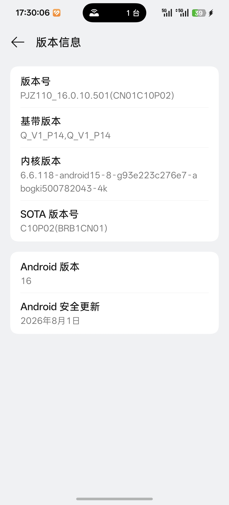
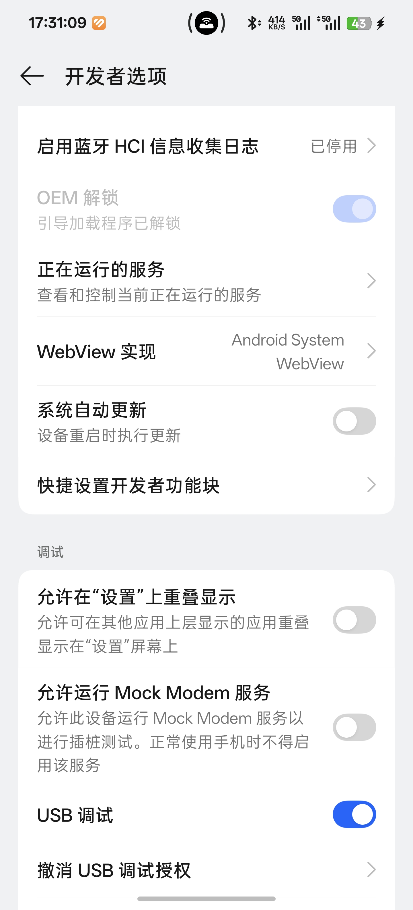
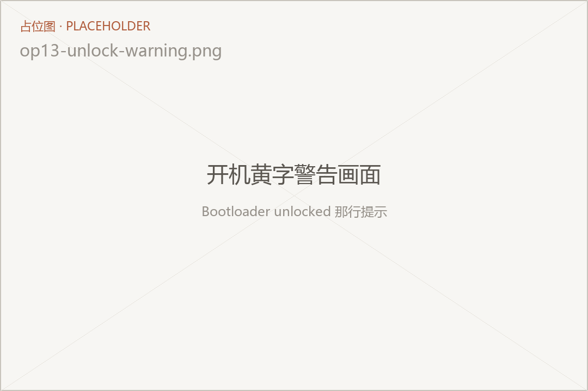
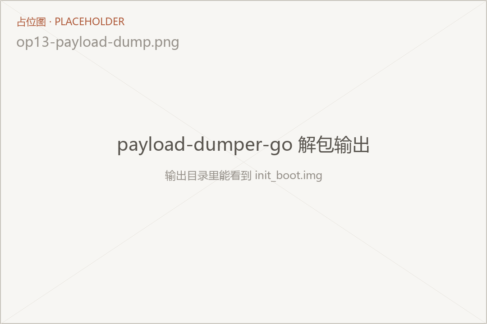
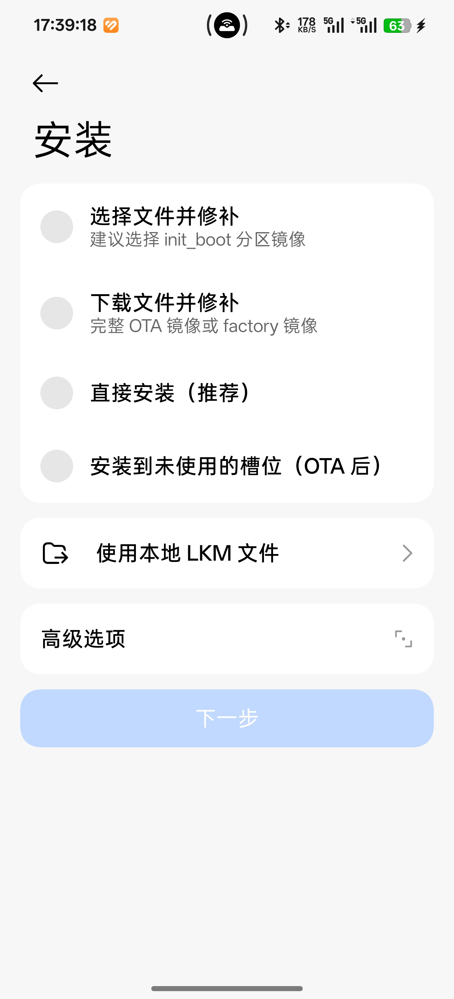
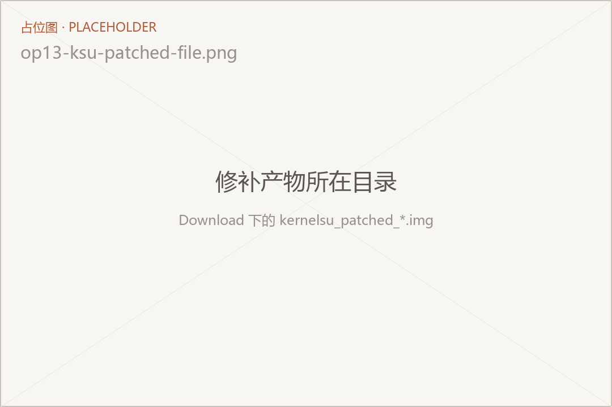
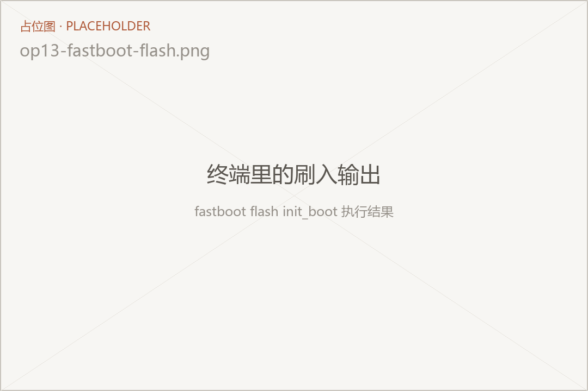
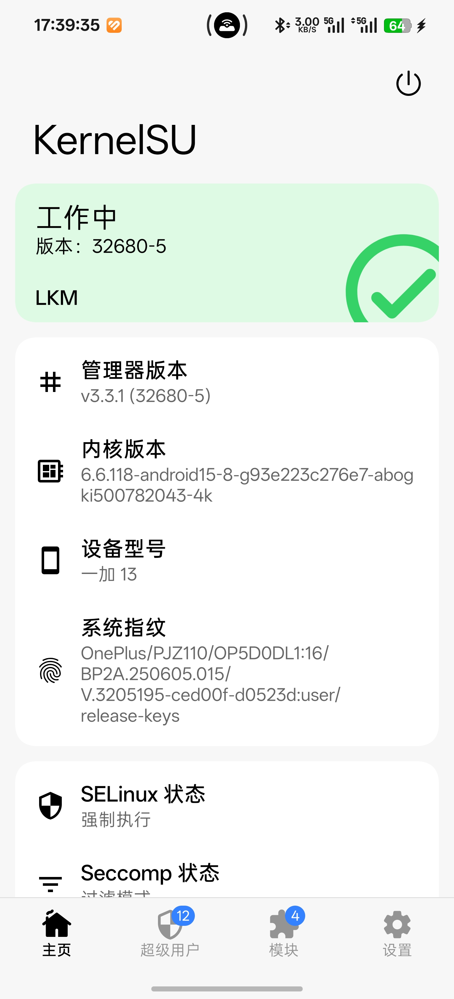
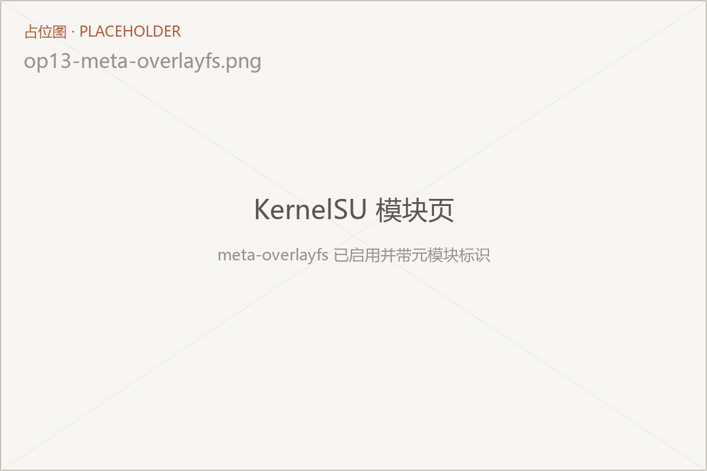

解 BL、root、装 LSPosed，经常被打包成「玩机三步走」来卖。实际上这是三个不同层级的权限，前提、失败方式、出事之后的后果都不一样，混在一起讲就必然会漏掉「哪一步做错了会变砖」这种关键信息。

这篇文章只做前两步：把 Bootloader 解开，再用 KernelSU 拿到 root。第三步装 LSPosed 单独写在 [安卓装 LSPosed](/blog/android-lsposed) 里，因为它的前提条件和踩坑点跟前两步完全是另一套。

> 本文以我手上的**一加 13（国行，ColorOS 16）**为例来写，因为只有这台机器能实际截图。但**核心流程对所有安卓机通用**：解锁 → 提取 init_boot → 修补 → 刷入。各家真正不同的只有「解锁渠道」这一步，其余环节换台机器照样走。

> [!核心] 主线四步
>
> 1. 确认解锁资格并提交申请（第 2、6 节）
> 2. `fastboot flashing unlock` 解锁（第 7 节）
> 3. 提取当前版本的 `init_boot.img`，用 KernelSU 修补（第 8、9 节）
> 4. `fastboot flash init_boot` 刷入并验证（第 10 节）
>
> 第 3 节的代价清单、第 13 节的救砖、第 14 节的常见问题都是补充材料，主线走完再看也不迟。


## 开始之前，先看这几条

照这张表对一遍，缺哪一条都先别往下走，尤其是「解锁资格」和「数据备份」这两行。

| 条件 | 具体要求 | 不满足会怎样 |
|---|---|---|
| 机型 | 本文以**一加 13 国行（ColorOS 16）**为例；其它机型流程通用，但解锁渠道完全不同 | 解锁申请那一步对不上，卡在第二步 |
| 电脑 | 一台 Windows 电脑 + 数据线，装好 `adb` 和 `fastboot` | 后面所有刷写命令都执行不了 |
| 解锁资格 | 账号注册满 60 天、实名 + 人脸、在本机连续登录 7 天、无违规记录 | 提交申请直接被拒，且 30 天内不能再申请 |
| 时间 | 审核约 7 个工作日，通过的额度只有 14 天有效期 | 急着当天弄完的，这篇帮不上 |
| 数据 | 解锁必然清空全部数据，必须提前备份 | 不可逆，没有后悔药 |
| 心理准备 | 开机黄字警告、指纹支付失效、部分银行 App 拒跑、Widevine 掉到 L3 | 这些都是解锁之后回不去的部分 |
| ARB 分界线 | 查清你这台机器从哪个版本开始启用防回滚 | 刷错版本会硬砖，只能进 9008 救 |

只想要 root 之外的小功能（装模块、改字体）的话，建议先权衡成本：解锁这一步做完，
保修、支付、部分流媒体体验都会跟着变。这条跟技术水平无关，换任何品牌都一样。

## 1. 先把三件事分清楚

| 层级 | 实际做了什么 | 没做到的后果 |
|---|---|---|
| 解锁 Bootloader | 让固件接受非官方签名的镜像 | 后面两步都无从谈起 |
| root（KernelSU） | 往带 ramdisk 的分区塞一个内核模块，给你 uid 0 | 能装模块，但没有 Zygisk 环境 |
| LSPosed | 在 Zygisk 之上做 ART 挂钩 | 模块装得进去，但不生效 |

三者的关系是层层依赖，不是并列的三个选项。所以顺序不能调，也不能跳。

## 2. 各家不同的只有「解锁渠道」

这一步是全文唯一强品牌相关的地方，也是最多人卡住的地方：**命令没变，难在拿到解锁资格。**

| 品牌 | 解锁方式 | 是否需要申请 | 官方入口 |
|---|---|---|---|
| 一加 / OPPO | 深度测试 App，配额制 | 是，审核 + 名额有效期 | [一加社区公告](https://bbs.oneplus.com/thread/2175833961601695750) |
| 小米 / Redmi | 社区申请解锁权限，绑定设备后等待期 | 是，有等待期 | [miui.com/unlock](https://www.miui.com/unlock/index.html) |
| 三星 | 开发者选项里直接开 OEM 解锁 | 否（部分机型有 Knox 限制） | [Samsung Developers](https://developer.samsung.com/) |
| Pixel | `fastboot flashing unlock` | 否，开箱即用 | [Google 官方镜像](https://developers.google.com/android/images) |
| 华为 / 荣耀 | 新机型基本关闭 | 官方通道已停 | — |

海外版和国行经常是两套政策，同一型号不同地区也可能不一样。所以第一步永远是**查你这台机器、这个地区、这个系统版本**的官方说明，别照搬别人的型号。

表中最后一列是各自政策的官方出处，点进去核当前规则，比看二手教程可靠——这类政策一年能改两次，本文写下的条件随时可能过期。



动手之前先看清楚这两行：版本号决定你后面要下载哪个固件包，机型代号决定你走哪套解锁流程。

内核版本那一行也顺带看一眼。写成 `6.6.118-android15-8` 这种 `android<版本>-<内核版本>` 形式的，就是 GKI 2.0 内核，官方 KernelSU 直接支持，不需要自己编译；如果这一行是不带 `android` 前缀的普通版本号，那多半是老设备，去第四步和第五步时要多确认一步。

### 示例：一加 13 的深度测试

> [!可选] 不用一加 13 的话，这一节可以跳过
>
> 其它机型看上面的品牌表，去各自的官方入口查规则即可。

这是这篇文章最需要更新的部分，网上大量教程还停留在「开发者选项里勾一下 OEM 解锁，然后 `fastboot oem unlock`」的年代，那套在一加 13 的国行机上已经不成立了。

从 ColorOS 16 起，国行一加的 Bootloader 解锁统一走「深度测试」通道，并且是配额制。2026 年 7 月调整之后的申请条件是这样的：

- 机型搭载 ColorOS 16.0 及以上
- 账号注册满 60 天，且无违规记录
- 账号完成实名认证与人脸认证，并绑定手机号
- 账号在**这台设备**上连续登录满 7 天
- 同一实名 30 天内没有申请记录，一年内解锁设备不超过 4 台
- 深度测试名额未达上限（每月 1 日释放，机型不同首次放号时间不同）
- 深度测试 App 升级到最新版
- 非政企、运营商定制机，且是中国大陆地区上市的机型

审核周期从早期的一两天拉长到了 **7 个工作日**，审核通过后名额只有 **14 天**有效期，过期得重新申请。也就是说：从提交申请到真正 `fastboot flashing unlock`，中间可能要等两周以上，别把时间压在周末或者出差前一天。

这些都是官方会在后台核验的硬条件，没有本地绕过的办法。网上所谓「一键解锁工具」，要么是让你走同一个 App，要么就是拿你的账号去代提交，风险自担。

一加 13 的机型代号能帮你确认手里这台走哪套流程：

| 代号 | 对应版本 |
|---|---|
| PJZ110 | 国行，ColorOS |
| CPH2653 / CPH2655 / CPH2649 | 海外，OxygenOS，不同地区略有差异 |
| CPH2649 | 印度版 |
| CPH2653 | 欧版 / 全球版 |
| CPH2655 | 北美版 |

国行对应的就是上面那套深度测试配额制。海外版 OxygenOS 走的是自己的解锁申请流程，政策跟国行不同步。海外的机器在「申请名额」这一步对不上，但后面的提取、修补、刷入完全一致。

## 3. 先想清楚代价

解锁 Bootloader 是不可逆的分水岭，做完这一步，有些东西就回不去了。这些代价跟技术水平无关，是厂商在系统层面写死的，而且**换任何品牌都逃不掉**：

- **数据全部清空**。解锁动作本身就会触发恢复出厂，不是「可能」，是必然。
- **每次开机都有黄字警告**。屏幕底部一行 `Bootloader unlocked`，去不掉。
- **微信、支付宝的指纹支付失效**。这是最常见的抱怨，后面有说明。
- **部分银行与支付类 App 会拒绝运行**，或者把某些功能锁掉。
- **Widevine 从 L1 掉到 L3。** Netflix 一类只能看标清，除非用模块修。
- **售后**：解锁本身不取消质保，但因解锁导致的功能故障不享受退换机服务。
- **防回滚（ARB）**。部分厂商在某些版本加了硬件级防回滚，刷旧固件会直接变砖，且不可恢复。这条最要命，后面单独说。

如果只是想装个模块、改个字体、用某个只认 root 的工具，先问问自己值不值。数据先备份，这条没有商量的余地。

### 先把 ARB 分界线查清楚

防回滚值得单独提一句，因为它决定了你**能不能反悔**。

启用 ARB 之后，向后刷入没有 ARB 的旧版本会被固件直接拒绝，后果不是「降级失败」，而是硬砖——只能进 9008 恢复。所以刷机前最该确认的不是「最新版是哪一版」，而是**你这台机器从哪个版本开始启用 ARB**。

以一加 13 为例，分界线是 `ColorOS PJZ110_16.0.3.501(CN01) C.84`，这个版本及之后都启用了
ARB。也就是说，一旦升到这条线以上，就再也回不到更早的系统了。

这条信息在官方渠道往往查不到，得靠机型资料站或者社区整理。前面提到的那个 ROM 站，机型页上就会直接标出来。

## 4. 动手之前：装好 adb 和 fastboot

整篇文章靠两条命令跑通，先把这个装上。

到 Google 官方的 [SDK Platform-Tools](https://developer.android.com/tools/releases/platform-tools) 页面下载压缩包，解压到一个固定目录，把这个目录加进系统 `PATH`。Windows 上建议直接解压到
`C:\platform-tools`，省得路径里带空格或中文。

```bash
adb version
fastboot --version
```

两条都能打印版本号就算装好了。**不需要装 Android Studio**，也不需要配 SDK，平台工具是独立分发的。

命令本身的用法查 [Android 官方的 adb 文档](https://developer.android.com/tools/adb)，比任何二手教程都准。

> Windows 上如果 `fastboot devices` 老是空的，九成是驱动问题。Google 的通用 USB 驱动能覆盖大部分机型，各家自己的驱动放在官网支持页，比如[一加支持](https://www.oneplus.com/cn/support/software)。

## 5. 打开开发者选项

这一步所有安卓机都一样。连点「关于本机 → 版本号」七次，开发者选项就出来了。进去之后要打开两个开关：

- **USB 调试**：后面 adb 和 fastboot 都要用
- **OEM 解锁**：允许发起解锁请求

不同品牌的菜单叫法略有差异，小米叫「允许 USB 调试」和「设备解锁状态」，三星叫「OEM 解锁」，但位置都在开发者选项里。



`OEM 解锁`这一项有时是灰的，分两种情况：**已经解锁过**的机器会变成灰底、下面标注「引导加载程序已解锁」，这是正常状态，不用管；如果是**还没解锁**却点不动，通常是没登录厂商账号、账号状态受限，或者机器有锁网限制，先把账号登上去、连上网，再回来看。

## 6. 走完本家的解锁申请

按前面那张表找到你这台机器的渠道，把申请提交掉。一加 13 走的是深度测试 App。

深度测试 App 只从一加社区的[官方公告帖](https://bbs.oneplus.com/thread/2175833961601695750)里下载，别去第三方站点拿 APK，那类站点经常把安装包重新签名或者捆绑推广。公告帖里除了下载链接，还有当期最新的申请条件和名额释放时间。

装好之后打开，登录一加账号，按提示走完申请流程。这个 App 的界面很简单，要看的只有两样：当前账号的申请状态，以及通过之后才出现的名额有效期。提交之后就是等，7 个工作日内出结果。

结果只有两种：

- **通过**：页面上会出现一个明确的有效期，从通过那天起算 **14 天**。这是整条流程里唯一的硬期限，第三步的 fastboot 解锁必须在这 14 天里做完，过期就得从头再申请一次。
- **未通过**：会给出原因，基本都是前面那几条硬条件里的某一条没满足——账号注册不满 60 天、没在这台设备上连续登录满 7 天、30 天内已经申请过一次。对照条件补齐，等下一个申请窗口。

所以别提前太久申请，也别通过了就放着。通过之后当天就把第三步做完最稳妥。

小米、OPPO 这类同样需要审核的品牌，逻辑是一样的：资格拿到了就开始倒计时，别拖。

## 7. fastboot 解锁

从这里开始，所有品牌完全一致。手机连电脑，确认驱动正常，然后：

```bash
adb devices                # 确认能看到设备
adb reboot bootloader      # 进入 fastboot
fastboot devices           # 这里也要能看到设备
fastboot flashing unlock
```

最后一条命令执行后，**手机会停在确认界面**，不会自动往下走：黑底白字，顶部提示用音量键上下移动、电源键确认。

这里有个容易吃亏的地方：**光标默认停在「不解锁」那一项上**。直接按电源键等于选择放弃，命令看起来执行完了，机器其实一点没动。要先用音量键把光标移到 `UNLOCK THE BOOTLOADER` 那一行，再按电源键确认。

确认之后手机会立刻清空数据并重启，第一次开机比平时慢很多，属于正常现象。

少数老机型用的是旧命令 `fastboot oem unlock`，两个都试一下，能过的那个就是对的。小米的部分机型在这一步还要求插着 SIM 卡、登录同一账号，是它自己的校验，不是命令的问题。

想确认是否真的解开了，回来看「关于本机」，设备状态会显示为已解锁；或者进 fastboot 跑一条：

```bash
fastboot getvar unlocked
```

输出 `unlocked: yes` 就对了。



这行字会跟你到回锁为止，属于正常现象，不用管它。

## 8. 提取当前版本的 init_boot.img

到了这一步，网上教程的分岔最多。有的让你刷 `boot.img`，有的让你刷一个来路不明的 `boot.img`，这两种在一加 13 上都不对——**判断依据不是机型，是你的分区布局。**

### 为什么是 init_boot 而不是 boot

Android 13 起，Google 把通用 ramdisk 从 `boot` 分区里拆了出来，单独放进 `init_boot`。`boot` 里只剩内核本身。分区布局的官方说明见 [AOSP 分区文档](https://source.android.com/docs/core/architecture/partitions)。

KernelSU 从 v3.0 开始，官方不再发布可以直接刷的 GKI 版 `boot.img`，改推 LKM 模式：内核不动，往 ramdisk 里加载一个内核模块。既然改的是 ramdisk，那要刷的就是 `init_boot`。这一点在 KernelSU 的[安装文档](https://kernelsu.org/zh_CN/guide/installation.html)里有明确说明，凡是要刷 boot 的旧教程都可以直接跳过。

一加 13 出厂就是 Android 15，一定有独立的 `init_boot` 分区，所以走这条路是对的。判断标准很简单：

- 出厂 Android 13 及以上 → 有独立 `init_boot` 分区，刷 `init_boot`
- 出厂 Android 12 及更早 → ramdisk 还在 `boot` 里，刷 `boot`

```bash
adb shell ls /dev/block/by-name/ | grep init_boot
```

有回显就说明这台机器有独立分区。这条命令比查机型表可靠，因为它问的是机器本身。

### 固件包从哪下

`init_boot.img` 必须来自**和你手机当前版本完全一致**的官方固件包。版本对不上，轻则开机卡住，重则触发防回滚直接变砖，这是整个流程里最容易出错的一步。

一加、OPPO、Realme 三家（同属欧加）可以到**大侠阿木的 ROM 站**下：

- 总目录：[yun.daxiaamu.com/OnePlus_Roms](https://yun.daxiaamu.com/OnePlus_Roms/)
- 按机型进子目录，一加 13 在 [一加OnePlus 13](https://yun.daxiaamu.com/OnePlus_Roms/%E4%B8%80%E5%8A%A0OnePlus%2013/) 这个目录下
- 站内还分了 [OPPO](https://yun.daxiaamu.com/OPPO_Roms/) 和 [Realme](https://yun.daxiaamu.com/Realme_Roms/) 两个分区

页面里按版本列出全量包、9008 线刷包、救砖包和降级包，下载链接走夸克或百度网盘。**认准和你当前系统版本号完全一致的那一栏**，比如 `ColorOS PJZ110_16.0.9.402(CN01) C.92`——型号、版本、括号里的地区码，一个都不能差。

这个站点还有一处比官方更实用的地方：**它会在机型页上直接标注 ARB 分界线**。一加 13 的页面上写着，`ColorOS PJZ110_16.0.3.501(CN01) C.84` 及之后的版本启用了防回滚，回退到更早的无 ARB 版本只有变砖一种结果。这类信息在官方渠道基本查不到，但恰恰是刷机前最该确认的。

> 第三方站点只是下载渠道，包本身仍是官方包。下完可以对一下文件大小和页面标注是否一致；有条件的话，用官方渠道再核一次版本号。

其他品牌的固件得自己找官方渠道——官网支持页、官方线刷工具，或者厂商的社区发布帖。**别用来路不明的第三方包**，那类包被改过的风险最高，而 boot 分区被改是直接变砖。

### 解包取出 init_boot

各家的固件包格式不同，但提取方式无非几种：

| 固件格式 | 提取工具 |
|---|---|
| `payload.bin`（A/B 机型常见） | [payload-dumper-go](https://github.com/ssut/payload-dumper-go) |
| 官方线刷包（`.tgz` / `.zip`） | 解压后直接有 `init_boot.img` |
| 卡刷包（`.zip`） | 解压后从 `boot.img` 里拆，或用 [magiskboot](https://github.com/ookiineko/magiskboot_build/releases/tag/last-ci) |

一加 13 的国行包是 `payload.bin`，用 [payload-dumper-go](https://github.com/ssut/payload-dumper-go)
解。它是个 Go 写的单文件命令行工具，到
[Releases](https://github.com/ssut/payload-dumper-go/releases) 下对应平台的压缩包，解压后把目录加进 `PATH` 就行，Windows、macOS、Linux 都有。

注意下的是全量包，不是增量更新包——增量包里没有完整的 `payload.bin`。然后：

```bash
payload-dumper-go -l payload.bin          # 先列出包里有哪些分区
payload-dumper-go payload.bin             # 全解，输出目录里会有 init_boot.img
```

全解会把 `system`、`product` 这些几个 G 的分区一起拆出来，只想要 root 的话没必要。用 `-p` 指定分区，几秒就完：

```bash
payload-dumper-go -p init_boot -o out payload.bin    # 只解 init_boot
```

完整参数看 `payload-dumper-go -h`，或者 [README](https://github.com/ssut/payload-dumper-go#usage)。



解出来的 `init_boot.img` 先复制一份留底，命名为 `init_boot_stock.img`。这份文件是你后面所有救砖操作的基础，丢了会很难受。

## 9. 用 KernelSU 管理器修补

到 [KernelSU 的 Releases](https://github.com/tiann/KernelSU/releases) 下载管理器 APK，装到手机上，打开。

第一次打开，首页那张状态卡片显示的是「未安装」，但下面的内核版本、设备型号、系统指纹都已经能正常读出来——说明管理器本身在跑，只是内核里还没有 KernelSU。这是正常现象，接下来要做的修补和刷入，就是来补上这一环。

这张卡片一共就三种状态，认字就行：

| 显示 | 含义 | 怎么办 |
|---|---|---|
| 未安装 | 管理器在跑，内核里没有 KernelSU | 继续往下走 |
| 工作中 | 两边都到位，root 可用 | 正常，不用管 |
| 不支持 | 这个内核不带 KernelSU | 去查非官方支持设备列表，自己编译 |

一加 13 这类 GKI 2.0 设备不会出现「不支持」；真遇到了，说明内核版本太老，得照[非官方支持设备列表](https://kernelsu.org/zh_CN/guide/unofficially-support-devices.html)自己编译内核才能用。

进入管理器的安装页，会看到一组选项，四条对应四种场景：

- **选择文件并修补**：手动指定一个分区镜像，首次 root 走这条
- **下载文件并修补**：让它自己拉完整 OTA 或 factory 镜像再打补丁
- **直接安装（推荐）**：设备已经有 root 时用，直接往当前槽位装
- **安装到未使用的槽位（OTA 后）**：刚更新完系统、还没重启时用，装到另一个槽位，做法见下面 OTA 那一节

首次安装选第一项，界面上的提示原文就是「建议选择 init_boot 分区镜像」，然后选中刚解出来的 `init_boot.img`：



修补过程几秒到十几秒，完成后会在 Download 目录生成一个带时间戳的镜像：



把它拉回电脑：

```bash
adb pull /sdcard/Download/kernelsu_patched_20261111_173000.img
```

文件名里的时间戳以你实际生成的为准。**别拉错文件**，同名目录里可能还躺着别的镜像。

> 修补后的镜像里记录了原厂镜像的 SHA1，`/data/adb/ksu/ksu_backup_$SHA1` 会在首次开机后生成对应备份。这个备份是后面处理 OTA 的关键，别手动删。

## 10. 刷入并验证

```bash
adb reboot bootloader
fastboot flash init_boot kernelsu_patched_20261111_173000.img
fastboot reboot
```

注意分区名是 `init_boot`，不是 `boot`。刷错分区是新手最常见的失败原因，症状是「刷成功了，开机也正常，但管理器一直显示未安装」。

老设备如果第四步确认了 ramdisk 在 `boot` 里，这里就把 `init_boot` 换成 `boot`，别的不变。



开机后打开管理器，首页会变成绿色的「工作中」，卡片上标着 `LKM`，下面依次是管理器版本、内核版本、设备型号、系统指纹和 SELinux 状态：



两处值得对一下：

- **内核版本**要跟第一步「关于本机」里看到的一致。一致说明内核本身还是原厂的那个，只是往里加载了模块，这是 LKM 模式该有的样子。
- **SELinux 状态**应该是「强制执行」。如果这里是「宽容」，说明 sepolicy 被动过，不少银行和支付类 App 就是靠这一项判断环境异常的。

状态写的是「工作中」而不是「已安装」，这是管理器版本之间的文案差异，认那个绿对勾就行，别因为跟别的教程对不上就以为失败了。

再用命令行确认一遍 root 是否真的拿到了：

```bash
adb shell su -c id
```

返回 `uid=0(root) gid=0(root)` 就成功了。如果这条命令卡住或者没反应，多半是管理器里的授权弹窗没点允许。

## 11. 装元模块

这一步经常被跳过，然后就会出现「模块装上了但没效果」的怪现象。

KernelSU 从这一代架构开始，把模块的挂载能力从核心里拆了出去，交给「元模块」实现。官方的参考实现是 `meta-overlayfs`，它负责把模块里的 `system`、`vendor` 等目录以 overlayfs 的方式挂上去。

换句话说：**不装元模块，只改脚本、sepolicy、system.prop 的模块能用；要改系统文件的模块一个都挂不上**。装完 root 之后建议一并装上，省得后面排查。

装法跟普通模块一样：管理器 → 模块 → 从存储安装 → 选 `meta-overlayfs.zip` → 重启。文件和说明在 [KernelSU 元模块文档](https://kernelsu.org/zh_CN/guide/metamodule.html)，那一页也把「只允许一个元模块运行」这类约束讲清楚了。



同一个时间只能有一个元模块在跑。想换别的实现，得先把现有元模块和所有常规模块卸掉，重启，再装新的，顺序不能省。

## 12. root 之后：OTA 会让 root 消失

这是长期使用中最容易踩的坑，任何品牌都一样。系统推送更新后，`init_boot` 被新版本覆盖，root 就没了；更麻烦的是，增量 OTA 会校验分区完整性，你带着修补过的 `init_boot` 去更新，多半直接失败。

先花一条命令确认自己的机型是哪种分区方案：

```bash
adb shell getprop ro.build.ab_update
```

返回 `true` 就是 A/B 机型（近几年的机器基本都是，一加 13 这种虚拟 A/B 也算），开机时会在两个槽位之间切换；返回空说明是单槽。

### A/B 机型：更新完直接装到另一个槽位

这是 LKM 模式最好用的一点：**不用再从固件包里提取镜像，也不用连电脑刷**。管理器里「安装到未使用的槽位（OTA 后）」这个选项就是为这个场景准备的。

1. 收到更新通知后，先进 KernelSU 管理器 →「卸载」→「还原原厂镜像」。增量包会校验 `init_boot` 的完整性，这一步省不了
2. 回到系统设置里下载并安装 OTA，**进度走完先别点重启**
3. 保持不重启，打开 KernelSU 管理器 → 安装 →「安装到未使用的槽位（OTA 后）」，等它跑完
4. 现在才重启。开机后系统是新版本，root 也还在

关键在第 2 步和第 3 步之间的那个空档：系统的更新这时已经写进了「另一个槽位」，但还没切过去。管理器在这时候往那个槽位里塞一份修补好的 `init_boot`，重启后一次到位，中间不需要电脑。

### 单槽机型，或者错过了那个空档

没赶上第 2 步到第 3 步之间的窗口（比如手快点了重启），就按老办法来：

1. 从新版本固件包里重新提取 `init_boot.img`
2. 重新修补、重新刷入

第 1 步不能省。拿旧版本的 `init_boot.img` 去刷新系统，正是触发防回滚的典型操作。

> 上面两条路的区别只是「镜像从哪来」，刷进去的东西完全一样，所以两边随时可以互相切换。另外，无论走哪条路，`/data/adb/ksu/ksu_backup_$SHA1` 里那份原厂镜像备份都别删——
> 还原原厂镜像要靠它，删了就只剩从固件包里提这一条路。

## 13. 出问题了怎么救

### 刷完开不了机

最稳的办法是刷回原厂镜像，别在原地试错：

```bash
adb reboot bootloader
fastboot flash init_boot init_boot_stock.img
fastboot reboot
```

只要保住了那份原厂 `init_boot.img`，这一层的任何问题都能靠这一条命令恢复。开机出现 Logo 卡住、或者反复重启，都可以先这么试一次。

### 连 fastboot 都进不去

长按电源键十秒以上强制关机，然后按住音量上下键再按电源，进 fastboot 模式。一加的 fastboot 入口比较稳定，只要不是分区表级别的破坏，一般都能进去。

各家的按键组合不一样，常见的还有音量下 + 电源（三星、谷歌）、音量上 + 电源（部分小米）。实在进不去，用 `adb reboot bootloader` 让系统带你进去。

### 能开机但卡在动画里

这种多半是模块的问题，不是 `init_boot` 的问题。KernelSU 内置了安全模式：开机第一屏出来之后，**连续按音量下键三次**（按下松开算一次，不是长按），所有模块会被自动禁用。

能进系统之后打开管理器，把可疑模块卸掉再重启。安全模式的按键监听在内核里，不会被上层拦截，但注册窗口只到开机动画之前，手慢就错过了——实在错过，强制重启再来一次。

安全模式救不回来时还有命令行和 Recovery 两条路，官方在[救砖文档](https://kernelsu.org/zh_CN/guide/rescue-from-bootloop.html)里写全了，包括删 `/data/adb/ksud` 这种硬办法。

模块导致的循环重启，处理办法写在 [LSPosed 那篇](/blog/android-lsposed)的最后一节。

### 想回锁

回锁不是把 `fastboot flashing lock` 敲一遍就完事。设备上任何一个分区的镜像跟官方不一致，回锁后都可能开不了机，而且这次没有 fastboot 可用。

正确做法是：先刷完整套原厂固件（所有分区回到出厂状态），确认能正常开机，再执行：

```bash
fastboot flashing lock
```

回锁同样会清空数据。除非要送修或者准备出二手，否则没必要回锁——黄字警告不影响使用。

## 14. 常见问题

**申请解锁提示不符合条件**。对着前面那张条件表逐条核：账号注册天数、本机登录天数、30 天内是不是刚申请过。这些是后台核验的，改不了，只能等。

**刷完开机正常，但管理器显示未安装**。九成是刷错了分区，刷到 `boot` 去了。回 fastboot 重新刷对的那个分区。

**刷完直接开不了机。** `init_boot.img` 的版本跟当前系统对不上，或者踩到了防回滚。刷回原厂镜像，然后老老实实下对应版本的全量包。

**能不能不解锁就 root**。不能。root 的前提就是固件肯接受非官方镜像，这也正是解锁 Bootloader 干的事。

**微信指纹支付没了**。解锁触发的，root 本身不是原因。有一类模块声称能修，本质是把指纹相关的校验绕过去，能不能用、稳不稳看系统和模块版本，本文不展开。

**银行 App 打不开、提示设备不安全**。解锁和 root 都会触发检测。靠隐藏类模块能缓解一部分，具体见 [LSPosed 那篇](/blog/android-lsposed)里的反检测一节。

**系统更新后 root 不见了**。正常，`init_boot` 被覆盖了。A/B 机型下次升级时按下面 OTA 那一节的「装到另一个槽位」走，能免掉重新提取镜像和连电脑这一步。

**换别的品牌还能照这篇做吗**。能。真正需要重新查的只有「解锁渠道」一步，第四步之后的操作是以分区布局和 KernelSU 版本为准的，跟品牌无关。

## 小结

解锁这一步的难点不在命令，在资格——查你本家、本地区、本系统版本的政策，别照搬别人的型号。root 的关键则在「选对分区」：出厂 Android 13 及以上补 `init_boot`，更早的补 `boot`，且必须跟当前系统版本严格一致。

一加 13 的具体门槛放在前面当例子了：账号满 60 天、本机登录满 7 天、名额 14 天有效。换成你手里的机器，把这一节替换掉，其余照走。

## 链接汇总

工具和官方文档，全是原始出处：

| 名称 | 地址 |
|---|---|
| SDK Platform-Tools（adb / fastboot） | [developer.android.com/tools/releases/platform-tools](https://developer.android.com/tools/releases/platform-tools) |
| adb 官方文档 | [developer.android.com/tools/adb](https://developer.android.com/tools/adb) |
| Android 分区布局说明 | [source.android.com/docs/core/architecture/partitions](https://source.android.com/docs/core/architecture/partitions) |
| payload-dumper-go | [github.com/ssut/payload-dumper-go](https://github.com/ssut/payload-dumper-go) |
| magiskboot（PC 可用的构建） | [magiskboot_build](https://github.com/ookiineko/magiskboot_build/releases/tag/last-ci) |
| KernelSU 管理器 | [github.com/tiann/KernelSU/releases](https://github.com/tiann/KernelSU/releases) |
| KernelSU 安装文档 | [kernelsu.org/zh_CN/guide/installation.html](https://kernelsu.org/zh_CN/guide/installation.html) |
| KernelSU 元模块说明 | [kernelsu.org/zh_CN/guide/metamodule.html](https://kernelsu.org/zh_CN/guide/metamodule.html) |
| KernelSU 救砖文档 | [kernelsu.org/zh_CN/guide/rescue-from-bootloop.html](https://kernelsu.org/zh_CN/guide/rescue-from-bootloop.html) |
| KernelSU 非官方支持设备 | [unofficially-support-devices](https://kernelsu.org/zh_CN/guide/unofficially-support-devices.html) |

固件下载与解锁入口：

| 用途 | 地址 |
|---|---|
| 欧加真 ROM（一加 / OPPO / Realme） | [yun.daxiaamu.com](https://yun.daxiaamu.com/OnePlus_Roms/) |
| 一加 13 固件 | [一加OnePlus 13](https://yun.daxiaamu.com/OnePlus_Roms/%E4%B8%80%E5%8A%A0OnePlus%2013/) |
| 一加深度测试公告 | [bbs.oneplus.com](https://bbs.oneplus.com/thread/2175833961601695750) |
| 小米解锁申请 | [miui.com/unlock](https://www.miui.com/unlock/index.html) |
| Pixel 官方镜像 | [developers.google.com/android/images](https://developers.google.com/android/images) |

下一步：[安卓装 LSPosed](/blog/android-lsposed)。
