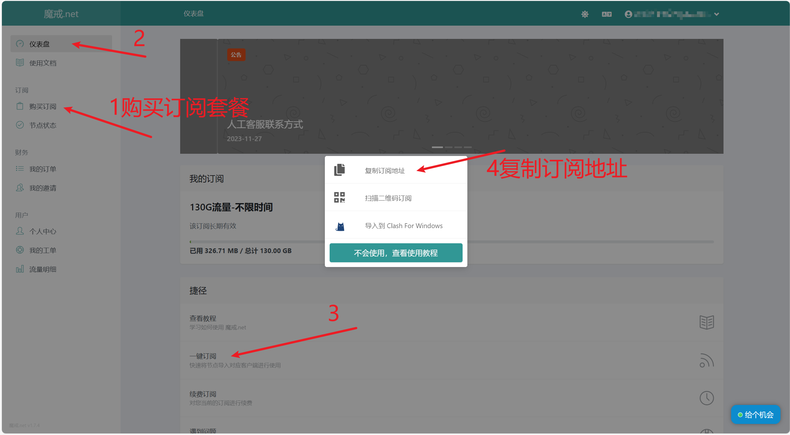
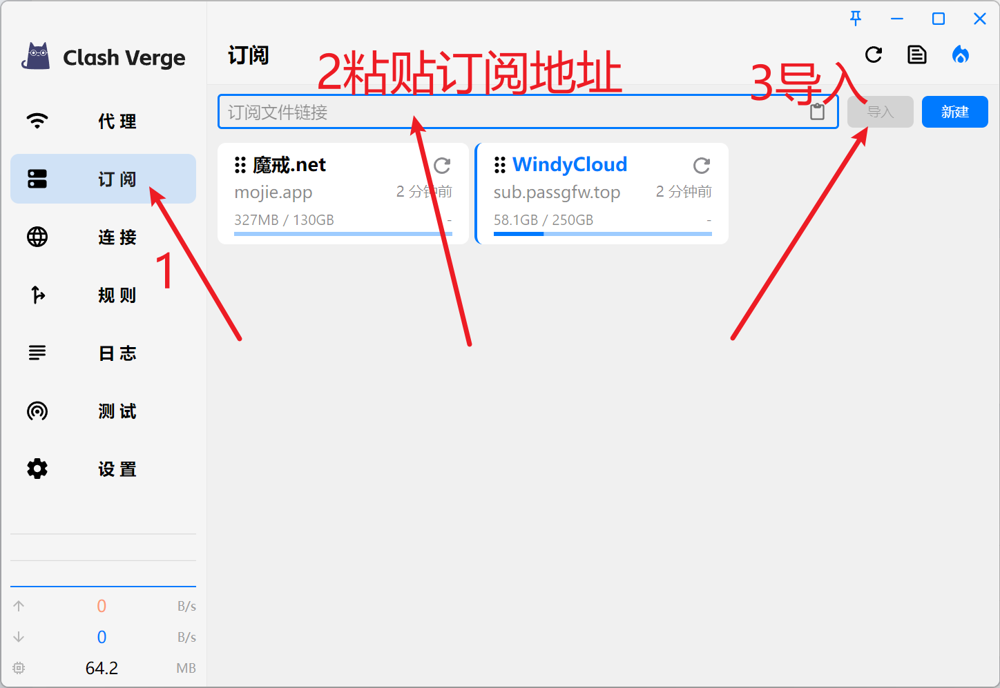
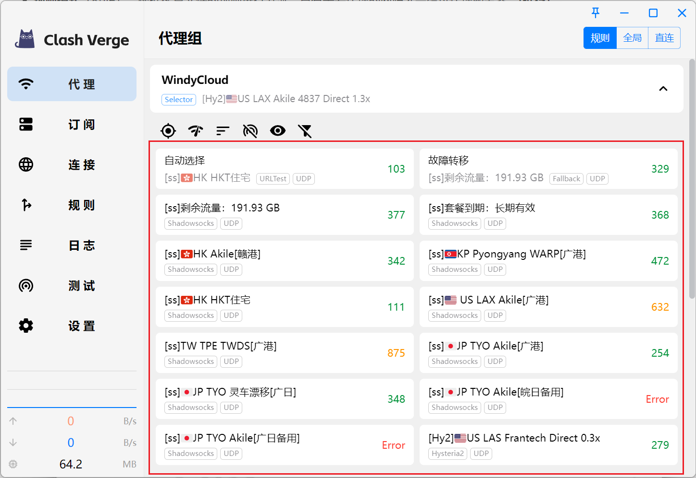
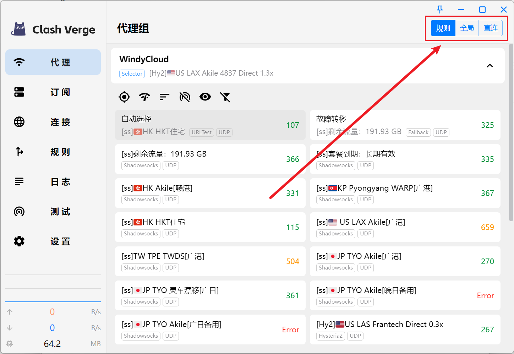
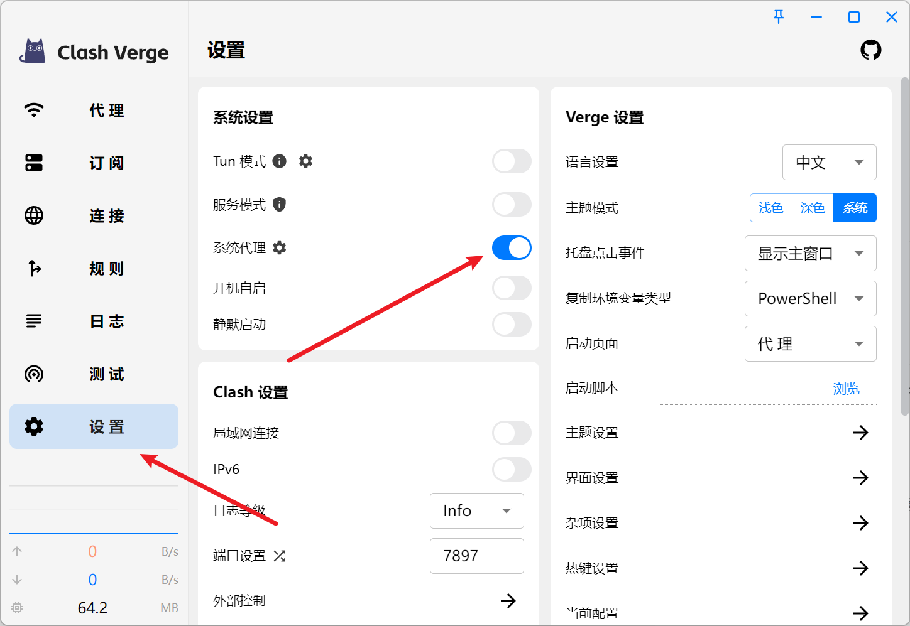

Clash Verge 是一个 Clash 图形客户端，内核用的是 mihomo（也就是以前的 Clash Meta），
界面基于 Tauri 2 写。它是 zzzgydi/clash-verge 的延续分支，现在还在活跃维护——
Clash for Windows 的作者 2023 年底删库之后，这基本是 Windows 上最省事的选择。

它本身不提供节点，只是个壳：给它一份订阅，它按规则把该走代理的流量送出去。
所以第一步不是装软件，是先弄到订阅。

## 下载和安装

到 [clash-verge-rev 的 Releases](https://github.com/clash-verge-rev/clash-verge-rev/releases)
下载稳定版（Stable）：

- **Windows**：`.msi` 或 `.exe`
- **macOS 11+**：按芯片选 `aarch64`（Apple Silicon）或 `x64`（Intel）的 `.dmg`
- **Linux**：`.deb` / `.rpm` / AppImage

装完打开，在设置里把语言切成中文。

## 先弄一个订阅

节点得从机场买。下面两个是我在用的，链接里带邀请码：

- [魔界.net](https://www.mojie.me/#/register?code=oCmKfVkU)
- [WindyCloud](https://portal.passgfw.top/#/register?code=bjn7QEKe)

注册、买套餐，然后进后台找订阅入口。一般是「我的订阅」下面一个按钮，
点开有几个选项——**选「复制订阅地址」**，别选「导入到 Clash For Windows」，
那个是给旧客户端用的，Verge 需要的是原始地址。

地址很长（`https://xxx/sub?token=...`），用复制按钮，别手动抄。

## 导入订阅

打开「订阅」页，把地址粘进最上面的输入框，点「导入」。

导入成功会出现一张卡片，上面写着机场名、剩余流量和上次更新时间。
卡片右上角的刷新图标是手动更新订阅用的；日常不用管，订阅会自己更新。

## 选节点

切到「代理」页，这里是一组一组的节点。

订阅一般会带几个特殊的组：

| 组 | 作用 |
|---|---|
| 自动选择（URLTest） | 定时测所有节点，自动用延迟最低的那个 |
| 故障转移（Fallback） | 按顺序试，第一个不通就换下一个 |
| 手动选择 | 你自己点，点哪个用哪个 |

右边的数字是延迟（毫秒），越小越快，`Error` 表示这个节点当时连不上。

延迟只是参考。有些节点延迟低但带宽小，看视频反而卡；反过来也有延迟高但跑得稳的。
不确定就用「自动选择」，懒得折腾也用它。

## 选模式

代理页右上角有三个按钮：规则、全局、直连。

- **规则**：按订阅里的规则分流，国内直连、国外走代理。日常用这个
- **全局**：所有流量都走代理。排查问题时用，平时开着会让国内网站也绕一圈
- **直连**：全部不走代理，等于临时关掉

规则模式的判断依据是订阅自带的那份规则集——域名后缀、IP 段、GEOSITE 分类之类。
所以出现「国内网站走了代理」或者「该翻的没翻」，先怀疑规则，再怀疑节点。
订阅质量差，规则也会跟着差。

## 开系统代理

这是最后一步，也是最容易出问题的一步。

到「设置」页，打开「系统代理」。打开后 Clash Verge 会改写 Windows 的代理设置
（注册表 `HKCU\Software\Microsoft\Windows\CurrentVersion\Internet Settings`），
读系统代理的程序——浏览器、大部分 Electron 应用——就自动走代理了。

端口默认是 **7897**，HTTP 和 SOCKS 混用同一个。网上很多教程写的 7890 是
Clash for Windows 的默认值，照抄会连不上。

验证：浏览器打开 `https://www.google.com`，能开就通了。

## 关机之前

正常退出时 Clash Verge 会把系统代理关掉。但如果是直接关机、或者程序被强杀，
注册表里那条设置会留下来。

于是就有了这个经典场面：第二天开机，Clash Verge 没自启，系统代理却还指着
`127.0.0.1:7897`，浏览器打不开任何网页，看起来像断网了。

两个办法：

- 打开「开机自启」，让它跟着系统起来
- 或者养成习惯，关机前先关掉「系统代理」

真碰上了也不慌：打开 Clash Verge，关掉系统代理，网络立刻恢复。

## TUN 模式

有些程序根本不读系统代理：一部分游戏、WSL、Docker，还有把代理写死在代码里的工具。
这时候需要用 TUN。

TUN 会建一块虚拟网卡，在更底层把流量截走，所以「不认代理」的程序也会被接管。
代价是要装一个系统服务，得给管理员权限：

1. 设置 → 系统设置 → 打开「服务模式」，按提示装一次
2. 再打开「Tun 模式」

装好之后系统代理可以关掉，两者二选一就行。

## 和学校 WebVPN 冲突

如果你也在用学校的 WebVPN 客户端（比如 [SDUST WebVPN](/blog/sdust-webvpn-guide)），
注意它们抢的是同一个「系统代理」开关，后开的赢。

表现是校内网站打不开，或者统一认证一直登录失败。

解决办法是让它们分工：Clash Verge 切到 TUN 模式，把学校域名和地址段设为直连；
或者反过来，用 WebVPN 的时候先把 Clash Verge 的系统代理关掉。

## 常见问题

**浏览器能上，别的程序不行**：它们不读系统代理，用 TUN 模式。

**所有网站都打不开**：先确认 Clash Verge 还在运行。程序退了但系统代理没关，
就是上面说的那个场面。再看「连接」页有没有流量。

**能连上但特别慢**：换个节点；或者把模式从全局切回规则——全局模式下国内网站也绕一圈，
慢是正常的。

**更新订阅后节点全没了**：机场换了订阅格式，或者地址复制错了。重新导入一次。

## 其他值得知道的

- **WebDAV 备份**：设置里能把配置同步到 WebDAV，换机器不用重新配
- **Merge / Script**：在订阅配置上做增量修改，订阅更新不会冲掉你的改动
- **局域网连接**：想让手机走电脑的代理时打开
- **内核**：内置 mihomo，可以在设置里切到 Alpha 版内核试新功能
- **主题**：浅色 / 深色 / 跟随系统

---

配置本身不复杂，麻烦的都在边界上：代理和应用谁先启动、系统代理留在注册表里、
两个都改系统代理的软件打架。把这几件事想清楚，剩下的就是点几下的事。

> 机场和节点请自行甄别，使用请遵守所在地法律法规与服务商条款。
