U 盘总有不在手边的时候，手机一定在。MultiBooter 就是干这个的：让手机给电脑当启动盘，
或者把 U 盘插到手机上，由手机把它做成 Ventoy 启动盘。

它和早年那个 DriveDroid 是同类，但更完整——**部分功能不需要 root**，还内置了 Ventoy，
直接解决了「手机装系统」最大的那个坎。

> [!核心] 按需求分两段
>
> - **不 root**：给 U 盘装 Ventoy、把 ISO 写进 U 盘（第 3 节）
> - **要 root**：手机本机虚拟成 U 盘或光驱、PXE 网络启动（第 4 节）
>
> 只想用第一段的话，可以完全不碰 root。

## 开始之前，先看这几条

这篇分两段：**不 root 的部分谁都能用，root 的部分要先解 BL、刷 KernelSU。**
看自己想干哪段，再对下面的表——别装完才发现卡在「要 root」这一步。

| 条件 | 具体要求 | 不满足会怎样 |
|---|---|---|
| 手机 | Android 8.0 以上（四个 ABI 都支持） | 装不上 |
| 数据线 / OTG 线 | 一条能连电脑的 USB 线；给 U 盘装 Ventoy 时还要 OTG 线 | 手机没法当主机也没法当从设备 |
| U 盘（可选） | 想给 U 盘装 Ventoy 或写 ISO 才需要 | 只玩虚拟盘的话不需要 |
| **root（仅第二段需要）** | 已解锁 Bootloader 并刷入 KernelSU | 三个 root 模式全是灰的 |
| 内核支持 | ConfigFS / FunctionFS 的 mass storage 功能 | 页面里自检那一步会标红，功能用不了 |

root 怎么弄，完整流程在[安卓解锁 BL 与 KernelSU root](/blog/android-unlock-bl-kernelsu)，
那篇的前提条件（账号、等待期、数据清空）同样躲不掉。**只想给 U 盘装 Ventoy 的话，完全不用碰 root。**

## 1. 它是什么

一个 GPLv3 的开源 Android 应用（[GitHub](https://github.com/werimsoln/MultiBooter)，
作者 Volkan Belek），把几件底层的事合到了一个 App 里：

| 功能 | 干什么 | 要 root 吗 |
|---|---|:---:|
| Ventoy 安装 | 给 U 盘装 Ventoy，MBR 或 GPT，还能读出盘上已有的版本 | 否 |
| ISO 写入 | 把 ISO / 光盘镜像直接写进 U 盘 | 否 |
| 虚拟 U 盘 | 手机本机变成一块 U 盘（Ventoy 或空白）给电脑用 | 是 |
| 虚拟光驱 | 通过 FunctionFS 模拟 CD-ROM | 是 |
| TFTP / PXE | 让电脑通过网络从手机启动 | 是 |
| USB Gadget | 走 ConfigFS 暴露成 U 盘或光驱 | 是 |
| 磁盘分析 | 查看分区、剩余空间、盘里的 ISO 列表 | 否 |

前两项走的是 Android 的 [USB Host API](https://developer.android.com/guide/topics/connectivity/usb/host)——手机当**主机**，U 盘插在手机上，
通过 SCSI 命令直接操作那块盘。所以不需要 root，也不需要碰 `/dev/sdX`。

后几项走的是反方向：手机当**从设备**，把自己伪装成一块盘给电脑。这需要配置
Linux 的 ConfigFS / FunctionFS，必须 root。

一句话分岔：**只想给 U 盘装 Ventoy 或者写个 ISO，装完就能用；想让手机本身当盘，先解决 root。**

> 这一点是它和 DriveDroid 最大的区别。DriveDroid 只能做后一半，且必须 root。

「必须 root」这件事本身得先解决：解锁 Bootloader、刷入 root 方案的完整流程写在[安卓解锁 BL 与 KernelSU root](/blog/android-unlock-bl-kernelsu)里，解锁会清空数据，代价清单也在那一篇。两条线是独立的——只想给 U 盘装 Ventoy 的话，完全不用碰 root。

## 2. 安装

Android 8.0 以上，四个 ABI 都支持。

- **F-Droid**：搜 MultiBooter，或者直接装
  [包页面](https://f-droid.org/packages/com.werismoln.multibooter/)
- **GitHub Releases**：从 [MultiBooter 的 Releases 页](https://github.com/werimsoln/MultiBooter/releases)下 APK
- **[Obtainium](https://github.com/ImranR98/Obtainium)**：加仓库地址，自动跟踪更新

当前版本是 **v0.1.4**。虚拟 U 盘、磁盘分析、写入校验和设置中心都是这一版加的，v0.1.3 没有——
如果你在 F-Droid 上装到的是旧版，界面上找不到「VIRTUAL USB DRIVE」这个按钮就是这个原因。

安装包 16MB 左右，里面打包了一份 Ventoy 的 VTOYEFI 镜像（32MB FAT16），
构建时从 Ventoy 1.1.17 的源码重新生成并校验哈希。**App 没有任何联网权限**，
所有资源都随包提供。

界面是英文的，作者没做本地化，下面按界面上的原文写按钮名。

权限全都是可选的，不给也能用，只是对应功能受限：

| 权限 | 用来干什么 | 不给会怎样 |
|---|---|---|
| Root | USB Gadget、FunctionFS、TFTP | 三个 root 模式锁着 |
| 通知 | 进度条、停止按钮 | 任务照跑，但看不到进度 |
| 忽略电池优化 | 长时间写入、共享 | 后台任务可能被系统提前掐掉 |

没有存储权限——选文件走的是系统文件选择器。

打开就是这样，五个入口，后三个标着 Root Required：

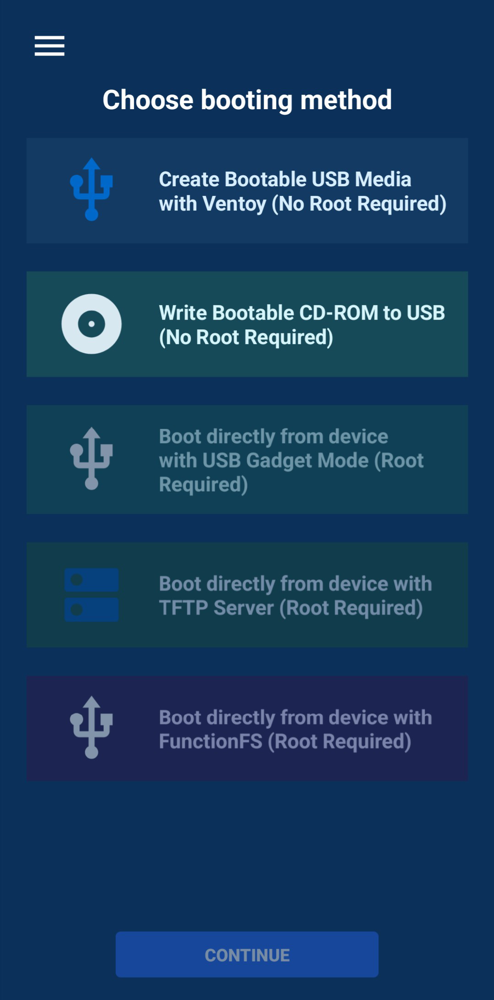

左上角汉堡菜单里还有 Homepage、Settings、About 和 Buy Me a Coffee。v0.1.4 的设置里能改主题
（含纯黑 AMOLED）、强调色（可填 HEX）、字号，另外有通知开关、调试日志，以及一份能直接贴出来求助的诊断报告。

## 3. 不 root 能做什么

这两件事已经解决大部分需求了。

### 在手机上给 U 盘装 Ventoy

以前要装 Ventoy，必须找台 Windows 跑 `Ventoy2Disk.exe`。现在可以直接在手机上做：

1. 用 OTG 线把 U 盘插到手机
2. 打开 MultiBooter，选「Create Bootable USB Media with Ventoy (No Root Required)」
3. 在 Target USB Device 那一栏点「SELECT / CHANGE USB DEVICE」，选目标盘
4. 点 CONTINUE，下一页选分区风格（MBR 或 GPT），再点 INSTALL VENTOY

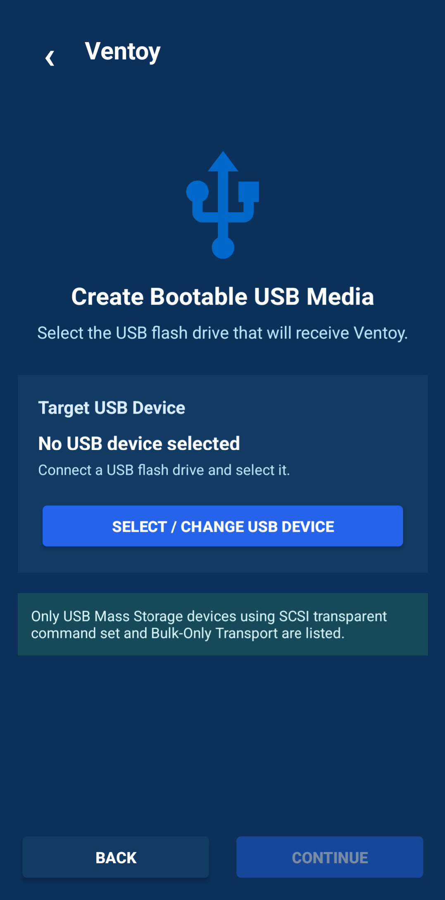

- **MBR** 通吃 BIOS 和 UEFI，拿不准就选它
- **GPT** 只适合 UEFI 机器，太老的 BIOS 机器可能不认

App 会读出盘上已有的 Ventoy 版本。**v0.1.4 起可以直接升级**：同一页有个
「UPDATE VENTOY (KEEP MY FILES)」，盘里已经装着 Ventoy 和数据的话，升级只替换引导部分，
ISO 不用重拷。v0.1.3 及以前只能全盘重装。

写入过程中通知栏有进度条、速度和剩余时间，还有一个 Stop 按钮，退出去干别的也不影响。
写完会回读整盘、比对 SHA-256，对不上会指出是哪一段坏了——这一步比电脑上大多数写盘工具都细。

装完的 U 盘拔下来插到电脑上，就是一个正常的 Ventoy 启动盘，之后往里拷 ISO 就行——
那部分用手机的文件管理器也能做。

**选错盘的后果和电脑上一样**：分区表被覆盖，整块盘的数据全没。确认设备名和容量再点。

### 直接把 ISO 写进 U 盘

不想用 Ventoy、只要一个单系统盘的话，这里也能做：选 ISO，选 U 盘，写进去。
效果等同于电脑上跑 Rufus 的 DD 模式。一样有回读校验。

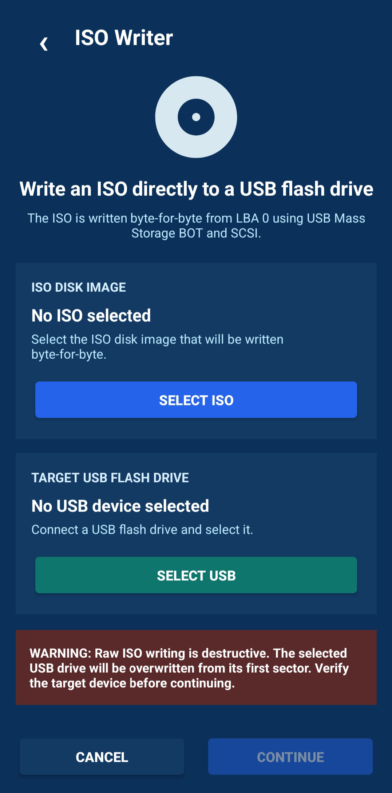

## 4. root 之后能做什么

### 虚拟 U 盘：手机直接变成启动盘

这是最有意思的一项。手机通过 USB 线连电脑，在电脑眼里它就是一整块 U 盘。

原理上，App 在手机存储里建一个 `.img` 镜像文件，再通过 USB Gadget（ConfigFS 的
mass storage 功能）把这个文件当作一块物理磁盘暴露给电脑。

入口在「USB Gadget Mode」那一页的顶上，按钮写着「VIRTUAL USB DRIVE (VENTOY OR BLANK)」：

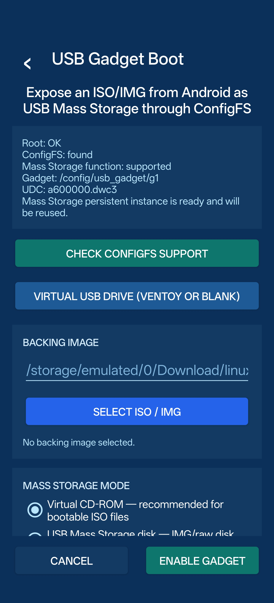

点进去是虚拟盘的列表页，一块盘都没有的时候只有一个「Create a new virtual drive」：

1. 点「Create a new virtual drive」
2. 填名字（默认 `virtual-usb`）、选容量、选类型，点 Create

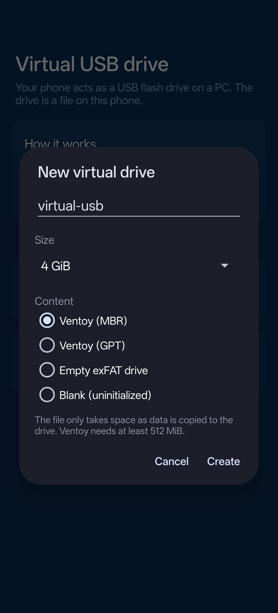

容量是 1、2、4、8、16、32、64、128 GiB 这几档，类型有四种：

| 类型 | 建出来是什么 |
|---|---|
| Ventoy (MBR) | 带 Ventoy 引导的启动盘，MBR 分区表 |
| Ventoy (GPT) | 同上，GPT 分区表 |
| Empty exFAT drive | 空的 exFAT 盘，当普通 U 盘用 |
| Blank (uninitialized) | 连分区表都没有，电脑看到一块未初始化的盘 |

3. 建好后列表里会多出一块盘，点它会弹出菜单：「Share with a PC (read-write)」或「(read-only)」

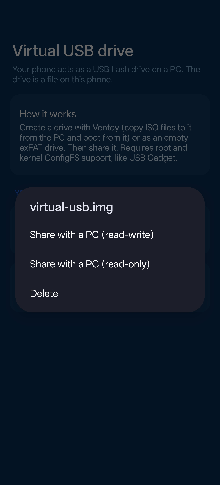

点共享之后会先弹一个提示，讲清楚两件事：用 USB 线连电脑，虚拟盘就会以 U 盘的形式出现；
共享期间别在手机上动这个镜像，先在电脑那边「安全弹出」，再回来停共享。

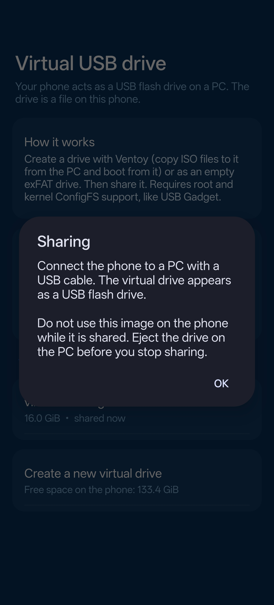

共享成功后页面顶部会显示「Sharing now」，写着当前共享的是哪块盘、只读还是读写，
下面跟着「Stop sharing / Eject the drive on the PC first.」：

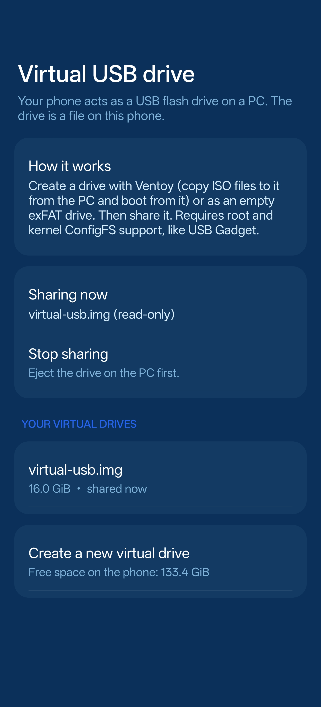

这时候电脑上已经多出一块 U 盘了。选 Ventoy 类型的话，启动电脑就能看到 Ventoy 菜单——
但你得先把 ISO 拷进去：电脑那边识别成 U 盘之后，直接把 ISO 拖进去就行。

也就是说：**不用 U 盘，手机本身就是那个 Ventoy 启动盘。** 这是 DriveDroid 要绕一大圈
（先建空白镜像、再在电脑上用 Ventoy2Disk 装）才能做到的事，这里建盘带共享一步到位。

几个实际细节：

- **镜像文件是稀疏的**。建一个 64GiB 的盘，实际只占几 MB；只有真的往里拷数据才会增长
- **Ventoy 类型最小要 512MiB**，其它类型 64MiB 就行，上限 2TiB
- **共享期间别在手机上碰这个镜像**。电脑那边「安全弹出」之后，再回 App 停共享
- **同一时间只能共享一块**。已经有别的 Gadget 会话在跑时，会弹「USB Gadget is busy」让你先停掉

> 注意：这个「虚拟 U 盘」只是把镜像喂给电脑，**它本身不负责往里塞 ISO**。
> 要放系统镜像，还是得电脑把这块虚拟盘认成 U 盘之后，由电脑拷进去。

### 虚拟光驱

同一个 Gadget 页往下，就是直接把 ISO 挂成 U 盘或光驱的路子：选 backing image，
再选「Virtual CD-ROM」还是「USB Mass Storage disk」，点 ENABLE GADGET。

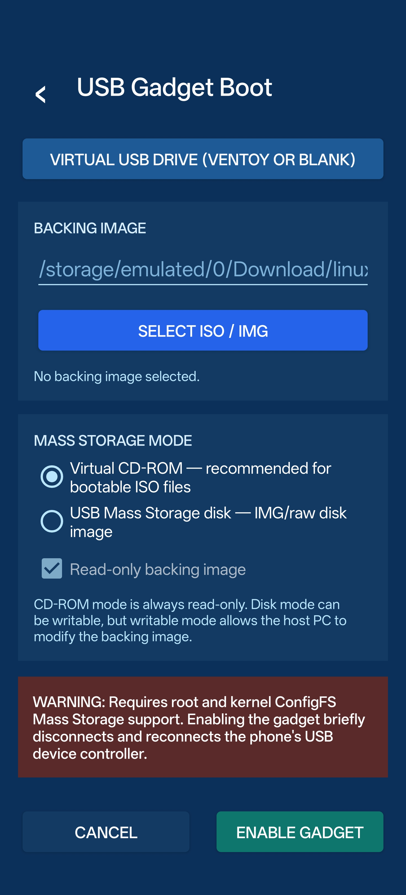

Virtual CD-ROM 对付那些不支持 U 盘启动、只认光驱的老机器或者特殊镜像有用。
CD-ROM 模式永远是只读的；Disk 模式可以写，但写了就是电脑在改手机里那个镜像。

另一条路是 FunctionFS：它在用户态接管 USB 端点，不需要内核的 mass storage 函数。
代价是兼容性看厂商，不是每台机器都成。页面里会先跑一遍自检，把 Root、ConfigFS、
FunctionFS 的支持情况逐条列出来。

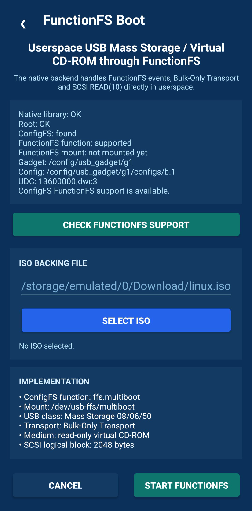

### 网络启动（TFTP / PXE）

这个思路完全不一样：不走 USB，走网线。

手机起一个 TFTP 服务（App 内置了 [dnsmasq](https://thekelleys.org.uk/dnsmasq/doc.html)），电脑那边设置 PXE 网络启动，
从手机加载引导文件，PXE 客户端的配置可以看 [iPXE 文档](https://ipxe.org/howto/)。适合电脑 USB 口坏了、或者一次要给多台机器装系统的场合。

需要手机和电脑在同一个局域网里，通常是手机开热点让电脑连。注意它会自己起 DHCP，
别在有正经 DHCP 的网上乱开。

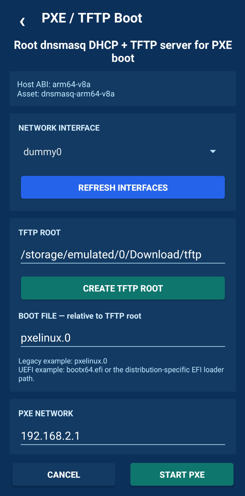

## 5. 磁盘分析

不用 root 的另一个小功能，入口藏在 Ventoy 安装页底部——「ANALYZE DRIVE (PARTITIONS,
FREE SPACE, ISO LIST)」。插着 U 盘的时候点它，能看到这块盘的分区结构、剩余空间，
以及盘里已经放了多少个 ISO、分别是什么。

排查「为什么 Ventoy 菜单里没出现某个镜像」的时候很有用——多半是 ISO 放错了分区，
或者根本没写进 Ventoy 那个数据分区。

## 6. 后台运行与通知

写入、共享、TFTP 这些活都能在后台跑，通知栏挂一条常驻通知，带进度和 Stop 按钮，
点一下能回到 App。

想让它跑久一点，把 App 的电池优化关掉；不然部分 ROM 会在息屏一阵后把任务掐了。
这也是上面那张权限表里「忽略电池优化」的用途。

## 7. 和 DriveDroid 怎么选

如果你在网上搜「手机装系统」，大概率会看到 DriveDroid。两者的现状差别很大：

| | MultiBooter | DriveDroid |
|---|---|---|
| 最后更新 | 2026 年 11 月 | 2019 年 |
| 源码 | 开源，GPLv3，活跃 | 已不公开 |
| 免 root 功能 | 有（Ventoy / ISO 写入） | 没有 |
| 内置 Ventoy | 有 | 没有 |
| Android 版本 | 8.0+ | 适配到 9，之后问题多 |
| 光驱模拟 | FunctionFS | 需第三方内核 |

社区要靠 [Magisk](https://github.com/topjohnwu/Magisk) 脚本手动切换 USB 功能，成本高且不一定成功。
社区要靠 [Magisk](https://github.com/topjohnwu/Magisk) 脚本手动切换 USB 功能，成本高且不一定成功。

DriveDroid 唯一还值得提的地方是它历史更久、能查到的老教程多。但那些教程大多基于
旧系统，照着做容易踩坑。

## 8. 常见问题

**「不需要 root」不等于「一定能用」。** USB Host 功能依赖手机的 OTG 支持和供电能力。
有些机型 OTG 供电不足，带不动 U 盘；有些 ROM 对 USB Host 的实现有 bug。

**虚拟 U 盘在部分主板上认不出。** 手机伪装成的存储设备，BIOS 兼容性不如真 U 盘。
碰到这种情况换 USB 2.0 口试试。

**Secure Boot 会拦 Ventoy。** 和 U 盘版一样，第一次启动要在 MokManager 里注册密钥，
详见 [Ventoy 使用教程](/blog/ventoy-tutorial)。

**项目很新。** v0.1.x 意味着接口可能变、bug 可能多、遇到问题不一定搜得到答案。
介意的话就先用电脑版工具，把它当备用方案。

**root 有代价。** 解锁 Bootloader 会清空数据，部分银行 App 和支付功能会受影响。
为了一个应急启动盘值不值，自己权衡。

## 9. 值不值得用

分两种情况看：

**如果只是偶尔装一次系统**，没有必要为它准备一套方案。一个几十元的 U 盘，用 Rufus 写一次，
比什么都省事。

**如果经常帮人修电脑**，或者不想随身带 U 盘，这个方案的价值就体现出来了——
手机通常就在身上，装一个 App 等于多了一套完整的启动盘能力。

装系统的完整流程见 [Windows 系统安装教程](/blog/windows-install-tutorial)；
Ventoy 本身的用法见 [Ventoy 使用教程](/blog/ventoy-tutorial)。
