本文以 **Clash Verge Rev** 为例。它的内核是 [mihomo](https://github.com/MetaCubeX/mihomo)（也就是以前的 Clash Meta），界面基于 [Tauri 2](https://tauri.app/) 写，是 zzzgydi/clash-verge 的延续分支，现在还在活跃维护——Clash for Windows 的作者 2023 年 11 月删库之后，这是 Windows 上最省事的选择。

这类客户端本身都不提供节点，只是个壳：给它一份订阅，它按规则把该走代理的流量送出去。所以第一步不是装软件，是先弄到订阅——这一步跟用哪个客户端无关。

整篇按「装 → 订阅 → 选节点 → 让它真的接管流量 → 出问题怎么查」的顺序写。中途界面找不到了，就回「先认一下界面」那一节对一下。换成别的客户端，这条线是一样的，只是菜单位置各不相同。

## 它现在是什么状态

版本号写死在文章里很快就会过期，所以这里只说清怎么判断：

- 客户端本体是 [clash-verge-rev/clash-verge-rev](https://github.com/clash-verge-rev/clash-verge-rev)，**只通过 GitHub Releases 发布**——官方专门强调过这一点，别从搜索引擎里的第三方下载站拿安装包
- 内置内核是 mihomo，随客户端一起发，也能在设置里单独换版本
- 文档站已经迁到 [clashverge.dev](https://www.clashverge.dev/)。旧的 `clash-verge-rev.github.io` 还能打开，但会 302 跳过去，而且子页面基本都 404——照着老链接找文档会一路碰壁

## 下载和安装

到 [Releases 页面](https://github.com/clash-verge-rev/clash-verge-rev/releases/latest) 拿稳定版（Stable）。测试版的 tag 叫 `autobuild`，官方已经把原来的 Alpha 通道标为废弃，日常别用。

| 平台 | 拿什么 | 注意 |
|---|---|---|
| Windows | `.msi` 或 `.exe`，按 CPU 选 x64 / arm64 | Windows 7 已不支持，要 Win10/11 |
| macOS | 按芯片选 `aarch64`（Apple Silicon）或 `x64`（Intel）的 `.dmg` | 要求 macOS 12 及以上 |
| Linux | `.deb`（x64/arm64/armv7）、`.rpm`、AppImage | 服务模式要用发行版包管理器装 |

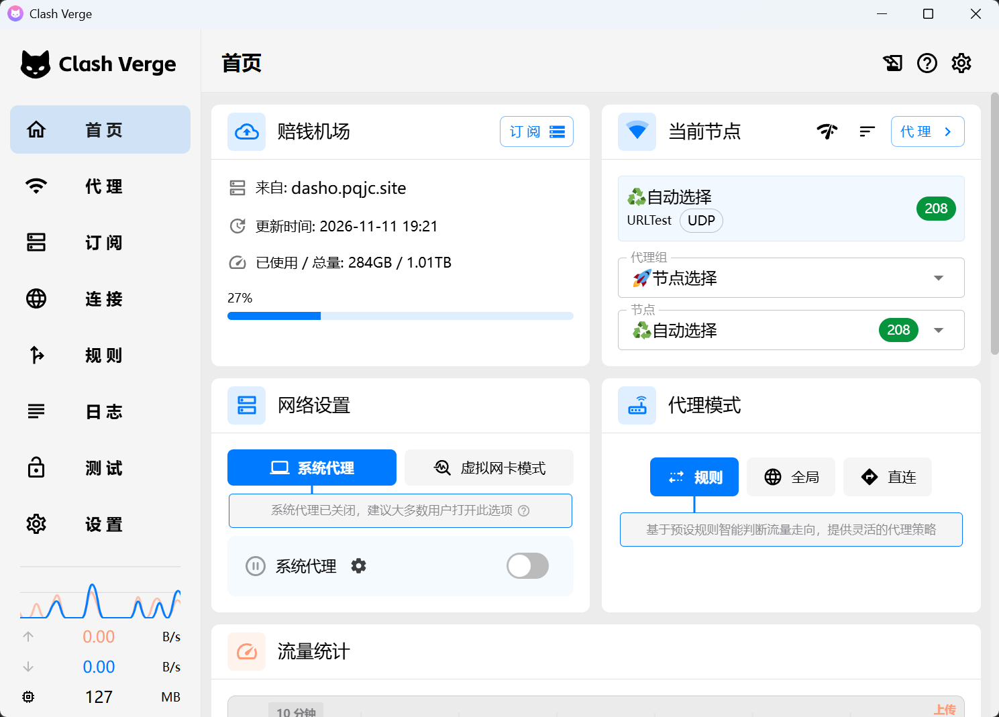

Windows 上还有一个 `fixed_webview2` 版本，把 WebView2 运行时打包进去了，体积大不少，只在系统确实缺 WebView2 时才需要它——正常装普通版就行。

包管理器也能装：`winget install ClashVergeRev.ClashVergeRev`。Scoop 的 `extras` 桶和 Arch 的 AUR 里也有，但那两个是社区维护的，版本可能滞后。

装完第一次打开，默认界面是英文。切中文在「设置 → Verge 设置 → 语言设置」，顺手把「主题模式」和「启动页面」也一起调了。启动页面默认是「代理」页，多数人保持默认就好。

## 先认一下界面

当前版本左侧一共有八项：**首页、代理、订阅、连接、规则、日志、测试、设置**。左下角常驻一个流量图和内存占用，点开是简版统计。

| 页面 | 干什么用的 |
|---|---|
| 首页 | 总览。当前订阅、当前节点、系统代理 / 虚拟网卡模式两个开关、代理模式、流量统计，往下还有网站测试、IP 信息、Clash 信息与系统信息 |
| 代理 | 代理组和节点，右上角切规则 / 全局 / 直连 |
| 订阅 | 导入和管理订阅，订阅卡片的右键菜单都在这儿 |
| 连接 | 实时连接列表（活跃 / 已关闭）：哪条流量走了哪个出口 |
| 规则 | 当前生效的规则与匹配调试 |
| 日志 | 运行日志，能按级别和关键词过滤，排错第一现场 |
| 测试 | 网站测速、流媒体解锁检测 |
| 设置 | 系统代理、TUN、端口、DNS、备份，都在这里 |

新手最容易找不到的几个地方，先记下来：

- **系统代理和 TUN 后面各有一个小齿轮**，点进去才是它们的详细设置（bypass 列表、TUN 的 stack 和 DNS 模式）
- 代理页右上角除了「规则 | 全局 | 直连」，右边还有一个「**链式代理**」按钮——把一个节点串到另一个节点后面走，平时用不上
- 订阅卡片要**右键**才有更新、启用、编辑规则、编辑扩展配置这些操作
- 设置里有个「**配置目录**」，出问题时经常要去那儿清缓存

## 先弄一个订阅

节点得从机场买。下面三个是我在用的，链接里带邀请码：

- [赔钱机场](https://xn--mes358aby2apfg.com/register?code=0O5iNqBN&cover=sfw)——量足价低，日常刷网页看视频够用，我目前的主力
- [魔界.net](https://www.mojie.me/#/register?code=oCmKfVkU)
- [WindyCloud](https://portal.passgfw.top/#/register?code=bjn7QEKe)

注册、买套餐，然后进后台找订阅入口。各家后台长得不一样，但都在「导入客户端」那一块：有的是「我的订阅」下面一排按钮，有的是「手动导入客户端」面板。最省事的是旁边那面图标墙，里面基本都摆着 **Clash Verge** 的一键导入（怎么走见下一节）；想自己留着地址、或者要粘到别的设备上，就**点「复制订阅链接」**，拿到的是一串原始地址。

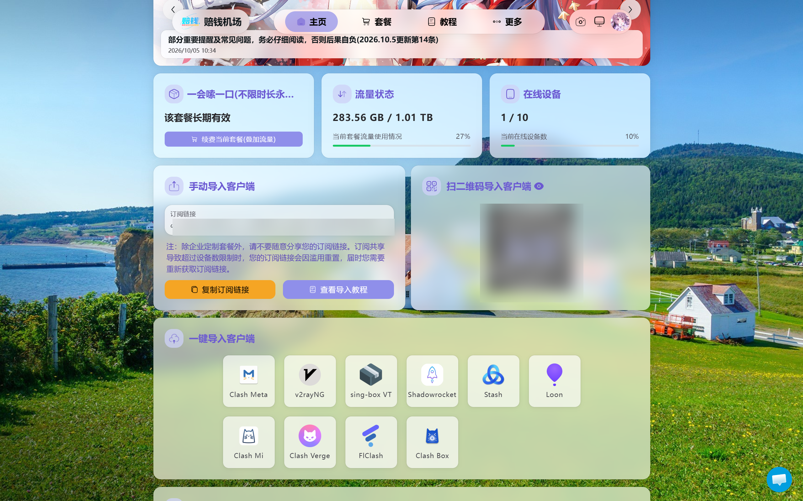

地址很长（`https://xxx/sub?token=...`），用复制按钮，别手动抄。

拿到之后想先验一下也行：`curl -A clash-verge/v2.4.0 '<订阅链接>'`。返回一坨 YAML 就是对的，返回登录页 HTML 就是链接或 token 不对。

> **UA 是有用的**：Verge 请求订阅时会带一个形如 `clash-verge/v<版本>` 的 UA，部分机场按 UA 下发不同格式的配置。所以用浏览器直接打开订阅地址看到的内容，可能和客户端拿到的不一样，这不算异常。单个订阅的 UA 可以在「订阅链接配置」里改。

## 导入订阅

进「订阅」页，当前版本有三条路：

1. **订阅链接**：把地址粘进输入框点导入，最常用
2. **订阅链接配置**：要改 UA、加请求头、走前置代理时用
3. **URL Schemes**：网页上点 `clash://` 开头的链接直接唤起客户端，机场的「一键导入」走的就是这个

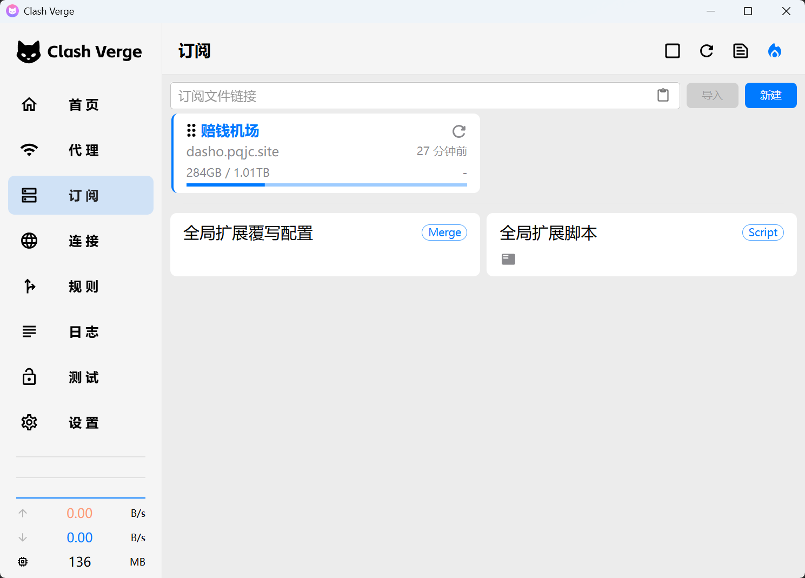

第四种是本地文件：新建一个空配置，或者把 `.yaml` 直接拖进窗口。自己手写配置、或者从别处导出一份配置时用它。

导入成功会出现一张卡片，写着机场名、剩余流量和上次更新时间。卡片上有几个入口，**在卡片上点右键**还会展开一整列：

| 菜单项 | 作用 |
|---|---|
| 使用 | 把这份订阅设为当前生效的那份（有多份订阅时才用得上） |
| 分享二维码 | 把订阅链接生成二维码，手机端扫一下就能导入 |
| 编辑信息 | 改显示名、更新间隔这类信息 |
| 编辑文件 | 直接改这份订阅的配置本体 |
| 编辑规则 | 在这份订阅的前置 / 后置位置插规则，订阅更新不会冲掉 |
| 编辑节点 / 编辑代理组 | 改节点、代理组的定义，一般只在订阅本身不规范时才动 |
| 扩展覆写配置 | 用 YAML 做增量覆写，就是老版本的 Merge |
| 扩展脚本 | 用 JS 改配置，能力比覆写大，就是老版本的 Script |
| 打开文件 | 在文件管理器里定位到这份配置 |
| 更新 / 更新（代理） | 手动拉一次订阅；后者让这次请求也走代理，订阅地址被墙时用它 |
| 删除 | 删掉这份订阅 |

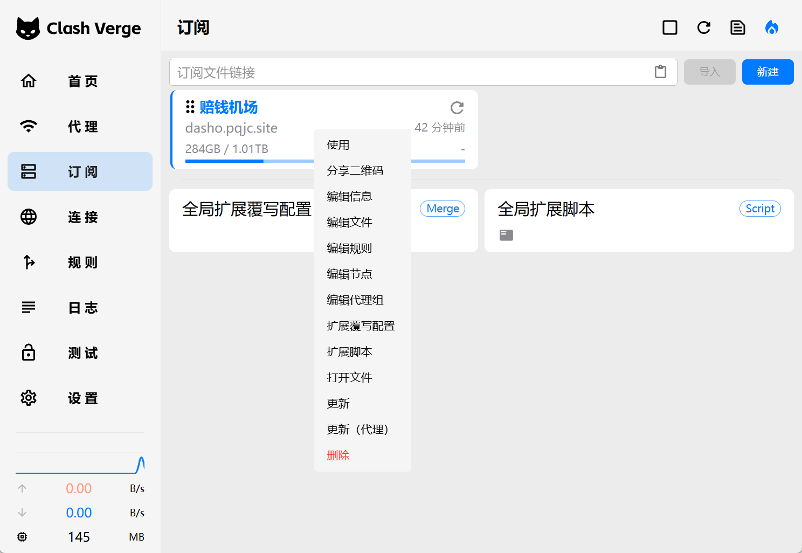

自动更新的间隔可以配，也可以直接关掉；「编辑规则」里插的**前置规则优先级最高**，想让某个域名永远直连，写在那儿最稳。

## 选节点

切到「代理」页，标题写的是「代理组」。每一块是一个**代理组**，组名下面挂着类型徽标（Selector、URLTest、Fallback 之类），右边的数字是这一组的延迟，折叠箭头展开就是组里的节点。

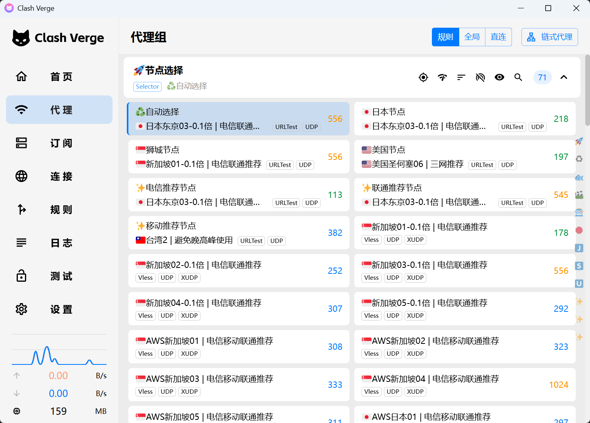

订阅一般会带这几个特殊的组：

| 组 | 作用 |
|---|---|
| 手动选择（Selector） | 你自己点，点哪个用哪个 |
| 自动选择（URLTest） | 定时测所有节点，自动用延迟最低的那个 |
| 故障转移（Fallback） | 按顺序试，第一个不通就换下一个 |
| 负载均衡（LoadBalance） | 按权重分摊，一般用不上 |

右边的数字是延迟（毫秒），越小越快，`Error` 表示这个节点当时连不上。节点右侧的**图钉**是锁定：红色表示锁定了而且可用，灰色表示锁定了但当前不可用，用 Fallback 时它会自动取消锁定。

延迟只是参考。有些节点延迟低但带宽小，看视频反而卡；反过来也有延迟高但跑得稳的。不确定就用「自动选择」，懒得折腾也用它。

## 模式：规则、全局、直连

代理页右上角是「规则 | 全局 | 直连」的分段控件。

- **规则**：按订阅里的规则分流，国内直连、国外走代理。日常用这个
- **全局**：所有流量都从你手动选定的那个出口走。排查问题时用，平时开着国内网站也绕一圈
- **直连**：全部不走代理，等于临时关掉

规则模式的判断依据是订阅自带的那份规则集——域名后缀、IP 段、[GEOSITE](https://github.com/MetaCubeX/meta-rules-dat) 分类之类。所以出现「国内网站走了代理」或者「该翻的没翻」，先怀疑规则，再怀疑节点。订阅质量差，规则也会跟着差。

想看某条规则到底命中没有，去「规则」页，那里能看到当前生效的规则列表，配合「连接」页里每个连接的命中结果，基本能定位所有分流问题。

## 让流量真的走代理

这是全文最容易出问题的一段，因为「开了代理软件」和「流量真的走代理了」是两件事。当前版本有两条路，而且**它们不是二选一**：可以只开一个，也可以两个都开。

### 系统代理

到「设置」页打开「系统代理」。它做的事很简单：在系统约定好的位置（Windows 上是注册表 `HKCU\Software\Microsoft\Windows\CurrentVersion\Internet Settings`）写上代理端口，**程序自己去读**，读完就走。

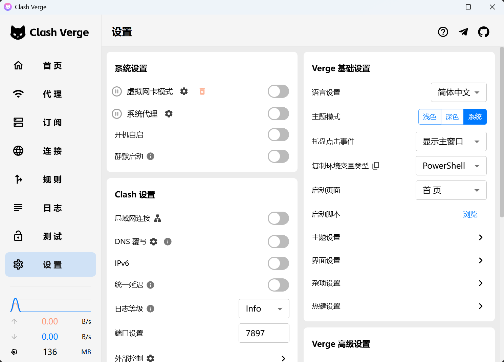

- 默认混合端口是 **7897**，HTTP 和 SOCKS 用同一个。很多老教程写的 7890 是 Clash for Windows 的默认值，照抄会连不上
- 订阅原文里往往还写着 `mixed-port: 7890`、`external-controller: '127.0.0.1:9090'`（后面「编辑文件」那张图里就能看到），那是机场照抄老配置留下的。这两个字段由客户端接管，运行时以「端口设置」里的值为准
- 别把 **9097** 当成代理端口，那是外部控制端口，给面板和 API 用的，是另一回事
- 不代理 UDP。游戏、以及把代理写死在代码里的程序，它管不了
- 开关右边的**齿轮**里有 bypass 列表，想让某些地址不走代理就写在里面

怎么确认真的生效了：浏览器打开 `https://www.google.com`，能开就通了。或者看首页右下角的 **IP 信息**卡片——出口 IP 从本地变成节点所在地，就说明流量确实走了代理；这张卡片默认开着自动刷新，上面能看到倒计时。

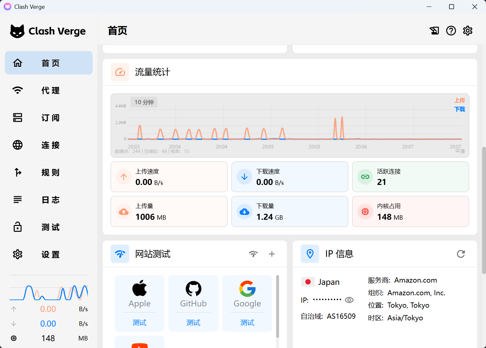

同一页下面还有 **Clash 信息**和**系统信息**两张卡片，内核版本、混合代理端口、系统代理地址、运行时间、规则数量都列在那儿，跟设置页里填的对得上就没问题：

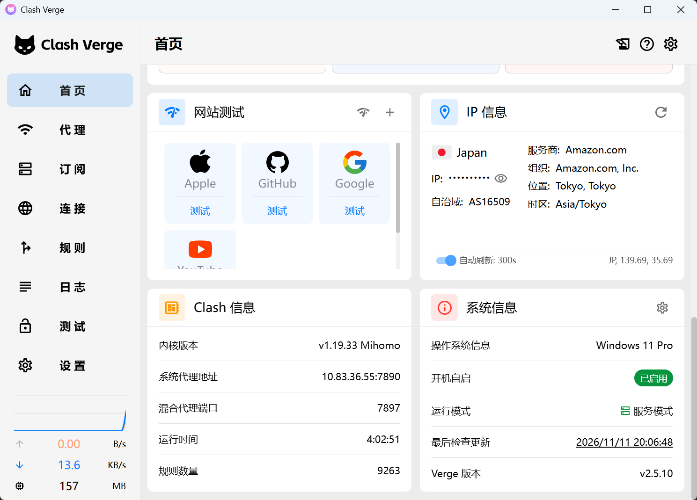

### TUN 模式

TUN 会建一块虚拟网卡，顺带改路由表，在更底层把流量截走，**TCP 和 UDP 全部接管**。所以「不认代理」的程序——一部分游戏、WSL、Docker、写死了代理的工具——用 TUN 都能吃到。

代价是要管理员权限，两条路：

- **装服务模式**：客户端自带一个后台服务，装一次之后，普通权限也能启停虚拟网卡模式
- **直接以管理员身份运行客户端**：官方在提示安装服务时会让你选「继续使用 Sidecar」，就是这条路

服务的入口就在「虚拟网卡模式」那一行的齿轮旁边，那块小图标是它的状态；装好之后，首页「系统信息」里的「**运行模式**」也会写着「服务模式」。

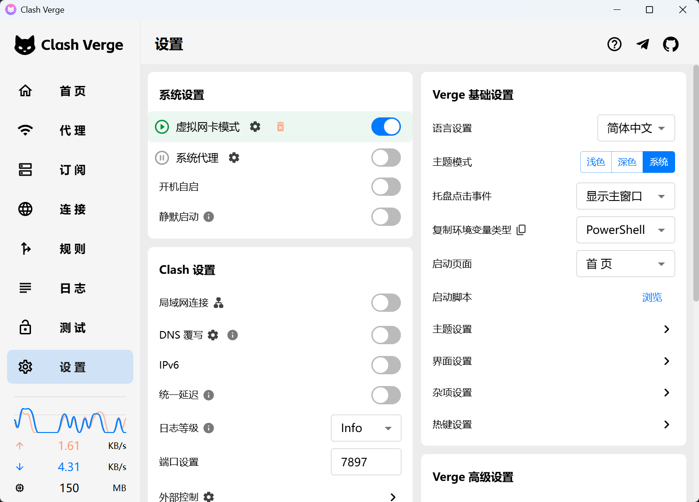

服务装好之后打开「虚拟网卡模式」。它的齿轮里有 TUN 模式堆栈、DNS 模式、网卡名、MTU 这些，通常不用动：

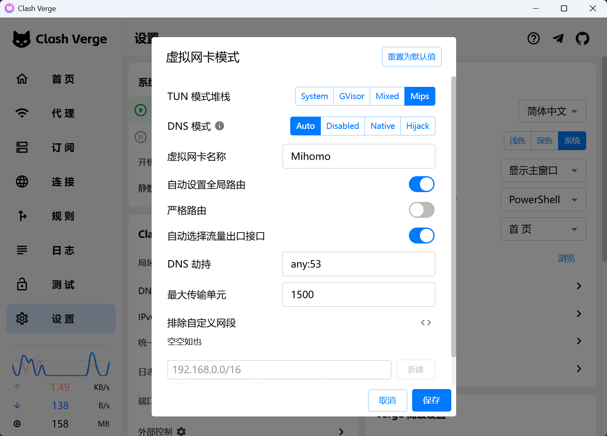

- **TUN 模式堆栈**：当前版本给的是 System、GVisor、Mixed 几种实现。官方文档给的默认是 GVisor，mihomo 文档则推荐 `mixed`——两边口径不一致，动手前先看当前版本的默认值，别盲目照抄别人截图
- **严格路由**和 **DNS 劫持**：这个对话框里就有这两项，也就是后面 DNS 那节要说的 `strict-route` 和 `dns-hijack`，想彻底接管 DNS 就从这里开
- **防火墙**：系统防火墙开着时，某些 stack 用不了，需要放行 `verge-mihomo` 这个进程
- **DNS 模式**：可以和 DNS 覆写配合，把 DNS 查询也一起接管

### 什么时候用哪个

| 场景 | 用哪个 |
|---|---|
| 就是浏览器上网、看视频 | 系统代理够了 |
| 命令行工具、git、npm 要翻 | TUN，或者系统代理加上手工设环境变量 |
| WSL、Docker、游戏 | TUN |
| 临时关掉代理但不想退软件 | 模式切「直连」 |

两者都开也没什么问题，但排错时会多一层变量。**遇上「上不了网」，第一件事是先把两个开关都关掉，确认裸连是通的**，再一个一个打开，看是哪个把它弄断的。

## DNS 与分流

设置里有一项「DNS 覆写」，它会在扩展配置之前生效，用来盖掉订阅自带的 DNS 设置。这项开关是**按订阅独立保存**的，只对对应的那份订阅生效。

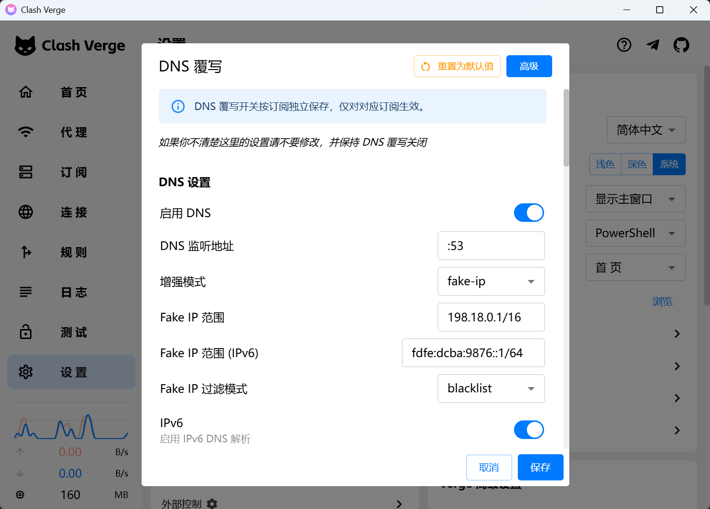

第一次打开它会先拦你一下：

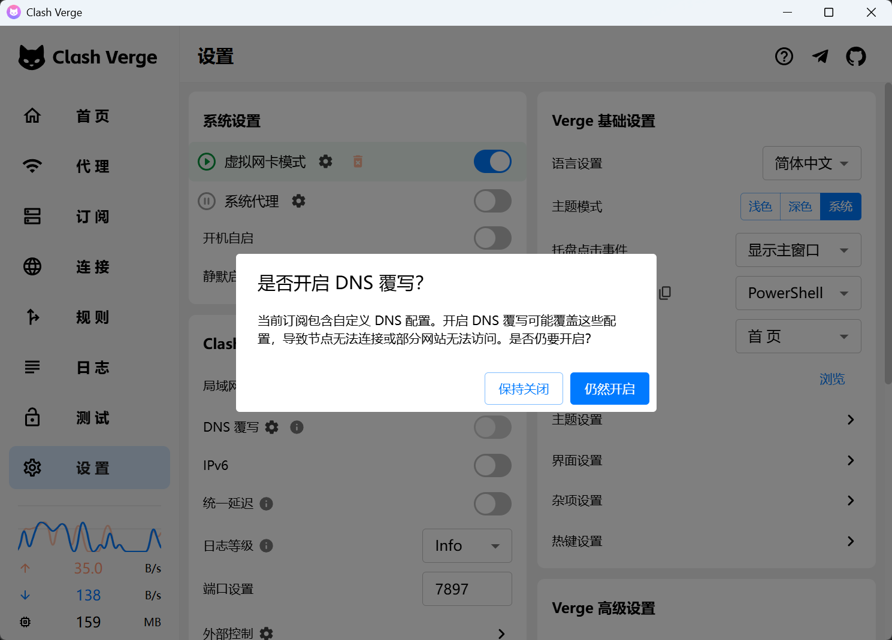

这句话不是吓唬人。很多订阅自己带了一整套 DNS 配置，覆写打开之后会把它们盖掉，表现就是节点连不上，或者部分网站打不开。所以**没问题就别开**；真要开，先记住原来的设置，出问题再关回去。面板上那句「如果你不清楚这里的设置请不要修改」也是这个意思。

几个实际问题：

- **内网域名解析不了**：用 `nameserver-policy` 把内网域名指到内网 DNS，别让它走公共 DNS
- **担心 DNS 泄漏**：mihomo 有 `strict-route`（Windows 上会顺带加防火墙规则），配合 `dns-hijack` 把 53 端口也接管
- **改了没效果**：记得先确认改的是「DNS 覆写」还是订阅里的 `dns` 段——订阅一更新，后者就回去了

分流本身还是靠规则。DNS 和规则的关系一句话说清：**DNS 决定「这个域名解析成什么 IP」，规则决定「这条连接走哪条路」**，两个都配错才会出现「域名对了但走错出口」这种怪事。

## 规则与扩展配置

规则的写法就那么几种，看几眼就能读懂订阅里那一大片：

| 写法 | 匹配什么 |
|---|---|
| `DOMAIN` / `DOMAIN-SUFFIX` / `DOMAIN-KEYWORD` | 域名，后缀和关键词是常用的 |
| `GEOSITE` | 按域名分类（`geosite:netflix` 这种） |
| `IP-CIDR` / `GEOIP` | IP 段 / 国家地区 |
| `DST-PORT` | 目标端口 |
| `PROCESS-NAME` | 发起连接的程序，Windows 上很好用 |
| `AND` / `OR` | 条件组合 |
| `MATCH` | 兜底，放最后一条 |

动作就是三种：`DIRECT`（直连）、`REJECT`（拒绝）、或者某个代理组的名字。规则自上而下匹配，命中就停，「前置规则」插在最前面。

不想动订阅本身，就用**扩展配置**和**扩展脚本**（老版本叫 Merge 和 Script，网上按旧名字搜到的教程也还能用）。订阅页上有全局的两张卡片——「全局扩展覆写配置 Merge」和「全局扩展脚本 Script」；单份订阅则在自己的右键菜单里，叫「扩展覆写配置」和「扩展脚本」。也可以直接点「编辑文件」，那份把订阅原文和扩展合并之后的完整配置就摆在眼前：

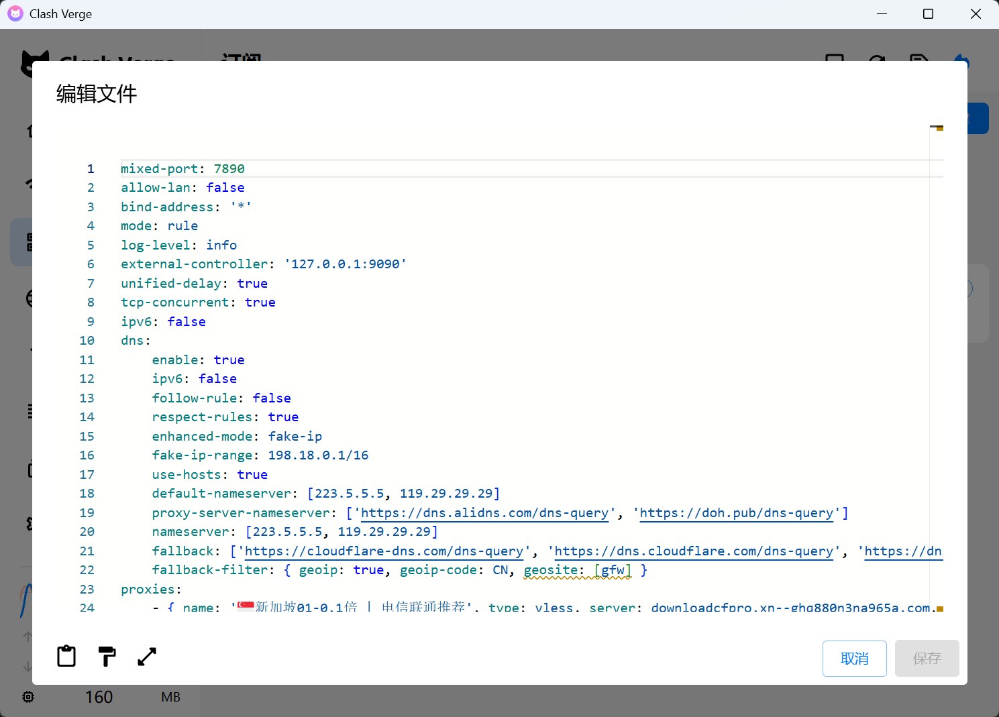

- 分**全局**和**订阅**两级，执行顺序是：订阅原文 → 应用设置 → 全局扩展配置 → 全局扩展脚本 → 订阅扩展配置 → 订阅扩展脚本 → 应用设置回写
- 普通的列表和值整体替换，嵌套对象逐项合并
- 从某个版本起，扩展里的 `dns` 和顶层 `hosts` 变成了**整体替换**——想保留订阅原有条目就得一并写出来，否则会被清空
- `external-controller`、`secret`、`mixed-port`、`mode`、`allow-lan`、`log-level`、`ipv6`、`tun.*` 这些字段由客户端接管，写在扩展里会被丢弃
- 脚本是 JS，入口是 `main(config)`，没有网络和文件 IO

多份订阅要合并成一份，官方文档里也有专门的做法，见文末链接汇总。

## 出问题先看这三个地方

别急着搜症状，先按这三个地方把范围缩小：

1. **日志页**。上面能筛级别和关键词，启动失败、订阅拉不下来、TUN 起不来，原因基本都在这儿写着
2. **连接页**。找到那条不听话的连接，看它命中了哪条规则、走了哪个出口、有没有流量。这是判断「是规则错了还是节点坏了」最快的方法
3. **首页**。两个开关的实际状态、当前节点的延迟，还有右下角的 **IP 信息**卡片——出口 IP 变了没有，一眼就知道代理到底生效没生效

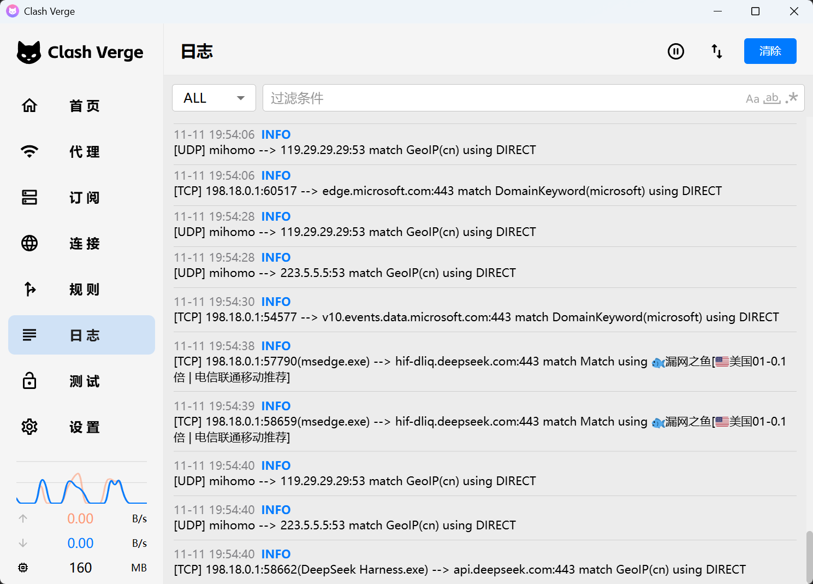

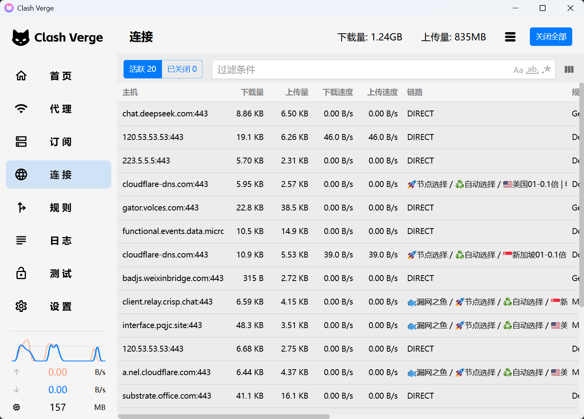

## 常见问题

| 现象 | 原因 | 怎么办 |
|---|---|---|
| 代理页一片空白 | 内核没起来，常见是被防火墙挡了 | 关掉 Windows 防火墙再开一次 |
| 开了代理上不了网，关了软件全网断 | 强杀或断电，系统代理留在了注册表里 | 系统设置 → 网络和 Internet → 代理 → 手动设置代理 → 关掉「使用代理服务器」 |
| 提示端口被占用 / `bind: address already in use` | 默认的 7897 或外部控制端口 9097 被别的软件占了 | 设置里改端口，注意这两个是两回事 |
| 部分网站打不开 | 加速器、破解工具改了 hosts | 清掉 hosts 里被改的行；或者用扩展配置写 `dns: use-system-hosts: false` |
| 订阅更新失败、节点全没了 | 本地配置损坏，或者订阅服务端返回异常 | 设置里进「配置目录」清空后重启，不行就删掉配置目录重装 |
| 虚拟网卡模式打不开 | 服务模式没装，或者安全检查没过退回了 Sidecar | 以管理员运行，或者重装服务模式 |
| 开了虚拟网卡模式网络反而异常 | 环境里有多余的虚拟网卡或网段冲突 | 把多余的网卡删掉再试 |
| 开机自启、静默启动不生效 | 开关状态没写进去 | 关掉再打开一次 |
| 一点就闪退 | WebView2 被卸载或禁用、杀软拦截、缺 VC 运行库 | 按这三条依次排查 |
| 老 CPU 报退出码 `-1073741819` | 内置 mihomo 要求 v2 指令集 | 换回旧版本客户端，或自己替换内核 |

## 关机、重启和卸载

正常退出时 Clash Verge 会把系统代理关掉。但如果是直接关机、或者程序被强杀，注册表里那条设置会留下来。

于是就有了这个经典场面：第二天开机，Clash Verge 没自启，系统代理却还指着 `127.0.0.1:7897`，浏览器打不开任何网页，看起来像断网了。

两个办法：

- 打开「开机自启」，让它跟着系统起来
- 或者养成习惯，关机前先关掉「系统代理」

真碰上了也不慌：打开 Clash Verge，关掉系统代理，网络立刻恢复。软件已经卸了的话，按上一节表格里那条改系统设置。

**彻底卸载**要清三层东西：

1. 服务模式：Windows 在「虚拟网卡模式」的弹窗里点删除图标，或者跑安装目录里的 `uninstall-service.exe`；Linux 是 `sudo /bin/uninstall-service`
2. 数据目录：`%APPDATA%\io.github.clash-verge-rev.clash-verge-rev`（订阅、配置、日志都在这儿）
3. WebView 缓存：`%LOCALAPPDATA%\io.github.clash-verge-rev.clash-verge-rev`，大版本升级之后建议清一次

**换机器**用「设置 → Verge 高级设置 → 备份设置」，可以导出成 ZIP，也能直接同步到 WebDAV。注意备份包里**带着订阅链接和节点密码**，别往不信任的服务器上放——配置文件 `verge.yaml` 里 WebDAV 密码是明文存的。

## 和别的代理软件冲突

同一时间只让一个软件管系统代理。和它抢同一个开关的，最典型的是学校的 WebVPN 客户端：[SDUST WebVPN](/blog/sdust-webvpn-guide) 这类工具也是改系统代理，**后开的赢**，表现是校内网站打不开或者统一认证一直登录失败。

解决办法是让它们分工：Clash Verge 切到虚拟网卡模式，把学校域名和地址段设为直连；或者反过来，用 WebVPN 的时候先把 Clash Verge 的系统代理关掉。

还有一类是 hosts 层面的冲突：Watt Toolkit、Steam++ 这类加速器会改 hosts 做域名劫持，而 mihomo 默认会读系统 hosts，两边一叠加就出怪问题。处置办法是设环境变量 `DISABLE_SYSTEM_HOSTS=1`，或者在扩展配置里写 `dns: use-system-hosts: false`。

## 隐私与合规

有两件默认开启的外联行为，值得知道：

- 首页的 **IP 信息**卡片默认开着，会定期向第三方 IP 查询服务请求你的出口 IP 和归属地（卡片上有「自动刷新」的倒计时），只在首页可见时才请求。不想让它查，就把这张卡片关掉
- **自动检查更新**默认开着，会向 GitHub 请求版本信息。更新订阅则是按设置的间隔去机场拉取，间隔可以调也可以关
- **订阅链接本身就是凭证**。它等价于账号密码，谁拿到都能用你的流量；机场也会因为「分享导致的滥用」把链接重置。截图发文章、发给朋友之前，记得把链接和二维码打掉

> 这篇只讲客户端怎么用，不提供任何节点、订阅或配置文件。请自行甄别机场，并在所在地法律法规与服务商条款允许的范围内使用，风险自负。

## 链接汇总

| 名称 | 地址 | 说明 |
|---|---|---|
| 官方文档 | https://www.clashverge.dev/ | 新域名，旧域名子页已失效 |
| 下载安装 | https://www.clashverge.dev/install.html | 各平台安装包与系统要求 |
| 快速入门 | https://www.clashverge.dev/guide/quickstart.html | 带界面截图的新手流程 |
| 订阅导入 | https://www.clashverge.dev/guide/profile.html | 导入方式与订阅管理 |
| 名词解释 | https://www.clashverge.dev/guide/term.html | 系统代理、TUN、规则模式的区别 |
| 自定义规则 | https://www.clashverge.dev/guide/rules.html | 前置 / 后置规则怎么写 |
| 扩展配置与脚本 | https://www.clashverge.dev/guide/extend.html | 就是以前的 Merge / Script |
| 自定义脚本 | https://www.clashverge.dev/guide/script.html | `main(config)` 入口与限制 |
| 多订阅合并 | https://www.clashverge.dev/guide/config.html | 把几份订阅拼成一份 |
| 导出日志 | https://www.clashverge.dev/guide/log.html | 出问题时该抓什么 |
| URL Schemes | https://www.clashverge.dev/guide/url_schemes.html | `clash://` 唤起客户端 |
| 卸载 | https://www.clashverge.dev/uninstall.html | 服务、数据、缓存的清理顺序 |
| 隐私政策 | https://www.clashverge.dev/privacy.html | 哪些数据会外联，写得很清楚 |
| Windows FAQ | https://www.clashverge.dev/faq/windows.html | 服务模式、TUN、防火墙 |
| 其它 FAQ | https://www.clashverge.dev/faq/other.html | 端口与常见故障 |
| 客户端仓库 | https://github.com/clash-verge-rev/clash-verge-rev | 唯一发布渠道 |
| 最新版本 | https://github.com/clash-verge-rev/clash-verge-rev/releases/latest | 拿稳定版 |
| mihomo 内核 | https://github.com/MetaCubeX/mihomo | 以前的 Clash Meta |
| mihomo 文档 | https://wiki.metacubex.one/ | 配置项的权威解释 |
| TUN 参数 | https://wiki.metacubex.one/config/inbound/tun/ | stack、DNS 模式都在这里 |
| DNS 配置 | https://wiki.metacubex.one/config/dns/ | nameserver-policy、fake-ip |
| 代理组 | https://wiki.metacubex.one/config/proxy-groups/ | 各类组的语义 |
| 规则语法 | https://wiki.metacubex.one/config/rules/ | 规则写法与动作 |
| GEOSITE 数据 | https://github.com/MetaCubeX/meta-rules-dat | 规则集的来源 |

---

配置本身不复杂，麻烦的都在边界上：代理和应用谁先启动、系统代理留在注册表里、两个都改系统代理的软件打架、TUN 要权限。把这几件事想清楚，剩下的就是点几下的事。
