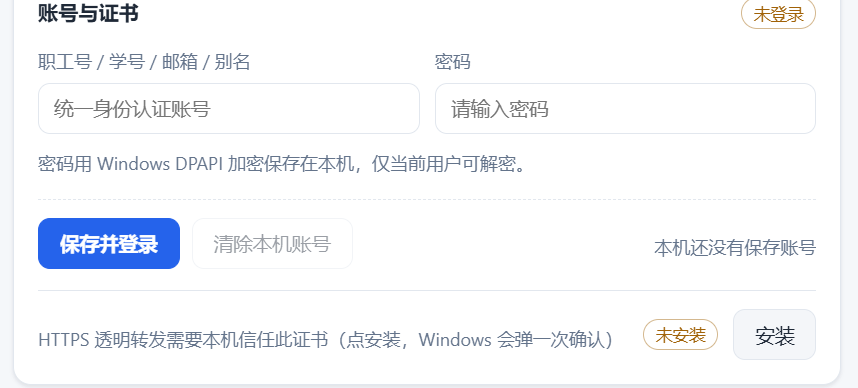
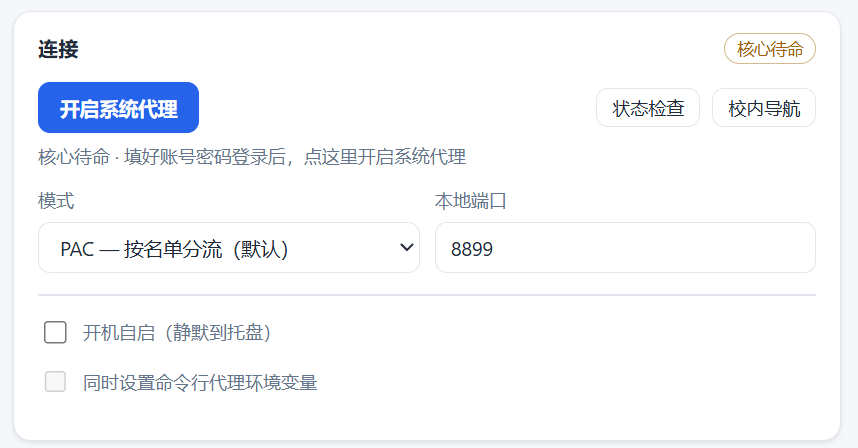
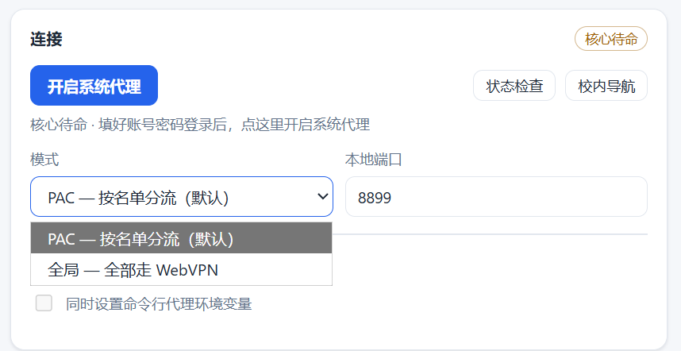
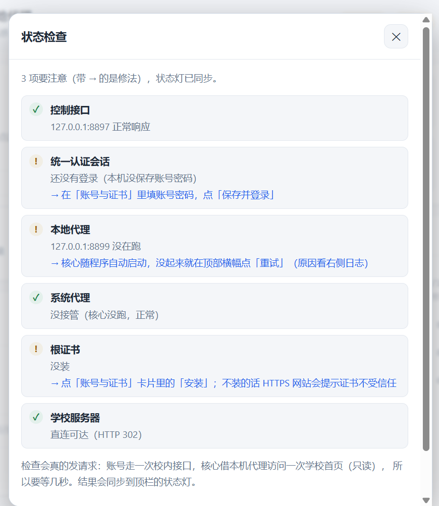

学校用的是**网瑞达 WebVPN**（clientless 反向代理），所有资源都会被改写成
`https://webvpn.sdust.edu.cn/https/<hex>/<path>` 这种形式，只能在门户里一个个点开。

在校外写代码时这很别扭：`git clone` 要手动复制改写后的地址，`pip install` 校内源要改
index-url，页面里的链接、302 跳转全是 webvpn 前缀，登录态过期还得重新输入。

[SDUST WebVPN 本地透明代理](/projects/sdust-webvpn)就是为解决这个而写的。这篇文章讲怎么用。

## 它做了什么

在本机跑一个 HTTP(S) 代理，工作流程很短：

```
浏览器 / 命令行工具
        │  原始地址：https://gitlab.sdust.edu.cn/xxx
        ▼
   ┌─────────────┐
   │  本地代理    │  是否命中白名单？
   └──────┬──────┘
          │ 命中：改写成 /https/<hex>/<path> 转发
          ▼
   webvpn.sdust.edu.cn  →  校内真实资源
          │
          ▼  响应返回时，链接 / Location / Cookie / CSP 头还原成原始地址
```

站外流量直连，速度不受影响。HTTPS 需要做中间人解密（否则无法改写页面里的链接），
所以程序会生成一个本地 CA 证书。

## 安装

只有便携版，**不需要安装、不需要管理员权限**。

1. 到 [Releases](https://github.com/XavierMu/sdust-webvpn-desktop/releases) 下载
   `SDUST-WebVPN-<版本>-portable.zip`
2. 解压到任意文件夹（不要放在 Program Files 之类需要提权的目录）
3. 双击 `SDUST WebVPN.exe`

**运行环境**：Windows 10/11 x64。Win11 自带 WebView2；Win10 一般随 Edge 已装，
缺了的话装一次 [WebView2 Runtime](https://developer.microsoft.com/microsoft-edge/webview2/)。

不需要 Node.js，也不需要装 .NET 运行时。

发行包有**在线版**和**离线版**两种：在线版体积小，要求系统已有 WebView2；离线版多带一个
`webview2\` 文件夹和 `install-webview2.ps1`，系统没装 WebView2 时用它（管理员运行一次脚本）。
拿到哪个都一样，不影响后面的步骤。

> **便携的含义**：数据目录跟着 exe 走。第一次运行会在 exe 旁边生成 `state\` 和 `.secrets\`。
> 换个文件夹就是一份全新配置，想共用配置就把 exe 放进已有 `state\` 的文件夹。

## 首次配置

程序打开后会弹一个「两步开始」的引导。核心是这三步：

### 1. 填账号

在「账号与证书」里填账号和密码，点「保存并登录」。



账号可以是职工号、学号、邮箱或别名。密码用 Windows DPAPI 加密后存在
`.secrets\creds.dpapi`，只有同一个 Windows 用户能解密——不会上传到任何地方，
本程序没有自建后端，只和学校 WebVPN 通信。

登录成功后程序会自己做会话保活：每 5 分钟一次心跳，票据过期自动重新登录。连续失败会退避，
避免把统一认证刷出验证码——正常情况下不需要你手动重登。

### 2. 装根证书

第一次点「开启系统代理」时会提示安装根证书。

这是必须的：HTTPS 流量要改写页面内容，就必须解密。程序用本地 CA（ECDSA P-256）
按站点签发证书，装到**当前用户**的证书库。私钥只留在 `state\ca\`。

装完程序会回读校验一次，确认真的装进去了。

### 3. 开启系统代理

点「开启系统代理」，默认走 **PAC 模式**。



这时浏览器已经可以用了——直接访问 `https://my.sdust.edu.cn` 这类校内原始地址即可。

## 命令行工具为什么不通

**这是最容易卡住的一步。**

勾了「开启系统代理」之后，浏览器能上校内站点了，但 `git clone` 还是超时。

原因：**Windows 系统代理和 `HTTP_PROXY` 环境变量是两套完全独立的东西**。

- 程序接管的是**系统代理**（注册表 `HKCU\...\Internet Settings`）
- 但 `git`、`curl`、`pip` 这些命令行工具**根本不读它**
- 它们读的是环境变量 `HTTP_PROXY` / `HTTPS_PROXY`

Windows 设置界面里那个「系统代理」开关，只对走 WinINET/WinHTTP 的程序有效——
浏览器、Electron 应用之类。

### 解决

在程序界面里勾上「**同时设置命令行代理环境变量**」，然后把模式切到「**全局**」。



两个条件缺一不可：

| 条件 | 说明 |
|---|---|
| 勾选环境变量选项 | 写 `HKCU\Environment` |
| 模式设为全局 | PAC 模式下这两个变量不会被设置 |

**为什么 PAC 模式不行**：PAC 是浏览器侧的机制（一个 JS 脚本决定请求走不走代理），
命令行程序无法使用。所以 PAC 模式下，git/pip 实际是**直连**的，根本没经过 WebVPN。

**还有一个细节**：环境变量只对**新开的终端**生效。已经开着的终端要关掉重开。

## 分流规则

由白名单（命中走 WebVPN）和黑名单（命中直连，优先级更高）决定，都没命中就直连。

条目支持这些写法：

```
sdust.edu.cn          本级域名 + 所有子域
*.example.com         同上（*. 只是写法糖）
10.0.0.0/8            网段
192.168.1.5           单个 IP
*                     全部
```

### 卡片是只读的

主界面「分流规则」卡片上显示的是**合并后真正生效的名单**（自定义 + 在线），只读、不能直接改。
两栏标题旁标着条数，左下角写着来源，比如 `自定义 3 条 + 在线 10 条`。

要改名单就点卡片右下角的「编辑规则…」，弹窗里是上下两个可折叠分区。

### 自定义规则

白名单、黑名单两个可编辑框，改完点「保存」立刻生效。有未保存改动时会亮出「未保存」标记和
「放弃修改」，后台轮询刷新也不会覆盖你正在打的字。

### 在线规则

不用自己去找规则。默认已经填好公共规则仓库的三个地址，装上就有一份清单：

- 第一条是 `raw.githubusercontent.com`，没有 CDN 缓存，改完立刻生效
- 后两条是 jsDelivr 镜像，raw 打不开时兜底
- 地址一行一个，**按顺序尝试**：前一条连不上、解析失败、或版本不比本地新，就换下一条
- 全部失败时保留上一次成功同步的那份，**不会把清单清空**

判断新旧用规则文件里的 `version` 字段（数字），或者 `updated` 字段（形如 `2026-11-09`）。
远端比本地旧、或者版本号跟本地一模一样（CDN 常发旧文件）时都会跳过；确实要用旧版覆盖，
点「强制同步」。

其余几个控件：

| 控件 | 作用 |
|---|---|
| 分区头的「启用」 | 取消勾选 = 在线规则不参与合并，只认自定义规则（订阅仍照常同步） |
| 同步间隔 | 关闭 / 每 6 小时 / 每天（默认）/ 每周 |
| 「查看条目」 | 展开看刚取回来的规则内容，默认折叠 |
| 「立即同步」 | 手动拉一次 |

自动同步的时机是：程序启动后几秒检查一次，**只有从没同步过、或距上次同步已超过间隔才真去拉**。
刚同步完就重开程序不会重复下载，日志里只写「下次在 N 小时后」。同步期间状态灯显示「同步中…」。

### 默认带了什么

新装自带一份默认白名单：学校域名 `sdust.edu.cn`、五个内网网段，以及要从学校出口才能用的
付费资源——知网 `cnki.net`、超星电子书 `sslibrary.com`、国研网 `drcnet.com.cn`、
IEEE Xplore `ieeexplore.ieee.org`。

升级时只会把**新增**的默认项并进去，你自己加的条目不会被覆盖。

公共规则仓库在 [XavierMu/sdust-webvpn-rules](https://github.com/XavierMu/sdust-webvpn-rules)，
缺站点可以去提 Issue。

### 两个前提

- **名单只在 PAC 模式下生效**。全局模式会忽略两个名单，除 `webvpn.sdust.edu.cn`、
  `localhost`、`::1`、`127.0.0.0/8` 这几个防环路的内置项外，全部经 WebVPN 出去
- 保存后立即生效，不用重启浏览器（程序会换 `AutoConfigURL` 的版本号触发重新拉取脚本）

## 用不了的东西

WebVPN 是 clientless 反向代理，所有东西都封装在 443 的 HTTP 里，**没有 TCP 隧道**。
下面这些在原理上就不可能，怎么设置都没用：

| ❌ 用不了 | 原因 |
|---|---|
| SSH / SFTP、`git@` 形式的仓库地址 | 非 HTTP |
| MySQL / PostgreSQL / Redis / MongoDB | 同上 |
| RDP / VNC | 同上 |
| FTP / BT / 其它私有 TCP、UDP | 同上 |
| VS Code Remote-SSH、JetBrains Gateway | 依赖 SSH |
| `ping` / `traceroute` | ICMP，代理完全不涉及 |
| 游戏、语音 | UDP |

这些只能走学校提供的网页版终端。

## 几个补充

**Node.js 的 `fetch` 默认不读代理环境变量**，要设 `NODE_USE_ENV_PROXY=1`（Node 24+），
或改用 `undici` 的 `ProxyAgent`。老的 `node-fetch`、`axios` 一般会读。

**全局模式下命令行访问站外地址也会绕一圈**（能用但慢）。如果介意，用 PAC 模式让浏览器走，
命令行单独用 `git config http.proxy` 按需指定。

**接系统代理前会先备份，退出或「关闭系统代理」时原样还原**。原设置存在
`state\sysproxy-backup.json`，不会把你原来的代理配置弄丢。

**关窗口只是隐藏到托盘**，核心继续跑、代理仍然生效。真正退出用托盘右键的「退出」。
如果碰上上次异常退出留下的残局，状态检查里的「系统代理归属」会告诉你是被本程序接管、
被别的软件（比如 Clash）占着，还是残留。

## 和翻墙软件冲突

本程序和 Clash、v2rayN 这类同样依赖系统代理的软件**互斥**——它们抢的是同一个开关。

解决办法：把翻墙软件切到 **TUN / 虚拟网卡模式**，然后把 `*.sdust.edu.cn` 和学校地址段
设为直连。这样两套机制不打架。

## 出问题了怎么办

界面里有个「状态检查」功能，一键体检六项：控制接口、会话、核心、系统代理归属、根证书、
学校直连。



它会告诉你具体哪一项不对、怎么修。比猜要快得多。

---

**项目地址**：[github.com/XavierMu/sdust-webvpn-desktop](https://github.com/XavierMu/sdust-webvpn-desktop)
（MIT 许可）

> 仅供本校师生在校外访问学校已授权的资源使用。请遵守学校网络使用规定与相关法律法规。
