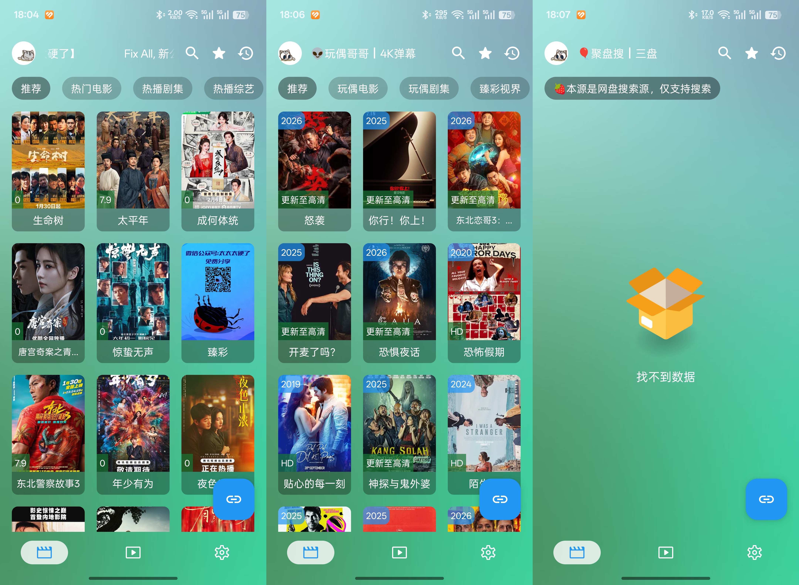
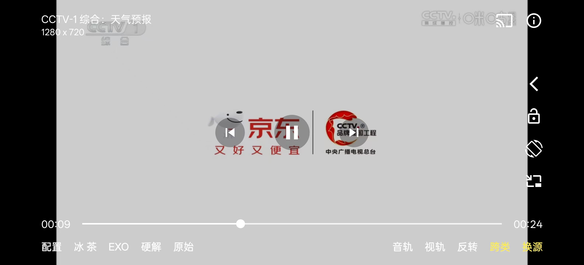
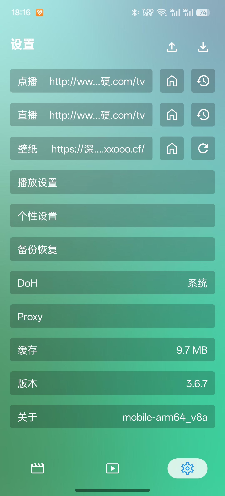
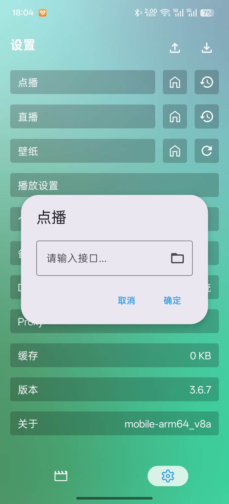
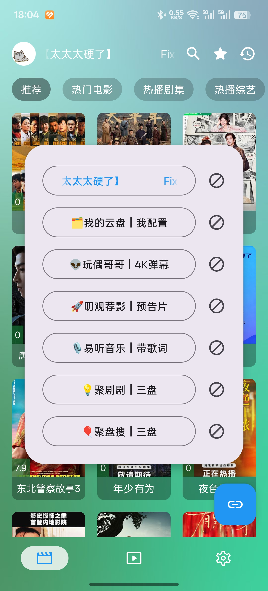
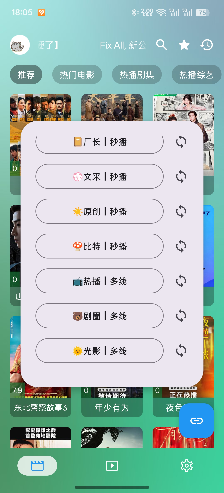
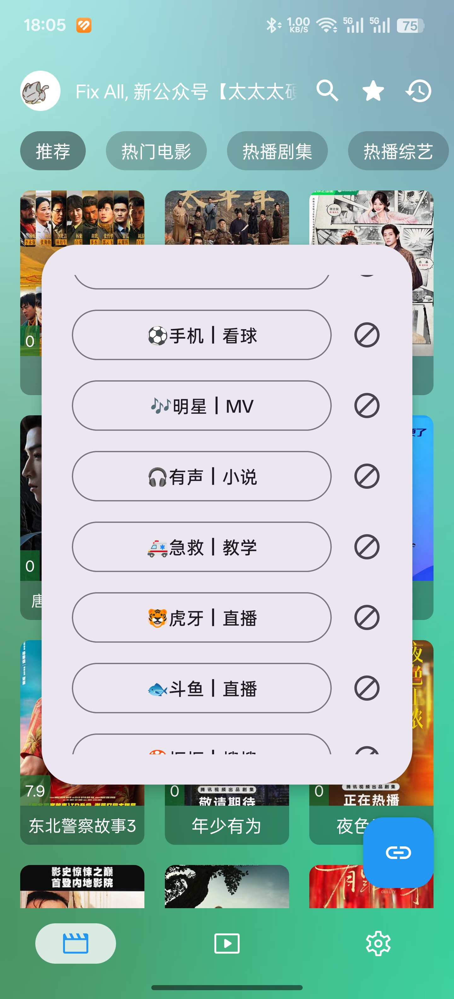
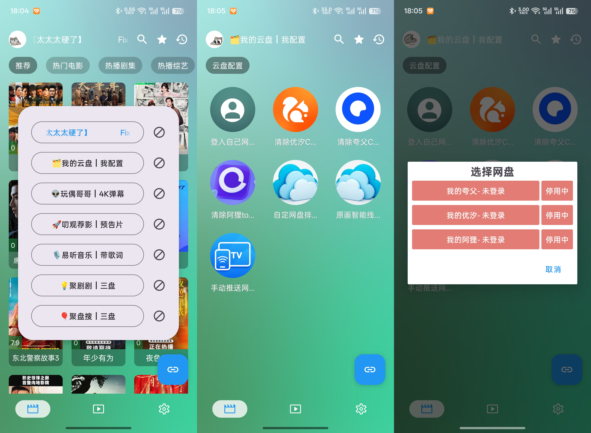
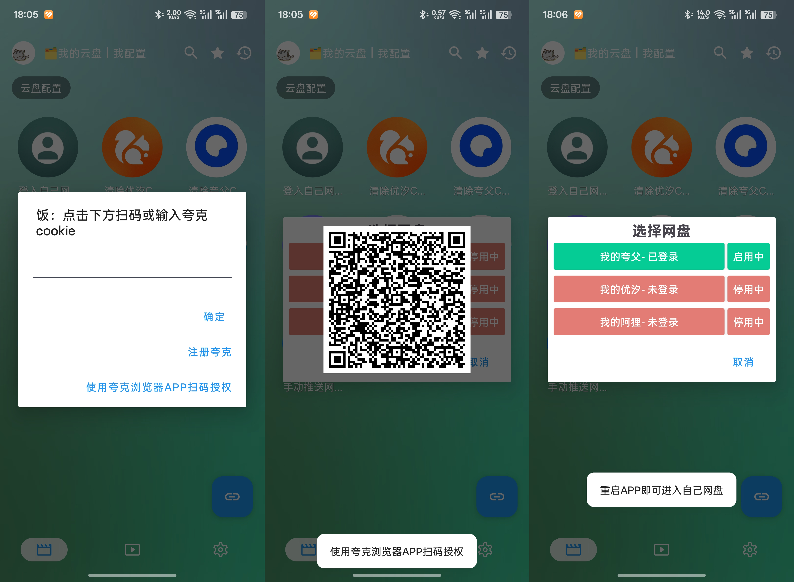
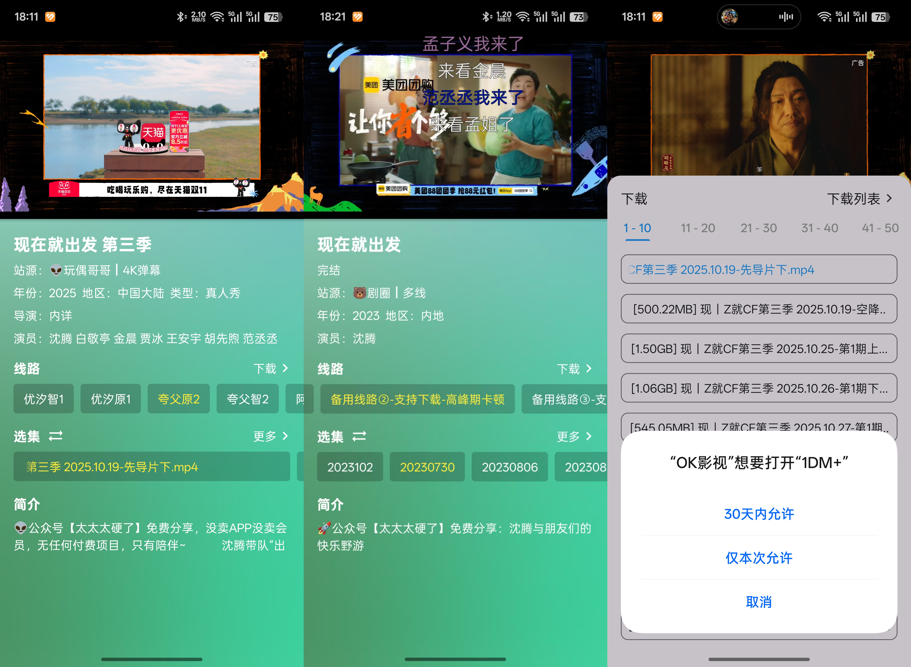

[TVBox](https://github.com/q215613905/TVBoxOS) 是个开源、免费、自己不带任何内容的播放器（原版的编译包由社区在 [TVBoxOSC](https://github.com/o0HalfLife0o/TVBoxOSC) 发布）。装完打开是空的，得先喂它一个「源」，才会有片单和直播频道。

这种做法叫壳源分离：软件只负责播放，资源全由外部接口提供。好处是换个源就等于换个内容库；麻烦的是刚装好那一刻，界面上什么都没有，也不知道该点哪里。

OK影视 和影视仓是这条线上最常被提到的两个改版，但它们不是同一个上游：影视仓属 TVBox 系（包名 `com.github.tvbox.osc`），OK影视 属[影視TV / FongMi](https://github.com/FongMi/TV) 系，界面和配置流程都有差别。下面以 OK影视 为例——它是闭源改版，没有公开的源码仓库，只能从构建产物看出沿用了上游 [FongMi/TV](https://github.com/FongMi/TV) 的代码；好处是手机、电视、盒子共用一套配置。

安装包里一般分标准版和 Pro 版：标准版没有广告，Pro 版多了在线弹幕和字幕搜索，电视端用 VLC、手机端用 MPV 播放，激活 Pro 需要看一段广告。挑哪个看你自己的取舍。

> 安装包：[pan.quark.cn/s/1c7e5aa53af6](https://pan.quark.cn/s/1c7e5aa53af6)（里面分标准版 / Pro / 安卓 5 专用三个文件夹）
> 接口导航：[饭太硬](https://www.xn--sss604efuw.net/)（页面上给的主接口就是下面那个 `.cc` 地址）
> 仅供技术研究与学习使用。

> [!核心] 主线两步
>
> 1. 装好 APK 并打开（第 1 节认界面）
> 2. 进设置填一个接口地址，等它加载完（第 2 节）
>
> 网盘源要单独登录、播放页的线路切换都是配好之后才会用到的内容。

## 开始之前，先看这几条

这篇讲的是「装好之后怎么配」，不提供也不制作片源。装之前先把下面几条对一遍，
不然打开就是一片空白，还以为是装坏了。

| 条件 | 具体要求 | 不满足会怎样 |
|---|---|---|
| 设备 | 一台安卓手机 / 电视 / 盒子，能自己装 APK | 电视端要先打开「允许安装未知来源」 |
| 安装包 | 从文末给的网盘拿，分标准版 / Pro / 安卓 5 专用 | 安卓版本低的机器要拿专用版，否则装不上 |
| 源地址 | 一条接口地址（`.cc` 之类），由第三方提供 | 没有源，App 里永远是空的 |
| 网络 | 能上网，且访问得了那个接口 | 加载源时一直转圈 |
| 认知 | 源由第三方维护，随时可能挂、换域名、夹广告 | 源失效不是 App 的问题，换源即可 |

内容全部来自第三方接口，能不能看、清不清楚、有没有广告，都不由客户端决定。
**装源这一步是在接入第三方服务，出了版权问题自己承担。**

## 1. 先认一下界面

### 首页（点播）

首页就是片单区。顶部一排从左到右：清除缓存、首页推荐源切换、搜索、收藏、下载、历史记录。
其中「下载」要先在设置里开启内置下载才出现，默认是关的。

中间的推荐位跟着当前选中的「首页推荐源」变。这块体验不太稳定，两种尴尬情况都常见：
点开封面跳去了搜索页、并没有能直接播的资源；或者整个推荐区是空的，只能靠搜索。

### 直播

CCTV、各省级卫视这些频道都在这里，横屏播放。换台、换线路的操作和一般播放器一样。

### 设置

设置页是配源的入口，后面细讲。播放、界面这些基础项按自己习惯调就行。

## 2. 配源

### 两种源

- **点播源**：电影、剧集、综艺、动漫，对应首页的片单
- **直播源**：CCTV、卫视、地方台，对应直播页

不少点播源会顺带一份直播源，导入时自动填上。

### 导入

1. 进「设置」，点顶部的「点播」
2. 在弹窗里填点播源地址（常用的一个：`http://www.饭太硬.cc/tv`）
3. 如果这个源自带直播源，直播源输入框会自动填好，也可以单独改
4. 保存之后开始加载资源

找不到源就以「TVBox 点播源」「TVBox 直播源」为关键词自己搜，或者去饭太硬导航上翻它列的接口。这类地址更换很频繁，搜到的失效了也很正常，换一个就是。

源文件的完整字段（`sites`、`lives`、`wallpaper` 这些）在上游的[配置指南](https://fongmi.github.io/TV/config/)里有说明，想自己改源文件时可以参考。

### 从名字认出源的类型

源的名字里通常带线索，看几眼就知道该选哪个。

#### 网盘源

名字里常出现「盘」「4K」「玩偶哥哥」这类词，有些接口还会用自有代号指代网盘——我这边看到的写法是「优汐」对应 [UC 网盘](https://drive.uc.cn)、「夸父」对应 [夸克网盘](https://pan.quark.cn)、「阿狸」对应 [阿里云盘](https://www.alipan.com)。各家接口的命名并不统一，认准你自己登录的那个网盘就行。

好处很直接：画质是网盘里的原始文件，HDR、杜比视界这些格式能原样保留，比在线平台的转码流好得多，也能下载。代价是要有对应的网盘会员，否则会被限速。

#### 解析源

名字里常带「秒播」「多线」「解析」。这类源靠视频解析接口取流，点开就能播，一般不用额外付费。

短板是画质上限低，热门资源的高峰期容易卡。能不能下载取决于接口和壳，不一定都有。

#### 其他

还有磁力源，以及 P2P 这类只在直播里出现的协议（配置里通常写成 `p2p`、`mitv`、`tvbus` 这种名字，能不能播要看壳有没有实现）。日常看片用前两类就够了，剩下的可以自己试。

## 3. 网盘源要先登录

1. 点首页左上角的「首页推荐源」，进去找「我的云盘」
2. 点云盘页左上角的「登入」，选网盘类型（夸克、阿里云盘等）

3. 按提示填 Cookie 或扫码，各家不一样，以实际界面为准

登录之后回首页切推荐源，或者直接搜索，就能看到网盘里的片子了。

## 4. 播放页

### 线路

- **网盘源**：线路要和绑定的网盘对上，比如夸克网盘就选「夸父」。我这边看到的线路名里，带「智」的是转码版，画质一般但基本都能播；带「原」的是网盘原始文件，画质最好——各家命名不统一，以你界面上的为准
- **解析源**：线路之间没有实质区别，播不动就换一条

### 下载

点播放页的「下载」，选集或选片段。开了内置下载就在软件里下，没开就跳到第三方下载工具。

### 其他

选集、倍速、解码方式都在播放页上，按需点就行。

## 5. 免责声明

本教程只讲 TVBox 这类开源播放框架怎么用，不涉及任何资源接口的开发、传播或维护，
也不提供版权内容的获取渠道。

OK影视 这类改版本身是闭源的，它的上游 [FongMi/TV](https://github.com/FongMi/TV) 才是开源项目；不管是哪一个，它们加载的第三方接口都可能包含未经授权的内容。你通过这类接口获取、播放、下载内容时，需要遵守《中华人民共和国著作权法》《互联网信息服务管理办法》等法律法规，尊重影视与直播内容的版权归属。由此产生的责任由使用者自行承担。

建议只播放、下载自己有合法授权的内容，或非商用性质的自用资源；发现侵权接口应停止使用，
并向版权方或监管部门举报。本教程仅作技术交流，请勿用于商业或非法用途。

文中提到的第三方链接（安装包、接口导航等）只是操作示例，不代表对其合法性、安全性和
稳定性的认可。访问前请自行判断风险，由此导致的设备安全或信息泄露问题由使用者自负。
