装系统本身不难，容易出问题的是几个决策点：镜像从哪里下载才干净、U 盘要不要先备份、
BIOS 里改哪几项、分区那一步怎么选。

全文按顺序走一遍，正常情况半小时左右，不含下载镜像的时间。

> [!核心] 主线只有六步
>
> 1. 确认前置条件（下一节的表）
> 2. 下载官方镜像并校验（第 4 节）
> 3. 用 Rufus 把镜像写进 U 盘（第 5 节，方法一）
> 4. 从 U 盘启动（第 7 节）
> 5. 分区并安装（第 8 节）
> 6. 首次启动与收尾（第 9、10、12 节）
>
> 其余小节是分支和补充：装 Win11 才需要看第 3 节；PE 装机、Ventoy、安全防护细节
> 都是备选路线，文中已单独标出。

> [!注意] 动手前先备份
>
> 后面会格式化 U 盘；分区那一步如果选错盘，硬盘里的数据也会一起没。

## 开始之前，先确认这几件事

这几条都是「走到一半才发现做不到」的典型，花十分钟提前确认，比装到分区那一步再退回来强。

| 条件 | 怎么确认 | 不满足会怎样 |
|---|---|---|
| **能进 BIOS / 启动菜单** | 开机连按 Del / F2 / F12 能出界面 | 做好的启动盘也用不上，得先解决这个 |
| **BitLocker 状态** | 进系统后看「此电脑」里磁盘图标有没有锁；或在管理里查「设备加密」 | 装完或进 PE 后会被要恢复密钥，没有 48 位密钥就打不开原有数据 |
| **恢复密钥已备份** | [Microsoft 账户的设备页](https://account.microsoft.com/devices/recoverykey)能看到对应机器的密钥 | 见上一条，这是最容易造成数据永久丢失的坑 |
| **数据已备份** | 重要文件已拷到别的盘或云上 | 装机的格式化不可撤销 |
| **8GB 以上 U 盘** | 手边有这个容量的空 U 盘 | U 盘里的东西会被全部清空 |
| **另一台能上网的设备** | 手机热点或别的电脑 | 装完可能缺网卡驱动，那时候没网很难受 |
| **硬件够不够 Win11** | 对照下文「Win11 的硬件门槛」 | 装到一半才被安装程序拦下，白折腾 |
| **固件模式与分区表** | `msinfo32` 看「BIOS 模式」和「分区样式」 | 两者不匹配，安装程序会在分区那一步把你挡死 |

**只想重装、不想清数据**的话，这条路线不合适——本文的做法会格式化系统盘。
要保留数据只能是升级安装或修复，那是另一套流程。

## 1. 先看清全貌

| 阶段 | 干什么 | 耗时 | 最容易出问题的地方 |
|---|---|---|---|
| 准备 | 备份、核对固件模式、备好驱动 | 10–30 分钟 | 没备份 |
| 过门槛 | 确认硬件够不够 Win11 | 5 分钟 | 装到一半才发现 TPM 不够 |
| 下镜像 | 拿官方 ISO 并校验 | 看网速 | 下了「优化版」 |
| 做启动盘 | Rufus 直写或微PE | 5–20 分钟 | U 盘被写坏、杀软拦截 |
| 处理安全防护 | 按需关 Secure Boot / 杀软 | 5 分钟 | 关了忘了开回来 |
| 改引导 | 进 BIOS 把 U 盘排到第一，或用启动菜单 | 5 分钟 | 按不出启动菜单 |
| 装 | 分区并释放镜像 | 15–30 分钟 | 选错分区、找不到硬盘 |
| 首次启动 | OOBE 设置 | 10 分钟 | 卡在联网、自动加密 |
| 收尾 | 驱动、激活、关加密、恢复安全设置 | 20–60 分钟 | 忘了把安全设置开回来 |

## 2. 动手之前：准备与决策

### 要准备的东西

- 一个 **8GB 以上**的 U 盘，里面的东西会被全部清空
- 一台能上网的电脑，用来下镜像和做盘
- 目标机器里没有要救的数据，或者已经备份到别处
- 一条网线，或者另一台能上网的设备——装完有可能缺网卡驱动，那时候没网就很难受

### 先确认三件事

装之前花两分钟把这三件事查清楚，后面每一步的选项都取决于它们。

**一、固件是 UEFI 还是 Legacy。** 在要重装的那台机器上按 `Win + R`，输入 `msinfo32`，
看「BIOS 模式」那一行，写的是「UEFI」还是「传统」。

**二、硬盘是 GPT 还是 MBR。** 同一个窗口里看「分区样式」，或者到磁盘管理里看磁盘属性。

**三、硬件够不够 Win11。** 对照下一节「Win11 的硬件门槛」。
不够的话，现在就得决定是绕过去还是换 Win10。

### 固件和分区表的搭配

这两个必须对得上，不然安装程序会在分区那一步把你拦住。

| 固件模式 | 分区表 | 启动盘怎么做 | 说明 |
|---|---|---|---|
| UEFI | GPT | Rufus 选 GPT + UEFI | 现在的主流，2016 年后的机器基本都这样 |
| Legacy | MBR | Rufus 选 MBR + BIOS | 老机器，或者手动改过设置 |
| UEFI | MBR | 转成 GPT，或者把固件改成 CSM | 会报「选中的磁盘具有 MBR 分区表」 |
| Legacy | GPT | 转成 MBR，或者把固件改成 UEFI | 少见，一般是装了一半改过设置 |

> 转换分区表通常要清空整块盘。数据比省事重要，先备份。

### 两种装法，先选一种

后面「安装」一节按这两条路线展开。

| 装法 | 适合谁 | 优点 | 缺点 |
|---|---|---|---|
| U 盘直接装 | 大多数人 | 最稳，微软官方流程 | 只能装系统，干不了别的 |
| PE 里装 | 想先分区、先备份的人 | 装之前能折腾硬盘，Dism++ 还能跳过部分检测 | 多一层 PE，可能缺驱动；盘上得已有 ESP |

## 3. Win11 的硬件门槛

> [!可选] 只装 Win10 的话整节跳过
>
> 这一节只影响 Win11。装 Win10 可以直接到第 4 节。

Win11 比 Win10 多了几道硬性检查，不满足的话安装程序会直接拒绝。

| 项目 | 最低要求 |
|---|---|
| CPU | 1GHz 以上、双核、64 位，且在微软支持列表内（Intel 8 代起，AMD 锐龙 2000 起） |
| 内存 | 4GB |
| 存储 | 64GB |
| 固件 | UEFI，支持 Secure Boot |
| TPM | 2.0 |
| 显卡 | 支持 DirectX 12 / WDDM 2.0 |
| 屏幕 | 9 英寸以上，720p |

TPM 2.0 是最常卡住的一项。台式机如果主板有 TPM 插针但没插模块，多半可以直接在
BIOS 里开「固件 TPM」（Intel 叫 PTT，AMD 叫 fTPM），不用买模块。

### 不满足怎么办

两条路，代价不一样。

**绕过去。** 两种做法。推荐第一种：Rufus 制作启动盘时，在「Windows 用户体验」对话框里勾掉
TPM、Secure Boot 和 CPU 检查，一次到位，还顺带跳过强制联网。

第二种是改注册表：在安装程序**启动之前**按 `Shift + F10` 调出命令行，输入 `regedit`，
定位到 `HKEY_LOCAL_MACHINE\SYSTEM\Setup`，新建一个项叫 `LabConfig`，
在里面建四个 DWORD 值，全部设为 `1`：

```
BypassTPMCheck
BypassSecureBootCheck
BypassRAMCheck
BypassCPUCheck
```

关掉窗口继续装，检查就过了。注意这一步得在进分区界面之前做，进去之后就晚了。

代价是明摆着的：微软不保证这类设备的更新，大版本升级可能被拦下重装；
24H2 之后还要求 CPU 支持 SSE4.2 和 POPCNT，太老的 Core 2 平台开机会直接蓝屏，绕不过去。

**换 Win10。** 更省心，但 Windows 10 已经停止支持，没有安全更新。老机器上网、
看视频这类用途可以接受，装来办公或者登网银就得掂量。

我的建议：能升级硬件就升级；不能升级又必须用 Win11，就用 Rufus 那条路，
注册表方案只当作备选。

## 4. 下载镜像

去 [ITELLYOU](https://next.itellyou.cn/Original/) 下原版镜像。这个站整理的是微软 MSDN
渠道的 ISO，没有第三方改动，比各种「优化版」「装机版」干净得多。

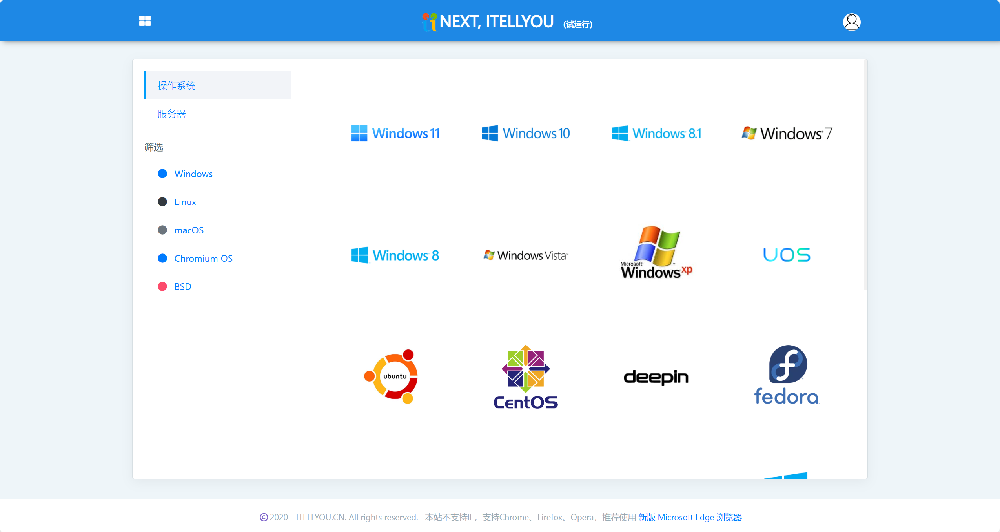

### 选哪个版本

镜像分 **consumer**（消费者版）和 **business**（商业版）两种打包方式：

- **consumer**：含家庭版、专业版、教育版。个人装系统选这个
- **business**：含专业版、企业版、教育版、专业工作站版。批量授权场景用

版本其实不用纠结，最终装哪个由密钥决定；没有密钥时按镜像里的默认项走。

### Win11 还是 Win10

Windows 10 已经在 2025 年 10 月停止支持，除非机器确实跑不动 Win11，否则现在没理由再装它。

Win11 这边，当前主线是 **25H2**（2025 年 9 月发布），**26H2** 在 2026 年 9 月跟进。
两者对普通用户差别不大，ITELLYOU 上选较新的版本即可。

### 品牌机自带的是哪个版本

国内买的笔记本、品牌台式机，出厂预装的几乎都是 **Windows 11 家庭中文版**
（Home Single Language），激活信息以「OEM 数字许可证」的形式烧在主板固件里。

这意味着：**重装时只要选对版本，装完联网就自动激活，不用输密钥、也不用登录微软账户。**

关键是「选对」——重装界面里有两项长得很像：

| 选项 | 对应出厂预装 | 是否自动激活 |
|---|---|---|
| Windows 11 家庭中文版 | 国内品牌机基本都是这个 | 是 |
| Windows 11 家庭版 | 部分海外机型、自己买的零售版 | 否，会提示输入密钥 |

选错了会卡在「输入产品密钥」那一步，而且装完也认不出固件里的授权。
不确定的话，在旧系统里跑一句 `wmic path softwarelicensingservice get OA3xOriginalProductKey`
能读出固件里烧的那个密钥。

### 想装专业版怎么办

专业版多的功能里，普通人真正用得上的其实就几个：**BitLocker 完整版**（家庭版只有受限的设备加密）、
**远程桌面服务端**、Hyper-V、组策略编辑器，以及加域。

如果这些你一个都用不上，就装回家庭中文版，省事且自动激活。

如果确实要专业版，**固件里那个家庭版授权是激活不了专业版的**，得另外解决。常见的两条路：

**买零售密钥。** 微软商店、京东自营这些渠道，正版价格摆在那儿，胜在稳定、可转移、
能绑到微软账户。

**买便宜密钥。** 拼多多、淘宝上几块钱到几十块的「Win11 专业版激活码」很常见。这类密钥
多半来自批量授权渠道（MAK）或者其它灰色来源，激活后通常也能生成数字许可证并绑定微软账户，
重装后登录同一账户就自动恢复激活。

买之前心里有数：这类密钥不属于正规零售授权，可能出现激活失败、用一段时间掉激活、
或者某个批次被微软封掉的情况。卖家一般承诺「激活不了包换」，但店铺跑路也是常事。
**几块钱买的是省事，不是保障**——重要的机器还是走正规渠道。

> 激活状态在「设置 → 系统 → 激活」里看。显示「已激活」且「激活状态：已链接到 Microsoft 账户」
> 就说明许可证已经绑账户了，以后重装登录同一个账户即可。

### 校验一下

下载完成后不要直接写盘。ITELLYOU 每个条目下面都有 SHA256，先核对一遍：

```powershell
Get-FileHash .\Win11_25H2_Chinese_Simplified_x64.iso -Algorithm SHA256
```

对不上就重下。少一位数都可能让安装卡在 20% 然后报 `0x8007025D`。

## 5. 做启动盘

拿到 ISO 之后，要把它变成一块能引导的 U 盘。两条路，选一条走。

下面用 Rufus 和微PE做代表，它们不是唯一的选择，同类工具不少，选谁差别不大，
同类工具不少，选一个即可。两种路线各自的代表作：

| 路线 | 代表 | 同类 |
|---|---|---|
| 把 ISO 直接写进 U 盘 | Rufus | [balenaEtcher](https://etcher.balena.io/)、UltraISO、微软官方的 Media Creation Tool |
| 先做 PE，再往 U 盘里放 ISO | 微PE | 优启通、FirPE、Edgeless、HotPE |

这些工具的定位不完全一样，选错方向比选错牌子更耽误事：

- **balenaEtcher** 界面比 Rufus 更傻瓜，跨平台，但功能和 Rufus 差不多，也没有绕过 Win11 检测的选项
- **UltraISO** 老牌但停更多年，写 UEFI 启动盘经常出问题，不推荐
- **[Media Creation Tool](https://www.microsoft.com/software-download/windows11)** 是微软官方的，最干净，但只能做 Windows 安装盘，且下载的是最新版
- **优启通、FirPE、Edgeless、HotPE** 都是 PE，和微PE同一类，界面和预装工具有差别。
  其中 HotPE 更偏「功能全集」，体积也大；FirPE 和 Edgeless 的可定制性更强

除此之外还有第三种思路——[Ventoy](https://www.ventoy.net/cn/)，用同一个 U 盘装下多个系统，
既不写单一 ISO 也不做 PE。它值得单独说，放在本节末尾。

### 方法一：把镜像直接写进 U 盘

> [!核心] 大多数人走这一条
>
> 只想给自己电脑重装一次，看完这一节就够了。方法二和第三条路是备选，可以跳过。

准备一个 8GB 以上的 U 盘，**里面的东西会被全部清空**。

插上 U 盘，打开 [Rufus](https://rufus.ie/)，按下面几项设置：

| 选项 | 选什么 |
|---|---|
| 设备 | 你的 U 盘，别选错成移动硬盘 |
| 引导类型选择 | 刚下的 ISO |
| 分区类型 | UEFI 机器选 GPT，老机器选 MBR |
| 目标系统 | 跟着分区类型自动变，不用管 |
| 文件系统 | 默认的 NTFS 就行 |

点「开始」。如果选的是 Win11 镜像，Rufus 会弹一个「Windows 用户体验」对话框，
可以一并勾掉 TPM、Secure Boot 和微软账户这几项检查——勾了等于跳过 Win11 的硬件门槛，
代价见后文。

写完之前别拔 U 盘。Rufus 会提示「准备就绪」，这时才算完。

> **为什么不用 FAT32**：Win11 的 `install.wim` 普遍超过 4GB，FAT32 单个文件上限就是 4GB。
> Rufus 默认用 NTFS，并额外写一个小引导器解决 UEFI 下读 NTFS 的问题，不用自己操心。

### 方法二：用微PE做启动盘

> [!可选] 帮人修机器、硬盘状态不明时才需要
>
> 微PE的价值在于「装系统之外还能干别的」。自己的电脑干净重装，用不上这一节。

微PE是一个精简的 Windows 预安装环境。用它做出来的 U 盘不只是安装介质，里面是一个能
启动的小系统，进去之后还能用分区工具、[Dism++](https://github.com/Chuyu-Team/Dism-Multi-language) 这些。

到 [wepe.com.cn](https://www.wepe.com.cn/) 下载微PE工具箱，插入 U 盘，
选「安装 PE 到 U 盘」，按向导走完。

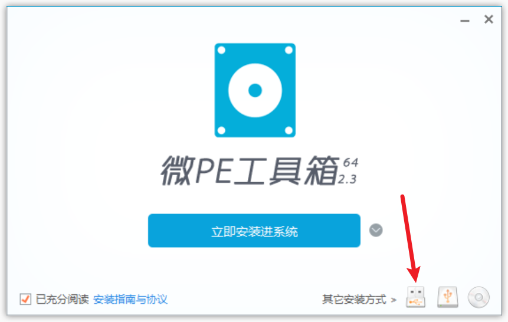

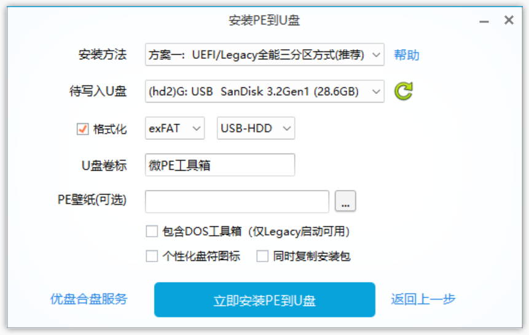

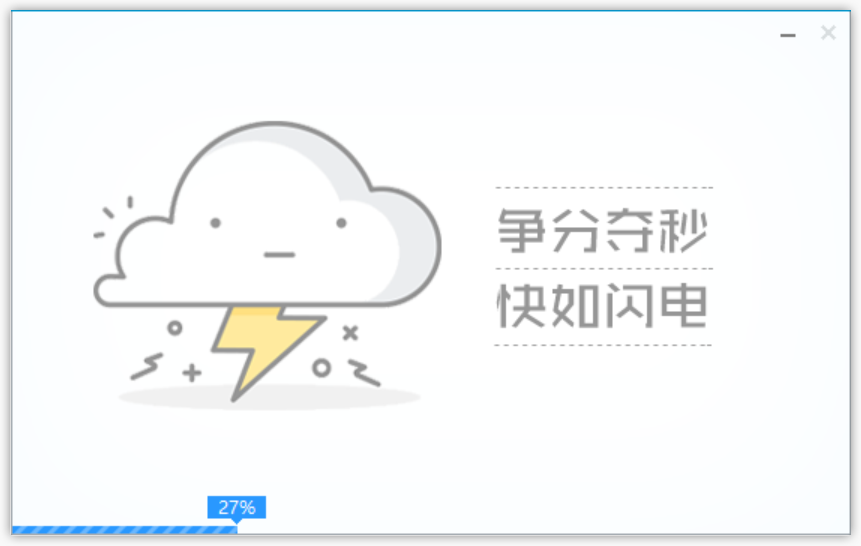

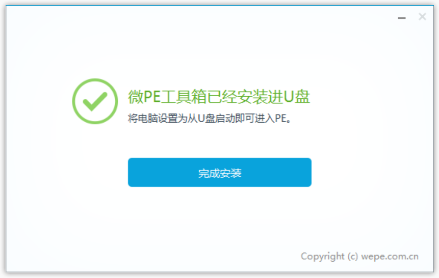

然后把 ISO 文件整个复制到 U 盘里——PE 下要用虚拟光驱挂载它。U 盘剩余空间要放得下
一个 5–7GB 的 ISO，8GB 盘勉强，16GB 会舒服很多。

### 两种方法怎么选

| | Rufus 直写 | 微PE |
|---|---|---|
| 上手难度 | 低 | 中 |
| 装系统之外的能力 | 无 | 分区、备份、修引导、改密码 |
| 硬盘出问题时的用处 | 没有 | 能救 |
| 占用 U 盘空间 | 全盘 | PE 占一小块，ISO 另放 |

如果你只是想重装自己的电脑，Rufus 够了。如果是在帮别人修机器，或者硬盘状态不明，
微PE更值得。

### 第三条路：Ventoy

> [!可选] 手上不止一个 ISO 时才值得
>
> 只装一次系统，跳过这一节。

上面两种做法都有个共同毛病：**一个 U 盘只能装一个系统**。想再放一个 PE 或者另一个版本的
ISO，就得重新写一遍，原来的数据全没了。

Ventoy 换了个思路：U 盘只装一次，之后往里**复制 ISO 文件**就行，开机时给你一个菜单选。
装完 Ventoy 的 U 盘还是一个普通 U 盘，能正常存文件。

值得单独写一篇：

> [Ventoy 使用教程：一个 U 盘装下所有系统镜像](/blog/ventoy-tutorial)

如果你经常装系统、或者手上 ISO 不止一个，直接看那篇；只装一次自己的电脑，
Rufus 或微PE 就够了。

还有更极端的一种：连 U 盘都不带，**用手机当启动盘**。现在有不 root 就能给 U 盘装 Ventoy
的工具，root 之后还能让手机直接虚拟成启动盘，见 [MultiBooter 使用教程](/blog/multibooter-tutorial)。手机怎么拿到 root 是另一条线，见 [安卓解锁 BL 与 KernelSU root](/blog/android-unlock-bl-kernelsu)。

## 6. 进 PE 之前，先处理安全防护

> [!可选] Rufus 直装且硬盘没加密的话，本节跳过
>
> 只有 Secure Boot 和磁盘加密真的会挡住你，其余多是做启动盘时的临时处理。

这一步很多人会卡住，而且网上的说法很乱：「进 PE 要关杀毒」「Win11 必须关安全启动」。
这些说法把四件不同的事混成了一件——固件层的 Secure Boot、磁盘加密、系统里的 Defender、
第三方杀软，各自挡的位置完全不一样。

主文不展开，单独写了一篇：

> [进 PE 之前要不要关安全防护：Secure Boot、BitLocker 和杀软各挡在哪](/blog/disable-security-before-pe)

一句话版本：**只有 Secure Boot 和磁盘加密真的会拦住你，其余多半是制作启动盘时才需要临时处理**。

## 7. 改 BIOS 引导顺序

重启，开机时快速连按对应按键，进 BIOS 或者弹出启动菜单。各家不一样：

| 品牌 | 进 BIOS | 启动菜单 |
|---|---|---|
| 华硕 / 华擎 | `Del` 或 `F2` | `F8` |
| 微星 | `Del` | `F11` |
| 技嘉 | `Del` | `F12` |
| 联想（笔记本 / 台式） | `F2` 或 `Fn + F2` | `F12` |
| ThinkPad | `F1` | `F12` |
| 戴尔 | `F2` | `F12` |
| 惠普 | `F10` | `F9` |
| 宏碁 | `F2` | `F12` |
| 华为 / 荣耀 | `F2` | `F12` |
| 小米 / Redmi | `F2` | `F12` |
| Surface | 音量减 + 电源 | 同左 |

部分联想机型键盘上按不出来，机身侧面有个小孔（Novo 键），用卡针戳一下更直接。

### 用启动菜单，别改顺序

多数机器按启动菜单键就能临时选一次启动设备，**这次生效、下次自动恢复**。
比重启进 BIOS 改顺序省事，也不容易忘了改回来。

如果你的机器只有 BIOS 没有启动菜单，那就进 Boot 选项卡，把 U 盘调到第一位，
按 `F10` 保存退出。**装完记得改回来**，否则插着 U 盘会一直进安装程序。

### Boot 选项卡里那几个开关

| 选项 | 什么时候要动 |
|---|---|
| Secure Boot | 启动 PE 报签名错误时关掉；装 Win11 时保持开启 |
| CSM / Legacy Support | 老系统、老显卡、老 U 盘时才打开 |
| Fast Boot | 进不去 BIOS 或启动菜单时关掉 |
| VMD / IRST | 装系统时找不到硬盘，改成 AHCI（详见排查一节） |
| Boot Order / Boot Priority | 需要改默认启动顺序时 |

## 8. 安装

### 路线一：安装程序直接装

从 U 盘启动后，看到的就是 Windows 安装程序的欢迎界面。

- 选语言、区域和键盘布局

  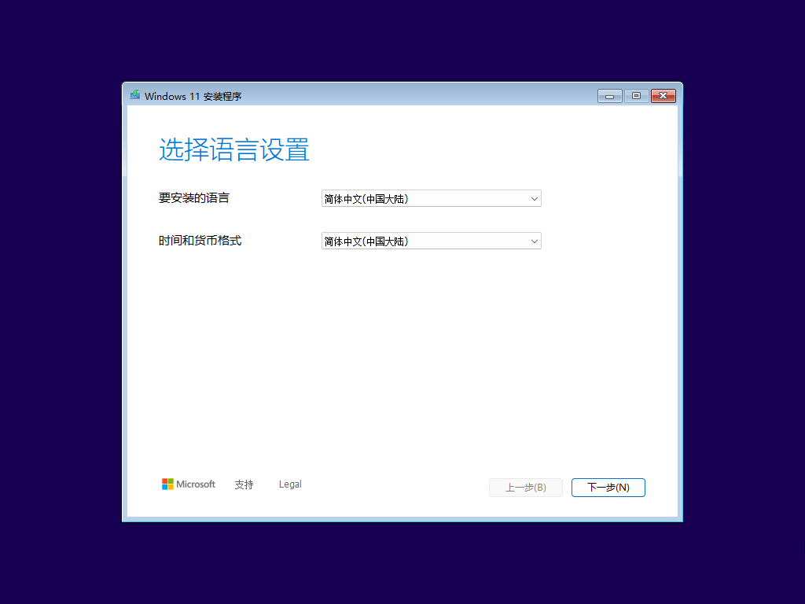

  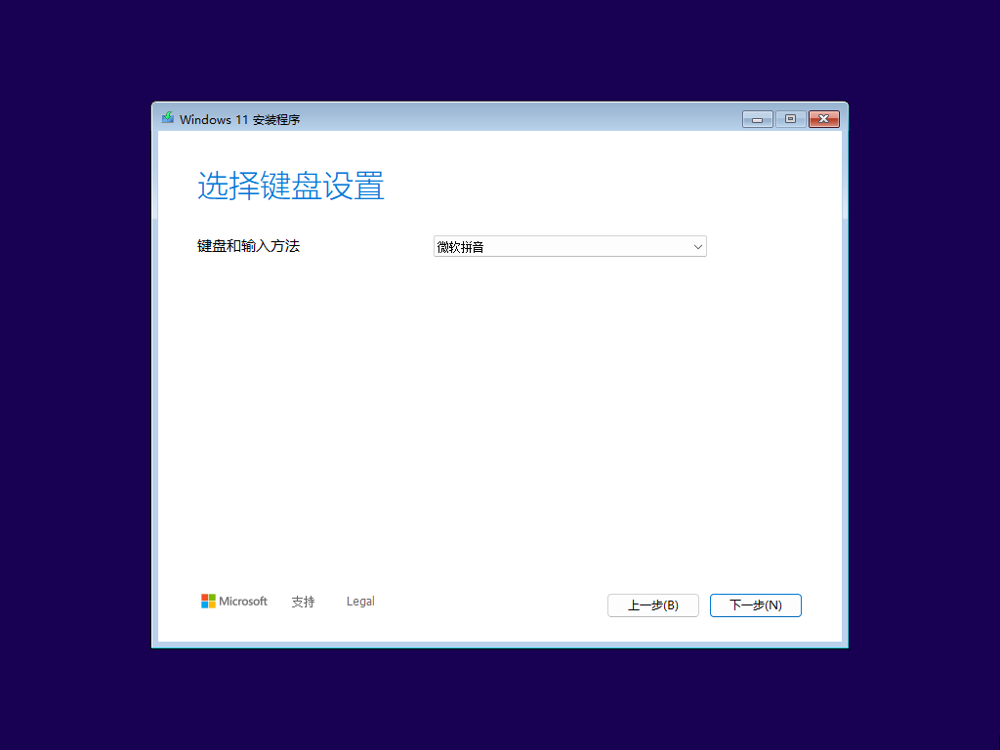

- 点「下一步」，再点「现在安装」
- 输入产品密钥。想装完再激活，就点「我没有产品密钥」
- 选版本。密钥会决定选哪个，没密钥就挑你要的（个人用专业版或家庭版）
- 阅读并接受许可条款
- 选安装类型：「自定义：仅安装 Windows（高级）」

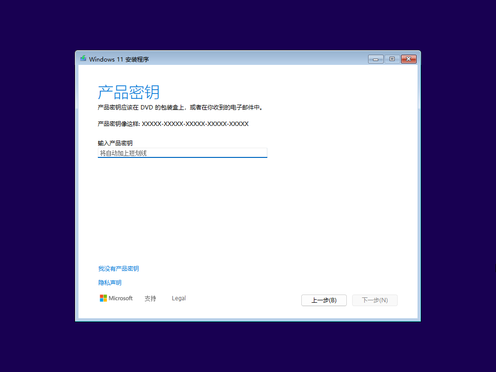

接下来是分区这一步，单独说。

### 分区怎么选

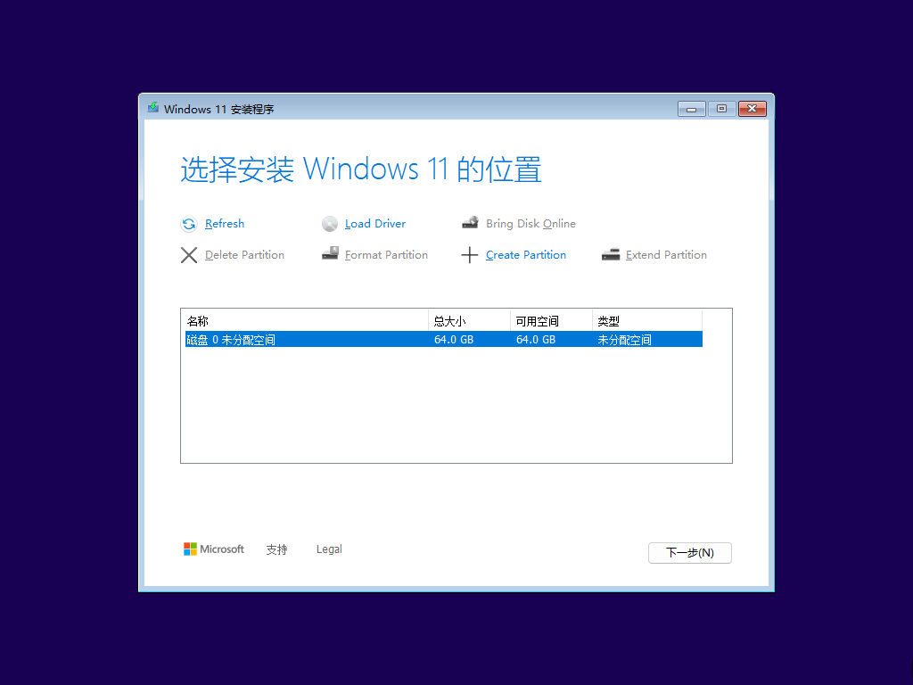

界面上会列出每块硬盘和它上面的分区。**先确认「驱动器」编号对不对**——多硬盘的机器
在这一步格错盘是最高频的事故。

**情况一：整盘重装，不留旧系统**

把这块盘上的分区全部删掉，直到只剩一行「驱动器 0 未分配的空间」，
然后选中它，点「下一步」。安装程序会自动建出 ESP、MSR、恢复分区和 C 盘，
不用你手动分。

这一步之后，原盘上的数据全没了。

**情况二：只清 C 盘，其他盘保留**

选中原来的 C 盘分区，点「格式化」，再点「下一步」。

前提是这块盘的分区结构没坏、ESP 还在。如果之前装的是 Linux 或者分区表乱过，
走情况一更干净。

**情况三：保留原有系统，只求修好**

不格式化，直接选原来的 C 盘分区装，装完会生成 `Windows.old`，旧文件在里面躺十天。
这不是「修复」，只是覆盖安装，驱动和软件大多要重来。

**情况四：要自己控制分区大小**

在安装界面按 `Shift + F10` 调出命令行，用 `diskpart` 手动分区（[diskpart 命令参考](https://learn.microsoft.com/en-us/windows-server/administration/windows-commands/diskpart)）：

```
diskpart
list disk            查看磁盘编号
select disk 0        选中目标盘（务必确认编号）
clean                清空整块盘的分区表
convert gpt          转成 GPT，UEFI 机器需要
exit
```

`clean` 会清掉整块盘，不可撤销。

退出后回到安装界面点「刷新」，就能看到一整块未分配空间。

### C 盘留多大

系统本身占 30GB 左右，加上常用软件、更新缓存、休眠文件和虚拟内存，
**建议至少给 128GB**。要装大型游戏或者 Adobe 全家桶，256GB 起。

装完再想扩 C 盘很麻烦——右边的相邻分区如果是数据盘，可以先压缩再扩展；
隔着一个恢复分区就基本没戏了。所以分区时想远一点。

### 路线二：在 PE 里装

> [!可选] 只有用微PE 做盘的人才需要看
>
> 走 Rufus 直装的跳到第 9 节。

从 U 盘启动后先进 PE——一个精简的 Windows 环境。

**方式一**：打开资源管理器，右键 ISO 选「装载」，双击里面的 `setup.exe`。
之后的步骤和路线一完全相同。

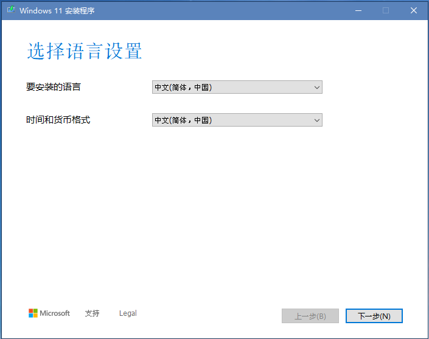

**方式二**：用 Dism++ 直接把镜像释放到硬盘。这条路更快，也能跳过一部分硬件检查。

打开 Dism++，点「释放镜像」，挑 U 盘里的 ISO，选目标分区和版本。

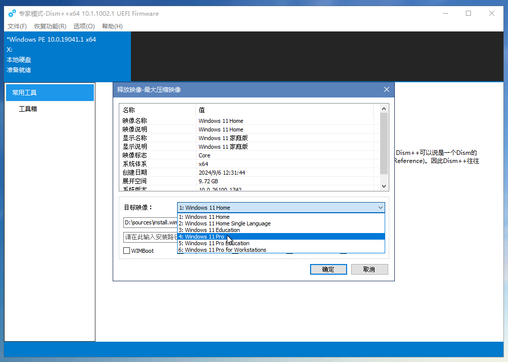

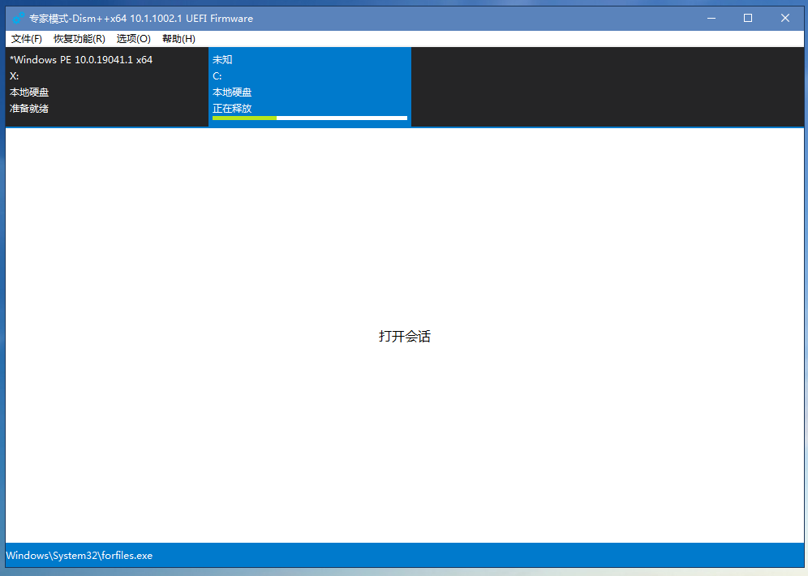

对话框底部有两个勾选项，都要留意：

| 选项 | 作用 | 建议 |
|---|---|---|
| 添加引导 | 释放完自动写引导 | **务必勾上**，不勾就得多跑一遍命令行 |
| 格式化 | 释放前先格式化目标分区 | 目标盘有旧数据时勾，全新盘不用 |

**勾了「添加引导」，释放完引导就已经写好了**，重启直接能进系统，不需要再开命令行补。
Dism++ 会自己找硬盘上的 ESP 分区（那个 100–300MB 的 FAT32 小分区）写进去。

如果它报错——常见的是「无法定位设备」「无法找到引导文件」——通常意味着这块盘上
压根没有 ESP 分区（全新盘还没分区、或者 ESP 被误删过），Dism++ 找不到地方写。
这种时候才需要手动补：

```
diskpart
list volume                      找到 ESP 分区（通常 100–300MB，FAT32）
select volume 1
assign letter=S
exit

bcdboot C:\Windows /s S: /f UEFI /l zh-cn
```

`/f UEFI` 对应 GPT 硬盘；MBR 硬盘改 `/f BIOS`，并且省略 `/s S:`，直接写进 C 盘。参数含义见 [bcdboot 命令行选项](https://learn.microsoft.com/en-us/windows-hardware/manufacture/desktop/bcdboot-command-line-options-techref-di)。
`C:` 是刚释放镜像的那个分区盘符，PE 里盘符不一定和平时一样，用 `dir` 确认一下。

连 ESP 都没有的盘，得先自己建一个：`diskpart` 里 `clean` 之后
`create partition efi size=300`，再 `format quick fs=fat32` 并分配盘符，然后才能跑 `bcdboot`。

> 用 PE 装完，重启时把 U 盘拔掉，否则有些机器会再次从 U 盘启动，白等一轮。

### 两条路线共同的收尾

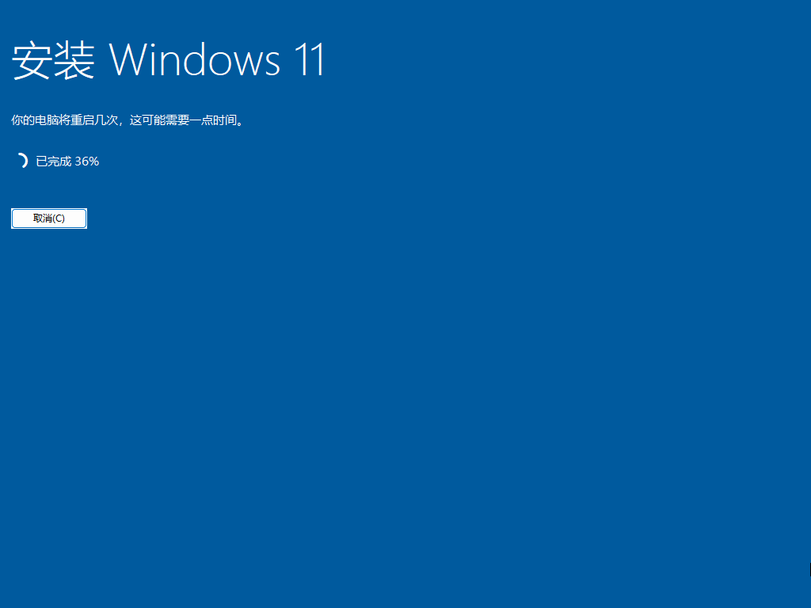

中间系统会自动重启几次，属于正常现象。第一次重启后如果又回到安装程序开头，
说明 U 盘还在启动顺序第一位，拔掉即可。

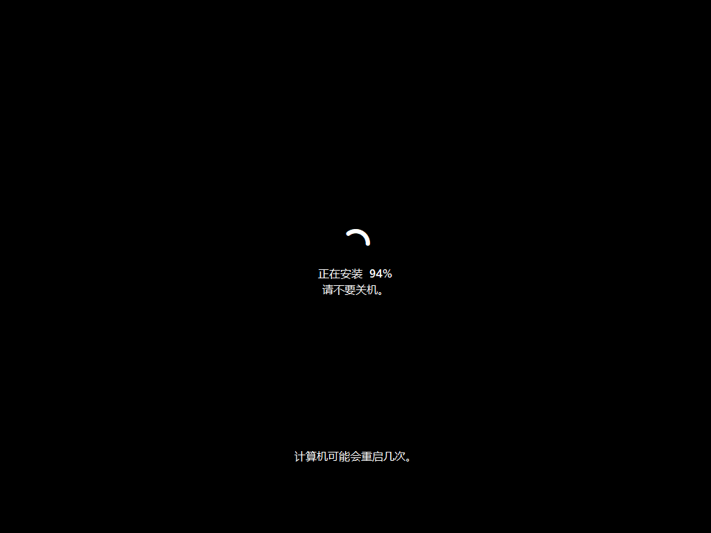

## 9. 首次启动

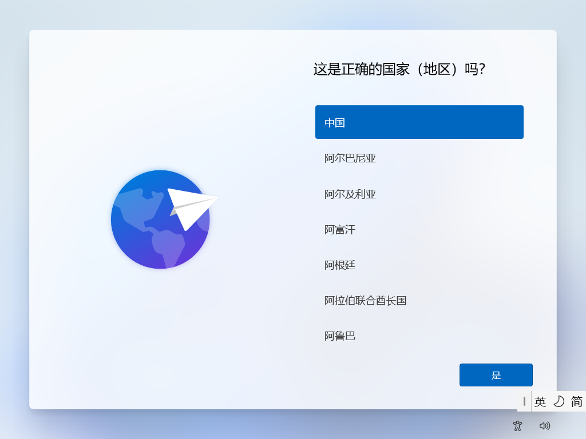

按提示走完地区、键盘、网络、账户这些设置，然后再重启一次，就进桌面了。

**但网络这一步是道坎，得提前想好。** Win11 的 OOBE 强制要求联网并登录微软账户，
没有「跳过」按钮。而这时候你可能正好没网——新机器的网卡驱动没装，右下角一个地球加斜杠，
点「下一步」毫无反应，就这么卡死在第一个界面。

所以这一节的两件事要一起看：**先解决「有没有网」，再决定「用谁的账户」。**

### 卡在联网这一步

没网的话，三条出路，按推荐顺序：

**一、手机 USB 共享网络。** 最快，OOBE 直接认。数据线连上手机，打开「USB 共享网络」
（iPhone 是「个人热点 → 允许其他人加入」），OOBE 会把它当成有线连接，就能往下走了。

**二、用本地账户绕过去。** 不需要网。在 OOBE 界面按 `Shift + F10` 调出命令行，执行：

```
start ms-cxh:localonly
```

会直接弹出本地账户的创建界面，建完就能进桌面，之后再慢慢补网卡驱动。

**三、插网线。** 笔记本自带的 RJ45 网口多数免驱，比无线省事。能插就插。

### 用微软账户还是本地账户

有网的情况下，OOBE 默认逼你登微软账户。想用本地账户，还是上面那条 `start ms-cxh:localonly`。

24H2 之后，老办法 `OOBE\BYPASNRO` 已经被微软移除，现在这条是常用替代。
它同样可能随版本失效——真失效了就先登微软账户，进桌面后在「账户」里改成离线账户。

> 用微软账户登录还有个副作用：系统会自动开启设备加密。不用微软账户就没有这一步，
> 下面这段可以跳过。

### 设备加密会自动打开

24H2 起，全新安装、用微软账户登录、硬件支持的话，
系统会自动开启「设备加密」（BitLocker 的家庭版形态），恢复密钥托管到你的微软账户。

这件事的后果是：以后这块盘拔下来接到别的机器上，或者进 PE 想拷数据，
会发现硬盘是锁的。**装完第一件事就是去关掉它，或者确认恢复密钥已经存好**，
详见[进 PE 之前要不要关安全防护](/blog/disable-security-before-pe)。

## 10. 装完之后

### 驱动

按这个顺序来，能省掉大部分麻烦：

1. **Windows Update**：联网后跑一遍，显卡、网卡、芯片组多数能自动装上
2. **主板或笔记本官网**：芯片组、声卡、读卡器、指纹这些冷门驱动去官网下对应型号的
3. **显卡官网**：[NVIDIA 官方驱动](https://www.nvidia.com/en-us/drivers/) / AMD / Intel，比 Windows Update 的版本新

如果是新笔记本，**装系统前**先在官网把 Wi-Fi 驱动下到 U 盘里。有些新网卡 Win11 自带驱动里没有，
装完没网又下不了驱动，就成了死循环。忘了也没关系，用手机 USB 共享网络破局。

### 激活

三种情况，对号入座：

- **数字许可证**：绑在主板上的，重装同版本系统后联网自动激活，不用做任何事。
  品牌机装回家庭中文版就是这种，装完等几分钟就好
- **零售密钥**：在「设置 → 系统 → 激活」里输入
- **换了主板或版本**：把许可证绑到微软账户上，换完用「疑难解答」转移

买来的便宜密钥激活成功后，建议**再绑定一次微软账户**：在「设置 → 系统 → 激活」里
点「添加账户」，之后重装登录同一账户，激活会自动恢复，不用再翻订单记录。

怎么确认绑上了：同一页面看「激活状态」，显示「已链接到 Microsoft 账户」就是成了。

如果显示「已激活」但没有绑定选项，说明是纯数字许可证或者 MAK 激活，绑不绑定都不影响
当前使用，只是重装时得重新输密钥。

### 确认加密状态

打开「设置 → 隐私和安全性 → 设备加密」，看开关状态。

- 是「关闭」，就可以放着不管
- 是「开启」，问自己一句：**恢复密钥在哪？** 不知道就去
  [account.microsoft.com/devices/recoverykey](https://account.microsoft.com/devices/recoverykey) 查，
  查不到就当场关掉加密

解密要跑一段时间，机械盘可能几个小时，期间别断电。

### 把安全设置改回去

如果前面为了进 PE 关过 Secure Boot 或者杀软，**现在全部恢复**：

- BIOS 里把 Secure Boot 打开
- 杀软的实时防护打开，或者把 PE 工具从隔离区放出来
- 引导顺序改回硬盘第一

这些是机器最后一道防线，忘了开回来，风险比装系统本身大得多。

## 11. 出问题了：按症状排查

先按症状定位，不要急着重装。

| 现象 | 原因 | 处理 |
|---|---|---|
| 找不到硬盘 | Intel VMD/IRST 模式，安装程序没有驱动 | 见下方 |
| `0x8007025D` | U 盘写入损坏、ISO 损坏、内存故障 | 换 U 盘、换口、重下镜像 |
| 选中的磁盘具有 MBR 分区表 | UEFI 启动 + MBR 硬盘 | `diskpart` 里 `clean` + `convert gpt` |
| 无法创建新的分区 | 分区表异常、ESP 太小、有隐藏分区 | 整盘 `clean` 重来 |
| 启动报签名错误 | Secure Boot 挡住了 PE | 关 Secure Boot |
| 卡在「准备设备」 | U 盘质量差、USB 3.0 兼容问题 | 换 USB 2.0 口、换 U 盘 |
| 装完直接进 BIOS | 引导没写进去 | Dism++ 工具箱「引导修复」，或 `bcdboot` |
| OOBE 卡在联网 / 装完没网 | 网卡缺驱动，或无法联网验证账户 | 手机 USB 共享，或用本地账户绕过，见下方 |
| 重启又进安装程序 | U 盘还在启动顺序第一位 | 拔 U 盘，或改回硬盘优先 |

### 找不到硬盘

Intel 11 代以后的笔记本常见。BIOS 里存储模式默认是 RAID 或 VMD，Windows 安装程序
认不出这块盘，分区列表一片空白。

两个办法，选一个：

**改成 AHCI。** 进 BIOS → Storage / Configuration → 把 VMD Controller 或 SATA Mode
改成 AHCI，保存重启。已经在用这块盘的系统会因此无法启动，但既然是重装，影响不大。

**加载驱动。** 保持 VMD 不变，去主板或笔记本官网下载「Intel Rapid Storage Technology
驱动」，解压到 U 盘。安装程序分区界面点「加载驱动程序」，选那个文件夹里的 `.inf`。官方驱动见 [Intel Rapid Storage Technology 下载页](https://www.intel.com/content/www/us/en/download/849936/intel-rapid-storage-technology-driver-installation-software-with-intel-optane-memory.html)。
这样装完系统能直接用 VMD 模式，性能更好，也避免以后改设置又蓝屏。

新机器我建议第二种。

### 没网怎么办

用的是同一个办法：手机 USB 共享网络（见[卡在联网这一步](#卡在联网这一步)）。
连上后跑一遍 Windows Update，网卡驱动几分钟内会自动装上。

不想折腾手机，也可以插网线，或者用另一台电脑按型号下好网卡驱动拷进 U 盘。

### 装完第一件事就蓝屏

多半是显卡或网卡驱动问题。进安全模式（开机时按住 `Shift` 点重启），
卸载可疑驱动，或者用 `系统还原` 退回到装完那一刻。

也有可能是内存条的问题——如果你刚拆过机，先把内存重插一遍。

## 12. 收尾清单

装系统这件事，难的部分从来不是点下一步，而是每一步之前想清楚「这一步会动到什么」。
分区动的是数据，BIOS 动的是启动链，安全设置动的是防线。想明白这三件事，
剩下的就是等进度条。
